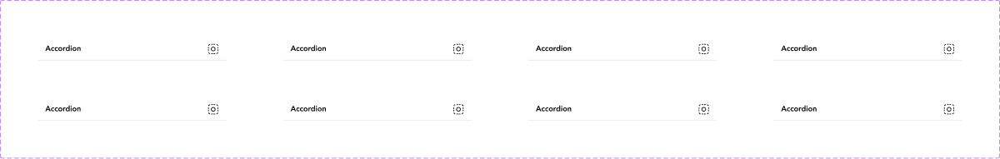

# Accordion

## Figma
Page **Accordion** (`3769:50208`), file `ilpJ5K66cGR85o287K4HDD`.

| Component set | Node id | Variants |
|---|---|---|
| Accordion | `5096:52027` | 8 |



## Description
No Figma description. Purpose: a collapsible section header that expands or collapses its content.

## Variant axes and props
- `expand: off|on`
- `state: default|hover|pressed`
- `disabled: false|true` (only with state=default)
- Non-variant prop: `left-icon` (boolean, false).

## Anatomy (expand=off, state=default)
```
Accordion (COMPONENT, H auto-layout, 400x48, padding 12/16/12/16, gap 8, bottom border 1px)
├─ (left-icon, hidden)
├─ Edit Text  TEXT "Accordion" 16, font style "85 Heavy" (Avenir LT Pro)
└─ Icon       INSTANCE icon-24 (24/Placeholder glyph)
```

## Token table
All 8 variants have identical properties:

| property | value |
|---|---|
| background | none (transparent) |
| bottom border | 1px inside, #dedede (no token, nearest `border/default` #e6e6e6) |
| height | 48 |
| padding | 12 vertical / 16 horizontal (`--aec-spacing-container-padding-s` = 16) |
| gap | 8 |
| title | #000000 16 Heavy (no token, nearest `text/default` #262626) |
| icon | 24x24, #000000 placeholder |
| radius | 0 |

## Notes
- **States are not designed.** Hover, pressed and disabled look identical to default (same colours, no background change, disabled is not greyed). `expand=on` is identical to `expand=off`: there is no content panel and the chevron does not rotate (the icon is a placeholder).
- The title uses Avenir LT Pro 85 Heavy instead of Chevy Sans, and pure black instead of the text tokens.
- Suggested mapping when building: title `text/default` with a bold body/heading style; hover `bg/variant`; disabled `text/disabled`; divider `border/default`; chevron-down/up `icon/default`.
- No variables or styles are bound.
