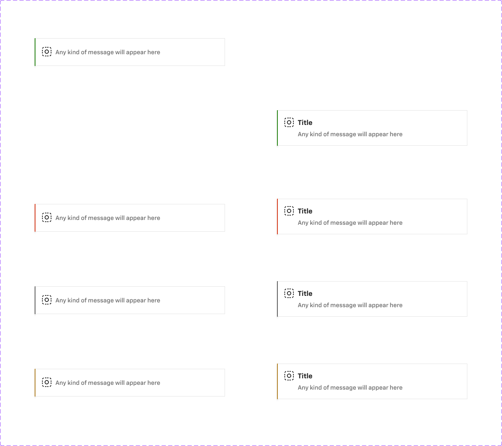

# Alert

## Figma
Page **Alert** (`3769:50197`), file `ilpJ5K66cGR85o287K4HDD`.

| Component set | Node id | Variants |
|---|---|---|
| Alert - Notification | `2380:36262` | 8 |



## Description
No Figma description. Purpose: an inline or toast notification card showing a status message, with an optional title, link and close button.

## Variant axes and props
- `status: success|warning|error|information`
- `title: off|on`
- Non-variant props: `icon` (true), `description` (true), `close` (false), `link` (false).

## Anatomy (status=success, title=on)
```
Alert (COMPONENT, H auto-layout, 440x82, padding 0 (spacing/container/padding/none), bg + 1px border)
└─ Container  FRAME H, padding 16 (spacing/container/padding/s), gap 16 (spacing/container/gap/m), 2px LEFT border in status colour, drop shadow
   ├─ Container  H, gap 8
   │  ├─ icon       INSTANCE icon-24 (24x24, placeholder glyph)
   │  └─ Container  V, gap 4 (spacing/container/gap/xs)
   │     ├─ Title    TEXT 16 Bold
   │     └─ Message  TEXT 14 Medium
   └─ Container  24x32, padding 4/0/4/0 → close button (hidden)
```
- With `title=off`: 64px tall. The text column gets 2px top/bottom padding and only shows the message.
- Width is 440 in the component (fixed width; the text fills the remaining space).

## Token table
Common to all statuses:

| property | value |
|---|---|
| background | `bg/default` |
| outer border | 1px inside `border/default` |
| status accent | 2px left border (inside) on the inner container |
| radius | 0 |
| padding / gap | 16 / 16 (`--aec-spacing-container-padding-s`, `--aec-spacing-container-gap-m`); icon–text gap 8; title–message gap 4 (`--aec-spacing-container-gap-xs`) |
| title | `text/default` 16 Bold |
| message | `text/subtle` 14 Medium |
| icon | 24x24, black placeholder (#000), not tinted per status |
| shadow | 0 2 2 rgba(0,0,0,.06) + 0 4 3 rgba(0,0,0,.07), raw effect, no effect style bound. The root also has an empty drop shadow (0/0/0, 0%). |

| status | accent (left border) |
|---|---|
| success | `success/default` (#2d871b) |
| warning | `warning/default` (#b3842d) |
| error | `error/default` (#d64022) |
| information | **#666666** (`text/subtle` / `dark-grey/base`), not `info/default` |

## Notes
- The status is shown only by the 2px left accent. There is no tinted background and the icon is the same placeholder in every status (the "Change Icon" swap is left as `24/Placeholder`). Pick a status icon (and probably a status colour) in code.
- `information` uses grey (#666666) rather than the `info/default` blue.
- Square corners (radius 0).
- Colours are raw hex. Spacing is bound to `spacing/container/*` variables. No text styles are bound.
