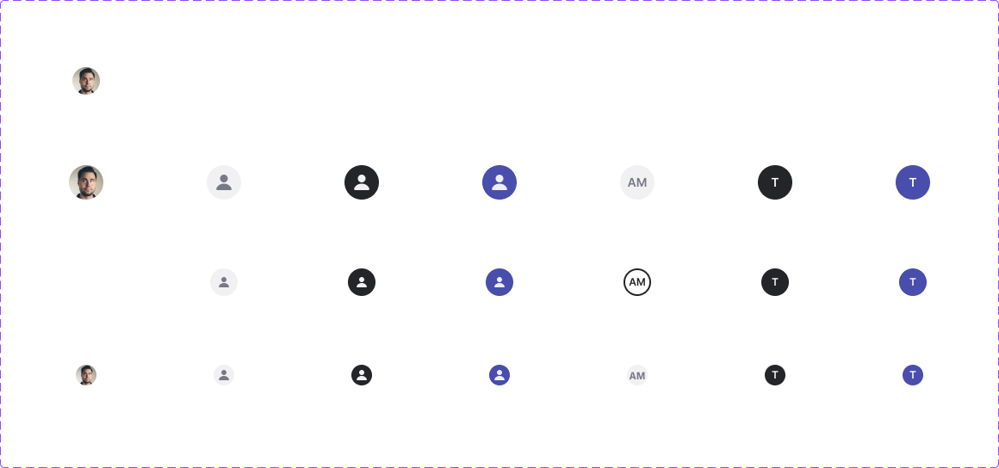

# Avatar

## Figma
Page **Avatar** (`3769:50184`), file `ilpJ5K66cGR85o287K4HDD`.

| Component set | Node id | Variants |
|---|---|---|
| Avatar | `4024:54890` | 21 |



## Description
No Figma description. Purpose: a circular token that represents a user, shown as initials, a generic user icon or a photo.

## Variant axes
- `size: small|medium|large`
- `variant: primary|neutral`
- `emphasis: on|off`
- `initial: on|off` (initials vs. user icon)
- `image: off|on` (photo fill)
- No non-variant props.
- The combinations that exist, per size: neutral/off/initial, neutral/off/icon, primary/on/icon, neutral/on/icon, neutral/on/image, primary/on/initial, neutral/on/initial (7 × 3 sizes = 21). `primary + emphasis=off` and `image` with primary or emphasis=off do not exist.

## Anatomy (size=medium, variant=neutral, emphasis=off, initial=on)
```
Avatar (COMPONENT, V auto-layout, 32x32 fixed, padding 8, gap 8, centred, radius 1000 = full circle)
└─ Initial    TEXT "AM" 12px Semi Bold
   (or) user-icon  INSTANCE user-fill 16x16 (24x24 at large) → path VECTOR
```
- Image variants have an IMAGE fill on the root and no children.

## Token table
Shape: circle (radius 1000, use `--aec-border-radius-rounded`). Sizes: small 24, medium 32, large 40. Padding 8 on every size. No shadow. No text styles are bound.

| combination | background | content colour | content |
|---|---|---|---|
| neutral, emphasis off, initial (small, large) | #f1f1f3 (no token, nearest `bg/variant` #f2f2f2) | #787987 (no token, nearest `text/subtle` #666666) | small "AM" 12px Bold; large 14px Semi Bold |
| neutral, emphasis off, initial (**medium**) | `bg/default` + 2px inside border `icon/default` (#262626), the only style-bound variant | `text/default` | "AM" 12px Semi Bold |
| neutral, emphasis off, icon | #f1f1f3 | icon #787987 | user-fill 16 (24 at large) |
| primary, emphasis on (icon / initial) | #494dac (no token, an indigo outside the palette) | icon #eeecf7 (no token); initial #ffffff `text/inverse` | "T" 12px Semi Bold (14 at large) |
| neutral, emphasis on (icon / initial) | #242529 (no token, nearest `bg/inverse` #262626) | icon #f1f1f3; initial `text/inverse` | same |
| image | photo fill | – | – |

## Notes
- Most colours are legacy, off-palette hex values (#494dac, #f1f1f3, #787987, #242529, #eeecf7). Only the medium neutral initial variant uses styles (`bg/default`, `icon/default` border, `text/default`). This looks like a partly migrated component. Map to tokens when building: primary → `primary/default` / `primary/on-default`, neutral-on → `bg/inverse` / `text/inverse`, neutral-off → `bg/variant` / `text/subtle`.
- The text weight is inconsistent: small neutral initial is Bold, all other initials are Semi Bold. Initials are 12px at both small and medium sizes.
- The page also has a "Token Comparison" frame (`5103:60124`, "for the moderation team only"), which is not a component.
