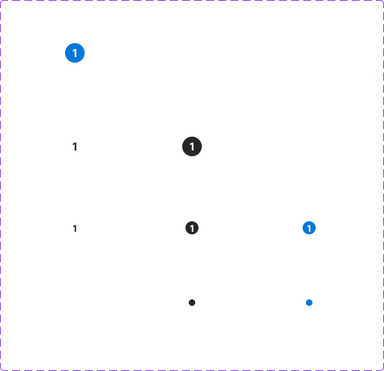

# Badge

## Figma
Page **Badge** (`3769:50186`), file `ilpJ5K66cGR85o287K4HDD`.

| Component set | Node id | Variants |
|---|---|---|
| Badge | `2324:24017` | 9 |



## Description
No Figma description. Purpose: a small pill with a count (or a dot, at x small) that sits on icons, tabs or chips to show a number or a notification.

## Variant axes
- `variant: primary|light|dark`
- `size: x small|small|medium`
- No non-variant props. The count text ("1") is edited by overriding the text layer.

## Anatomy (variant=primary, size=small)
```
Badge (COMPONENT, V auto-layout, 16x16 hug, padding 0/4/0/4, gap 0 (spacing/selectable/gap/none), centred, radius 384)
├─ Label       TEXT "1" 12px Bold
└─ min. width  RECTANGLE 8x0 (zero-height spacer that sets the minimum width)
```
- `x small` is an 8x8 dot: padding 0/2/0/2, no label, no spacer.
- `medium`: 24x24, label 14px Bold, spacer 16x0.
- The stroke is 1px inside, `#000000` at 0% opacity (invisible).

## Token table
Radius `--aec-border-radius-rounded` (384). No shadow. No text styles are bound.

| variant | background | text | sizes (box / label) |
|---|---|---|---|
| primary | `primary/default` (#0077d9) | `primary/on-default` / `text/inverse` (#ffffff) | x small 8x8 dot; small 16x16, 12px Bold; medium 24x24, 14px Bold |
| dark | `bg/inverse` (#262626) | `text/inverse` (#ffffff) | same |
| light | `bg/default` (#ffffff) | `text/default` (#262626) | same |

Padding-x is 4 for small/medium and 2 for x small (no spacing token matches 4 for padding; `--aec-spacing-selectable-gap-s` = 4 is the nearest value).

## Notes
- Colours are raw hex, not bound to styles or variables, but every value matches a token.
- The light badge has no border, so it disappears on white. Use it only on dark or coloured surfaces.
- The label text box is 20/22px tall inside a 16/24px badge, so it relies on centring and overflows vertically.
- No states (badges are not interactive).
