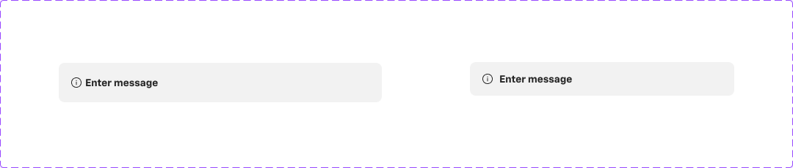

# Banner

## Figma
Page **Banner** (`4911:57297`), file `ilpJ5K66cGR85o287K4HDD`.

| Component set | Node id | Variants |
|---|---|---|
| Banner | `2747:40636` | 2 |



## Description
No Figma description. Purpose: a compact, full-width informational strip with an icon and a short message, optionally with a description and a close button.

## Variant axes and props
- `mobile: off|on`
- Non-variant props: `icon` (true), `description` (false), `close` (false).

## Anatomy (mobile=off)
```
Banner (COMPONENT, H auto-layout, 440x54, padding 16, gap 16 (spacing/container/gap/m), radius 8)
└─ Container  H, padding 0 (spacing/selectable/padding/none), gap 4
   ├─ icon       INSTANCE icon-16 (16/Info glyph)
   └─ Container  H, gap 8
      ├─ Title    TEXT "Enter message" 14 Bold
      └─ Message  TEXT 12 Medium (hidden; `description` prop)
   (Close Button INSTANCE, hidden; `close` prop)
```
- mobile=on: 360x46, padding 12/16/12/16. The icon is wrapped in a 16x22 frame (padding 3/0/3/0). The icon–text gap is 8 and the text column is vertical (gap 4).

## Token table
| property | value |
|---|---|
| background | `bg/variant` (#f2f2f2) |
| border | `border/variant` (#b3b3b3) with stroke weight 0 (no visible border) |
| radius | 8 (`--aec-border-radius-default`) |
| padding | 16 desktop; 12/16 mobile (`--aec-spacing-container-padding-s` horizontally) |
| gap | 16 outer (`--aec-spacing-container-gap-m`); 4 icon–text desktop, 8 mobile |
| icon | 16x16, `icon/default` (#262626) |
| title | `text/default` 14 Bold |
| description | 12 Medium (hidden by default; colour not checked) |
| shadow | an empty drop shadow (0/0/0, 0%), so effectively none |

## Notes
- There is a single neutral style. There are no status variants (info/success/…). Use Alert for statuses.
- Banner has radius 8, while Alert and Tooltip have 0 and Snackbar has 4. Corner radius is inconsistent across feedback components.
- The page also holds loose font-specimen text layers ("Avenir LT Pro 45/55/65/85") and two screenshots, which are not components.
- Colours are raw hex. Gap is bound to `spacing/container/gap/m`. No text styles are bound.
