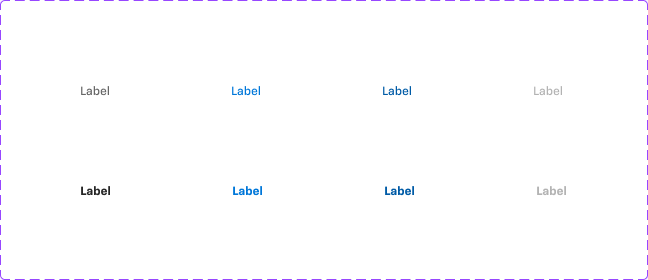
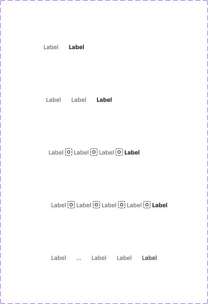

# Breadcrumbs

## Figma
Page **Breadcrumbs** (`3769:50215`), file `ilpJ5K66cGR85o287K4HDD`.

| Component set | Node id | Variants |
|---|---|---|
| .Label (hidden base: one crumb) | `2815:41558` | 8 |
| Breadcrumbs | `2815:41585` | 5 |




## Description
No Figma description. Purpose: shows the user's location in a hierarchy, with links to each ancestor level.

## Variant axes
- **.Label**: `last-node: false|true; state: default|hover|active; disabled: false|true` (disabled only with state=default)
- **Breadcrumbs**: `count: 2|3|4|5|5+`. With `5+`, the middle crumbs collapse to "…".
- No non-variant props.

## Anatomy (Breadcrumbs, count=3)
```
Breadcrumbs (COMPONENT, H auto-layout, hug x 24, gap 4, centred)
├─ .Label      INSTANCE (last-node=false) → Label TEXT 12 Medium
├─ icon-16     INSTANCE resized to 12x12 (chevron separator)
├─ .Label      INSTANCE (last-node=false)
├─ icon-16     separator
└─ .Label      INSTANCE (last-node=true) → Label TEXT 12 Bold
```
- `.Label`: H auto-layout, 20 tall, gap 8, no padding, no background.
- `5+` = first crumb, "…", then the next two crumbs, then the last crumb (5 nodes total).

## Token table (.Label)
| last-node | state | text colour | weight |
|---|---|---|---|
| false | default | `text/subtle` (#666666) | 12 Medium |
| false | hover | `primary/default` (#0077d9) | 12 Medium |
| false | active | `primary/hover` (#005ba6) | 12 Medium |
| false | disabled | `text/disabled` (#b3b3b3) | 12 Medium |
| true | default | `text/default` (#262626) | 12 Bold |
| true | hover | `primary/default` | 12 Bold |
| true | active | `primary/hover` | 12 Bold |
| true | disabled | `text/disabled` | 12 Bold |

Separator: chevron icon at 12x12, colour `icon/variant` (not checked). Gap between items: 4 (`--aec-spacing-selectable-gap-s`). Height 24.

## Notes
- **Inconsistency:** in the `5+` variant, the last crumb instance is `last-node=true` but shows 12 Medium (an overridden weight), unlike `count=3`, where it shows Bold.
- The last node has hover/active states even though the current page is normally not a link.
- No underline on hover (colour change only).
- Colours are raw hex matching tokens. No text styles or variables are bound.
