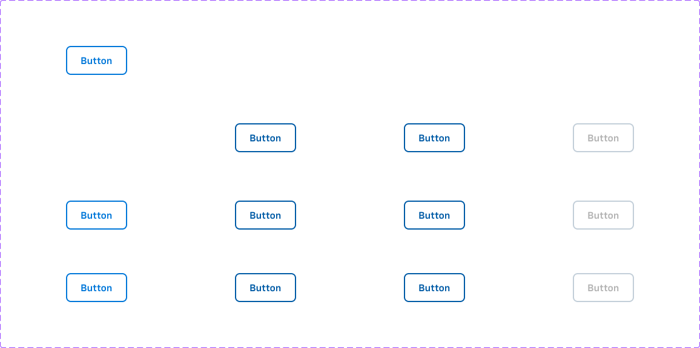
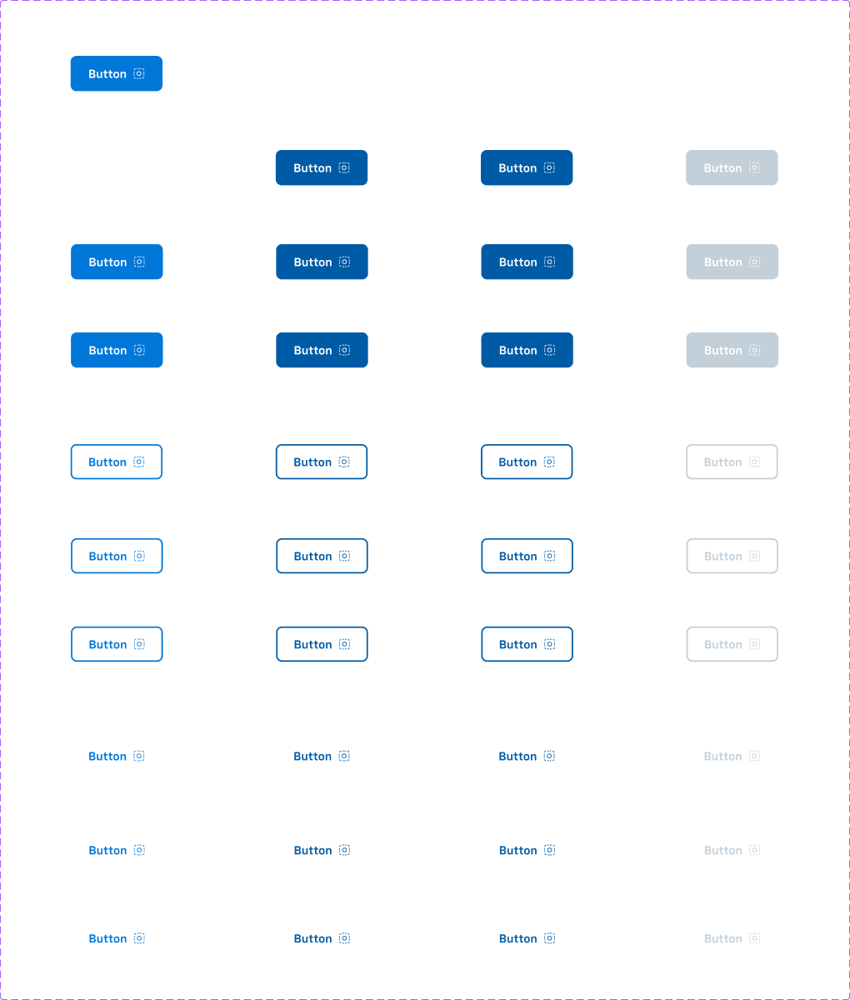
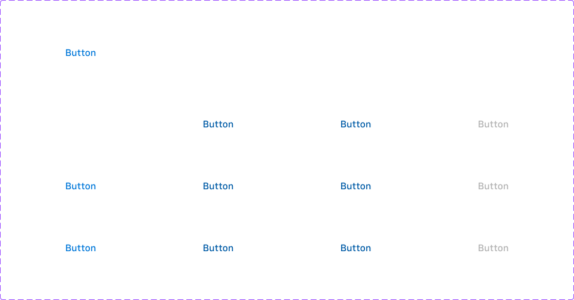

# Button (+ Inline Button)

## Figma
Page **Button** (`3769:50169`), file `ilpJ5K66cGR85o287K4HDD`.

| Component set | Node id | Variants |
|---|---|---|
| Button - Standard | `4736:60451` | 12 |
| Button - Primary | `4740:60659` | 36 |
| Button - Secondary | `4740:61725` | 36 |
| Button - Neutral | `4740:62365` | 36 |
| Button - Inverse | `4740:63005` | 36 |
| Button - Destructive | `4740:63645` | 36 |
| Inline Button - Primary | `4740:67485` | 12 |
| Inline Button - Secondary | `4742:68459` | 12 |
| Inline Button - Neutral | `4742:68673` | 12 |
| Inline Button - Inverse | `4742:68887` | 12 |
| Inline Button - Destructive | `4742:69101` | 12 |

Icon Button sets are on the same page and are written up in [icon-button.md](icon-button.md).





## Description
Figma description (shared by every set): "Buttons are used for interface actions. They default to appearance that has dark text with gray border. Primary style should be used only once per vie[w]…"
Purpose: trigger an action. The emphasis (Primary/Secondary/…) is the set name, and the visual weight is `style`. Inline Button is a text-only button that sits inside running text or a dense layout.

## Variant axes
- **Button - Standard**: `size: large|medium|small; state: default|hover|pressed; disabled: false|true` (no `style` axis)
- **Button - Primary/Secondary/Neutral/Inverse/Destructive**: `size: large|medium|small; style: filled|outline|plain; state: default|hover|pressed; disabled: false|true`
- **Inline Button - ***: `size: large|medium|small; state: default|hover|pressed; disabled: false|true`
- Non-variant props (all sets): `left-icon` (bool), `right-icon` (bool), `focus-ring` (bool). Defaults are false, except: Button - Primary `right-icon=true`, and Inline Button - Inverse `left-icon=true` and `right-icon=true`.
- Disabled exists only with `state=default`.

## Anatomy (Button - Primary, large/filled/default)
```
Button (COMPONENT, H auto-layout, 125x48, padding 0/24/0/24, gap 8, radius 8, stroke 2 inside)
├─ left-icon   INSTANCE icon-16 (16x16, hidden by default)
├─ Edit Text   TEXT "Button" 16px Chevy Sans Demi, line 24
├─ right-icon  INSTANCE icon-16 (16x16)
└─ Focus Ring  RECTANGLE (hidden) 133x56, radius 12, 2px stroke inside (focus/default), i.e. 4px outset
```
- Plain style: padding 0 (hugs text), height still 48. Destructive is the exception: its plain style keeps the 24px side padding.
- Inline Button: H auto-layout 52x24 (hug), padding 0, gap 8, no fill or stroke. Icons are `icon-24` (24x24). Focus ring is 60x32, radius 4 (4px outset).
- Variables bound: height `sizing/selectable/l` = 48, gap `spacing/selectable/gap/m` = 8.

## Token table — Button (size large; the other sizes are identical, see Notes)
Common to all: height 48, radius `--aec-border-radius-default` (8), padding-x 24 (`--aec-spacing-container-padding-m`; plain = 0), gap 8 (`--aec-spacing-selectable-gap-m`), border 2px inside, no shadow, label 16px / line 24.
Label weight: Primary and Standard use **Chevy Sans Demi**. Secondary, Neutral, Inverse and Destructive use **Chevy Sans Medium**. No text style is bound.
No colour styles or variables are bound; every colour is a raw hex, mapped to its token below.

| Set / style | State | Background | Border (2px) | Text / icon |
|---|---|---|---|---|
| Standard | default | bg/default | primary/default | primary/default |
| Standard | hover = pressed | bg/default | primary/hover | primary/hover |
| Standard | disabled | transparent | border/disabled | text/disabled |
| Primary filled | default | primary/default | transparent | primary/on-default |
| Primary filled | hover = pressed | primary/hover | transparent | primary/on-default |
| Primary filled | disabled | bg/disabled | transparent | text/inverse |
| Primary outline | default | transparent | primary/default | primary/default |
| Primary outline | hover = pressed | transparent | primary/hover | primary/hover |
| Primary outline | disabled | transparent | border/disabled | border/disabled (#c3cfd9, not text/disabled) |
| Primary plain | default / hover=pressed / disabled | transparent | none | primary/default / primary/hover / #c3cfd9 |
| Secondary filled | default | secondary/default | transparent | text/inverse |
| Secondary filled | hover = pressed | secondary/hover | transparent | text/inverse |
| Secondary filled | disabled | bg/disabled | transparent | text/inverse |
| Secondary outline | default / hover=pressed / disabled | transparent | secondary/default / secondary/hover / border/disabled | same as border; disabled text = text/disabled |
| Secondary plain | default / hover=pressed / disabled | transparent | none | secondary/default / secondary/hover / text/disabled |
| Neutral filled | default | secondary/default (#262626) | transparent | text/inverse |
| Neutral filled | hover | secondary/hover (#1a1a1a) | transparent | text/inverse |
| Neutral filled | pressed | secondary/default (same as default) | transparent | text/inverse |
| Neutral filled | disabled | bg/disabled | transparent | text/inverse |
| Neutral outline/plain | default, pressed / hover / disabled | transparent | #262626 / #1a1a1a / border/disabled (outline only) | #262626 / #1a1a1a / text/disabled |
| Inverse filled | default | action/inverse/bg/default (#fff) | transparent | text/default |
| Inverse filled | hover = pressed | action/inverse/bg/hover (#e6e6e6) | transparent | text/default |
| Inverse filled | disabled | action/inverse/bg/disabled (#666) | transparent | text/inverse |
| Inverse outline | default | transparent | border/default (#e6e6e6) | text/inverse |
| Inverse outline | hover = pressed | transparent | #e6e6e6 | #e6e6e6 |
| Inverse outline/plain | disabled | transparent | #666666 (outline) | #666666 (text/subtle) |
| Inverse plain | default / hover=pressed | transparent | none | text/inverse / #e6e6e6 |
| Destructive filled | default = hover = pressed | error/default | transparent | text/inverse |
| Destructive filled | disabled | bg/disabled | transparent | text/inverse |
| Destructive outline | default = hover = pressed | transparent | error/default | error/default |
| Destructive outline/plain | disabled | transparent | border/disabled (outline) | text/disabled |
| Destructive plain | default = hover = pressed | transparent | none | error/default |

Focus (all): `focus-ring` boolean shows a 2px `focus/default` ring, radius 12, 4px outside the button.

## Token table — Inline Button (all sizes identical: 24px tall, 16px Chevy Sans Medium, no bg or border)
| Set | default | hover = pressed | disabled |
|---|---|---|---|
| Primary | primary/default | primary/hover | text/disabled |
| Secondary | secondary/default | secondary/hover | text/disabled |
| Neutral | primary/default (#0077d9) | primary/hover | text/disabled |
| Inverse | text/inverse | #e6e6e6 (action/inverse/bg/hover; no text token) | #666666 (text/subtle) |
| Destructive | error/default | error/default (no change) | text/disabled |

## Notes
- **Sizes don't differ (confirmed).** Large, medium and small all render 48px tall with 24px padding and 16px text, because every size binds height to `sizing/selectable/l` (48). Inline Button sizes are identical too (24px, 16px text). The code will need its own size scale; Figma doesn't define one.
- **Hover and pressed share the same colour (confirmed)** in every set except Neutral. There, hover is darker (#1a1a1a) and pressed goes back to the default colour (#262626), which looks like a bug. Destructive has no state change at all (default = hover = pressed = #d64022).
- Standard is actually blue-outlined (primary/default border and text), which contradicts its description ("dark text with gray border").
- Inline Button - Neutral is blue (identical to Inline Primary), not grey.
- Primary outline/plain disabled text uses #c3cfd9 (border/disabled), but the other sets use #b3b3b3 (text/disabled).
- Font weight differs: Primary and Standard use Demi, the others use Medium.
- Destructive plain keeps the 24px side padding; the other plain styles have 0.
- The page also has 3 loose Button-Primary instances, Banner/Label annotation instances and "Token Comparison" frames (documentation, not components).
