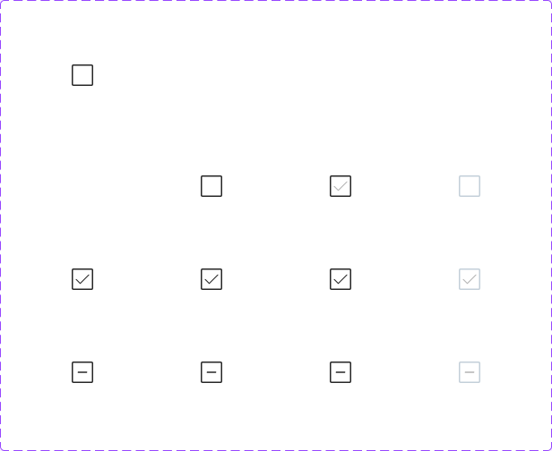
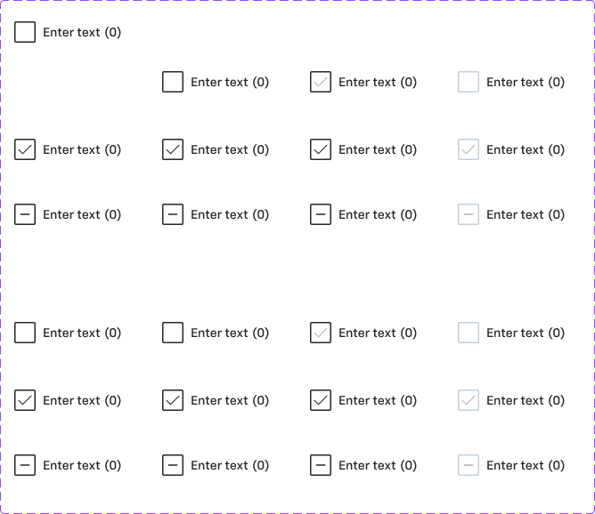

# Checkbox

## Figma
Page **Checkbox** (`3769:50171`).

| Component set | Node id | Variants |
|---|---|---|
| Checkbox | `3012:6837` | 12 |
| Checkbox with Label | `3012:6886` | 4 |
| Checkbox with Label new | `3012:6921` | 24 |




## Description
No Figma description. Purpose: a binary (or indeterminate) selection control, used on its own or paired with a form-control label.

## Variant axes
- **Checkbox**: `state: default|hover|pressed; checked: off|on; indeterminate: off|on; disabled: off|on`. Prop: `focus-ring` (bool, false). Only 12 of the 24 possible combinations exist: disabled only with state=default, and no checked+indeterminate.
- **Checkbox with Label**: `mobile: on|off; position: left|right`.
- **Checkbox with Label new**: `state: default|pressed|hover; disabled: Off|On; checked: Off|On; Indeterminate: Off|On; size: large breakpoint|small breakpoint`. Props: `left icon` (bool, true) and `right icon` (bool, false). These toggle a checkbox on the left or on the right of the label.

## Anatomy
```
Checkbox (COMPONENT 24x24, H auto-layout, gap 8)
├─ container   FRAME 24x24, radius 2, fill bg/default, stroke 1.5 inside
│   └─ Icon    INSTANCE icon-16 (16x16) — check glyph ("Change Color" layer, 15x11) or dash (11px + path)
└─ focus-ring  RECTANGLE (hidden) 28x28, radius 8, 2px focus/default (2px outset)

Checkbox with Label new (H auto-layout, gap 8 / spacing-selectable-gap-m)
├─ Checkbox            INSTANCE (left)
├─ .form control label INSTANCE size=medium (see form-control.md)
└─ Checkbox            INSTANCE (right, hidden by default)
```
Row height: large breakpoint 40 (padding 8/0); small breakpoint (mobile) 48 (padding 12/0). Variables: `sizing/selectable/xs` (24) and `spacing/selectable/gap/s` (4).

## Token table
| Variant | Box fill | Box border (1.5px) | Glyph |
|---|---|---|---|
| unchecked default / hover | bg/default | text/default (#262626) | none |
| unchecked pressed | bg/default | #262626 | check in text/disabled (#b3b3b3), as a preview |
| checked default / hover / pressed | bg/default | #262626 | check, icon/default (#262626) |
| indeterminate default / hover / pressed | bg/default | #262626 | dash, icon/default. Inner path stroke is #373637 (no matching token) |
| unchecked disabled | bg/default | border/disabled (#c3cfd9) | none |
| checked disabled | bg/default | border/disabled | check, icon/disabled (#b3b3b3) |
| indeterminate disabled | bg/default | border/disabled | dash, icon/disabled |
| focus | add the focus-ring: 2px focus/default, radius 8 | | |

Label (in the with-label sets): "Enter text" + count "(0)", 14px Chevy Sans Medium, text/default.

## Notes
- Checked is **not** a filled box. It's a white box with a dark border and a dark check mark (no primary blue).
- Hover looks identical to default, so there's no visible hover feedback in Figma.
- In "Checkbox with Label new", disabled=On leaves the label at text/default (#262626). Only the box goes disabled.
- There are two "with label" sets. "Checkbox with Label" (older: mobile/position axes) and "Checkbox with Label new" (full state matrix + breakpoint) overlap.
- No colour/text styles are bound (raw hex), and the corner radius of 2 isn't a radius token.
