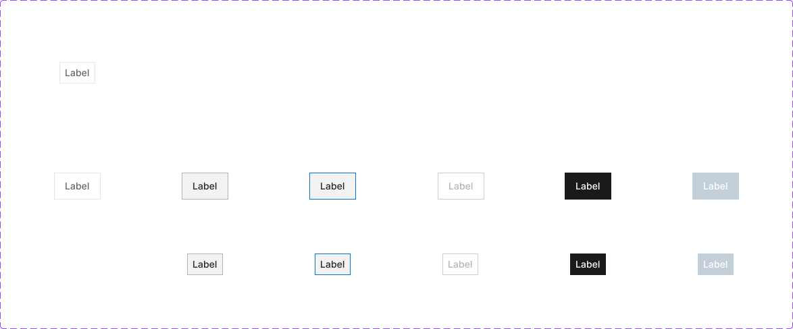
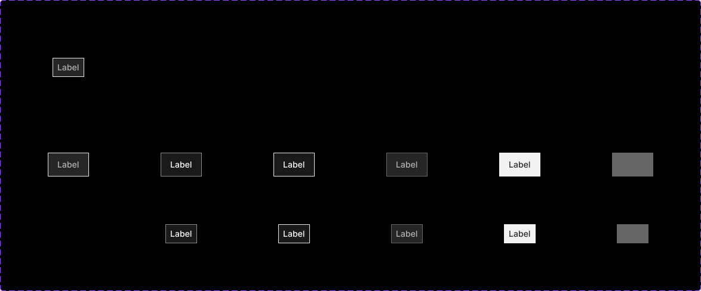
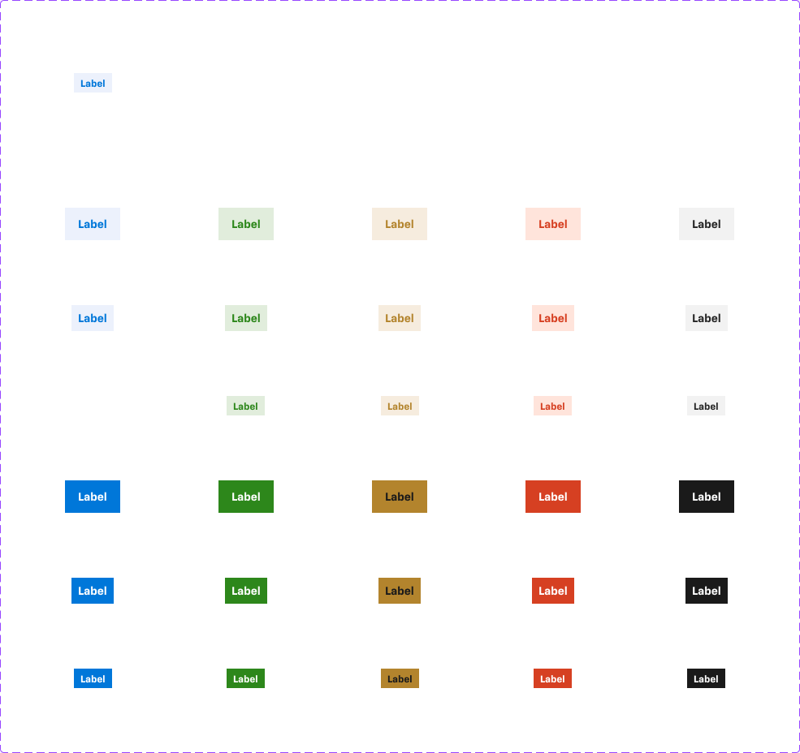
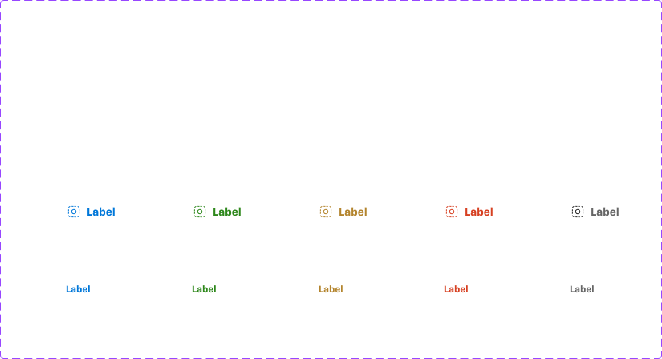
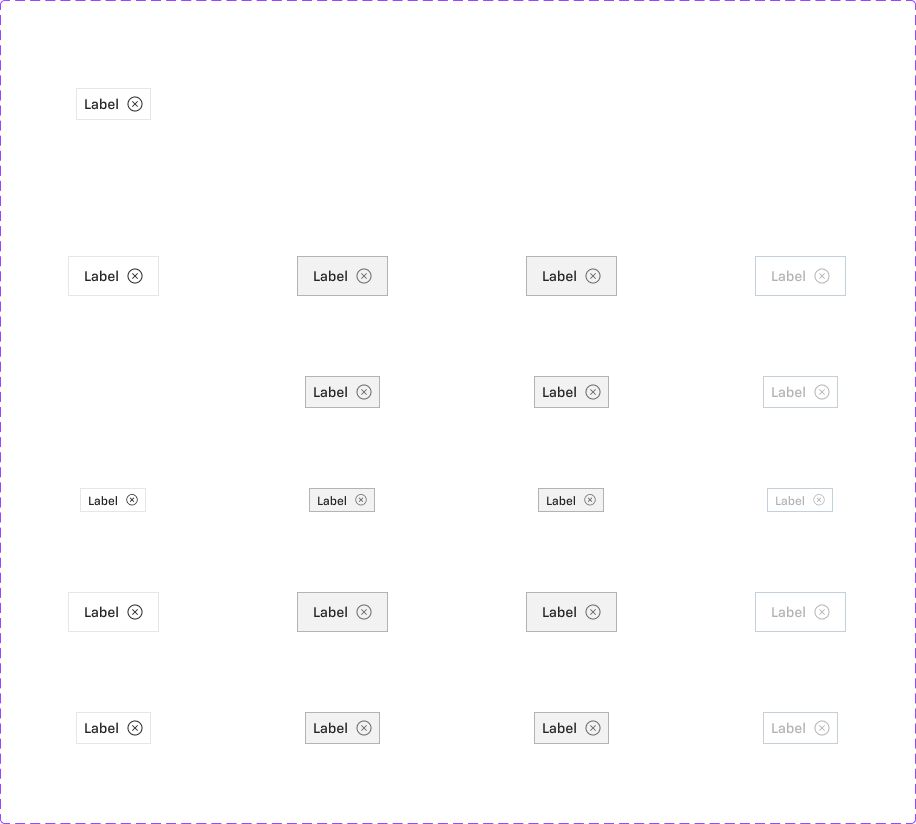
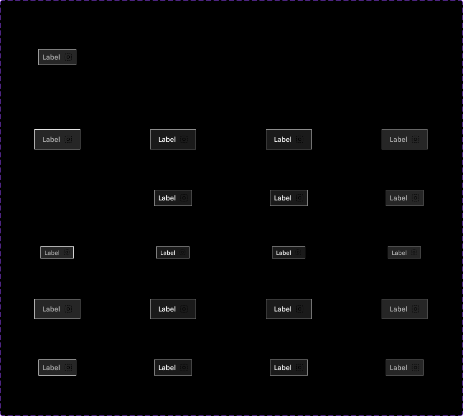

# Chip

## Figma
Page **Chip** (`3769:50187`), file `ilpJ5K66cGR85o287K4HDD`.

| Component set | Node id | Variants |
|---|---|---|
| Chip - Information | `4030:55171` | 30 |
| Chip - Plain | `4744:64325` | 10 |
| Selectable Chip | `4028:54755` | 12 |
| Selectable Chip Inverse | `4961:45844` | 12 |
| Dismissable Chip | `4030:62356` | 20 |
| Dismissable Chip Inverse | `4961:46261` | 20 |








## Description
- Chip - Information (Figma description): "Use this to show information" in Primary, Success, Warning, Error and Neutral. It is a static status label.
- Chip - Plain: a status label with an optional icon and no container.
- Selectable Chip: a toggle filter chip.
- Dismissable Chip: an input/tag chip with a close icon.
- The Inverse sets are the same chips for dark surfaces.

## Variant axes and props
| Set | Variant axes | Non-variant props (default) |
|---|---|---|
| Chip - Information | `size: large\|medium\|small; variant: primary\|success\|warning\|error\|grey; emphasis: off\|on` | `left-icon` (false), `right-icon` (false) |
| Chip - Plain | `size: small\|medium; variant: primary\|error\|success\|warning\|grey` | `left-icon` (true) |
| Selectable Chip (+Inverse) | `size: small\|medium; state: default\|hover\|pressed; selected: off\|on; disabled: false\|true` | `left-icon`, `right-icon`, `badge`, `focus-ring` (all false) |
| Dismissable Chip (+Inverse) | `size: small\|medium\|large; state: default\|hover\|active\|disabled; disabled: false\|true; adornment: icon\|avatar` | `action` (true, close icon), `show-adornment` (false) |

The variant counts are sparse:
- Selectable has hover/pressed only with `selected=off`.
- Disabled exists for both selected values. Small `default/off` exists, but the Figma frame lays out the small row without it.
- Dismissable `state=disabled` always goes with `disabled=true`.

## Anatomy
Selectable Chip (medium, default, off):
```
Chip (COMPONENT, H auto-layout, 69x40 hug, padding 0/16/0/16, gap 8 (spacing/selectable/gap/m), centred, radius 0, 1px inside border)
├─ left-icon / right-icon / badge   (hidden by default)
└─ Edit Text  TEXT "Label" 14px Medium
```
- Small: 32px tall, padding-x 8.
- Chip - Information: same structure. Heights: small 24 (padding-x 8, 12px Bold), medium 32 (padding-x 8, 14px Bold), large 40 (padding-x 16, 14px Bold). Its stroke is #000 at 0% (invisible).
- Chip - Plain: no container, padding 0 (`spacing/selectable/padding/none`), gap 4 (`spacing/selectable/gap/s`). Small: 16px tall, 12px Bold. Medium: icon-16 + 14px Bold.
- Dismissable: text then `close-icon` (icon-12 at small, icon-16 at medium/large). Heights: small 24 (padding-x 8, 12px Medium), medium 32 (padding-x 8, 14px Medium), large 40 (padding-x 16, 14px Medium). Gap 8.

## Token tables
All chips: radius 0 (square corners, `--aec-border-radius-none`), no shadow. No text styles are bound (raw size/weight).

### Selectable Chip
| state | background | border (1px) | text |
|---|---|---|---|
| default, off | `bg/default` | `border/default` | `text/subtle` 14 Medium |
| hover, off | `bg/variant` | `border/variant` | `text/default` |
| pressed, off | `bg/variant` | `action/border/active` (#0077d9) | `text/default` |
| selected (on) | `secondary/hover` (#1a1a1a) | none | `text/inverse` |
| disabled, off | `bg/default` | `border/disabled` | `text/disabled` |
| disabled, on | `bg/disabled` | `border/disabled` | `text/inverse` |

### Selectable Chip Inverse
| state | background | border | text |
|---|---|---|---|
| default, off | `bg/inverse` (#262626) | `border/default` (#e6e6e6) | `inverse/text/variant` (#b3b3b3) |
| hover, off | `inverse/bg/variant` (#1a1a1a) | `inverse/border/variant` (#8c8c8c) | `text/inverse` |
| pressed, off | `inverse/bg/variant` | `border/default` (#e6e6e6) | `text/inverse` |
| selected (on) | `bg/variant` (#f2f2f2) | none | `text/default` |
| disabled, off | `bg/inverse` | `action/inverse/bg/disabled` (#666666) | `text/disabled` (#b3b3b3) |
| disabled, on | `action/inverse/bg/disabled` (#666666) | #666666 | #666666 (text is invisible, see Notes) |

### Chip - Information (emphasis off = subtle, on = filled)
| variant | off: bg / text | on: bg / text |
|---|---|---|
| primary | `primary/subtle` / `primary/on-subtle` | `primary/default` / `primary/on-default` |
| success | `success/subtle` / `success/default` | `success/default` / `text/inverse` |
| warning | `warning/subtle` / `warning/default` | `warning/default` / `warning/on-default` (#1a1a1a) |
| error | `error/subtle` / `error/default` | `error/default` / `text/inverse` |
| grey | `bg/variant` / `text/default` | #1a1a1a (`secondary/hover`) / `text/inverse` |

### Chip - Plain
Text and icon colour per variant: primary `primary/default`, success `success/default`, warning `warning/default`, error `error/default`, grey `text/subtle`. No background or border.

### Dismissable Chip (and Inverse)
| state | bg | border | text | close icon |
|---|---|---|---|---|
| default | `bg/default` | `border/default` | `text/default` | `icon/default` |
| hover | `bg/variant` | `border/variant` | `text/default` | `icon/variant` |
| active | `bg/variant` | `border/variant` (same as hover) | `text/default` | `icon/variant` |
| disabled | `bg/default` | `border/disabled` | `text/disabled` | `icon/disabled` |
| **Inverse** default | `bg/inverse` | `border/default` | `inverse/text/variant` | – |
| Inverse hover / active | `inverse/bg/variant` | `inverse/border/variant` | `text/inverse` | – |
| Inverse disabled | `bg/inverse` | #666666 | `inverse/text/variant` | – |

## Notes
- All colours are raw hex, not bound to styles, but they map to tokens. Spacing gaps are bound to variables (`spacing/selectable/gap/m|s`).
- Chips have square corners (radius 0), unlike buttons (radius 8).
- Dismissable `active` looks the same as `hover` (no pressed border). Selectable `pressed` adds the blue border.
- Selectable Chip Inverse disabled+selected uses the same colour (#666666) for background and text, so the label is unreadable. This is probably a bug.
- Selectable Chip Inverse pressed uses a #e6e6e6 border, but default also uses #e6e6e6. Pressed and default differ only in background.
- `adornment=avatar` vs `icon` makes no visible difference unless `show-adornment` is on (hidden by default).
- Medium Chip - Information and large Chip - Information use the same 14px text. Only the height and padding differ.
