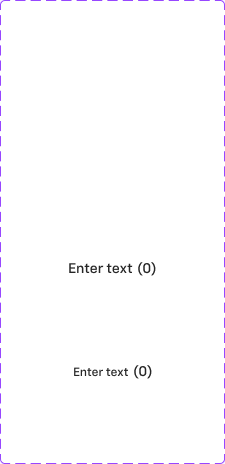

# Form Control (label)

## Figma
Page **Form Control** (`1992:17724`).

| Component set | Node id | Variants |
|---|---|---|
| .form control label (hidden base — only content on the page) | `2815:42181` | 2 |



## Description
No Figma description. Purpose: the label block (label + optional count + optional description) that Checkbox, Radio and Switch "with Label" sets place next to their control.

## Variant axes
`size: medium|small`. Non-variant props: `Count` (bool, default **true**) shows the "(0)" count, and `description` (bool, false) shows the helper line.

## Anatomy
```
.form control label (COMPONENT, V auto-layout, gap 4)
├─ Label Container  FRAME H auto-layout, gap 4, padding-y 1 (medium) / 2 (small)
│   ├─ Label        TEXT "Enter text"
│   └─ Label        TEXT "(0)" (count)
└─ Description      TEXT "Descriptive text" (hidden by default)
```

## Token table
| Part | medium | small |
|---|---|---|
| Overall height (no description) | 24 | 26 |
| Label | 14px Chevy Sans Medium, line 22, text/default | 12px Chevy Sans Medium, line 20, text/default |
| Count "(0)" | 14px Chevy Sans Medium, text/default | 14px Chevy Sans Medium (not scaled, see Notes), text/default |
| Description | 12px Chevy Sans Medium, line 20, text/subtle (#666666) | same |
| Gap label→description | 4 (`--aec-spacing-container-gap-xs`) | 4 |

## Notes
- The only component here is a hidden base (`.` prefix). It's documented anyway because it's the page's only content and every "with Label" control uses it.
- In size=small the count stays at 14px while the label drops to 12px, which looks like an oversight.
- `Count` defaults to true, so every with-label instance shows "(0)" unless it's turned off.
- There are no disabled or error variants. Disabled controls keep the label at text/default (see checkbox.md).
- The page's other children are 49 empty TEXT nodes, Banner/Label doc instances and a Token Comparison frame.
