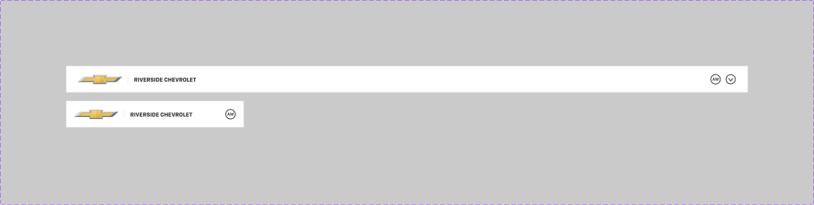

# Header

## Figma
Page **Header** (`5248:1167`), file `ilpJ5K66cGR85o287K4HDD`.

| Component set | Node id | Variants |
|---|---|---|
| Header | `5248:1423` | 2 |
| .Header_Profile_Icon (hidden base) | `5738:96` | 2 |

The page also has a loose `icon-logo` frame (`5783:14622`).



## Description
No Figma description. Purpose: the app's top bar, with the brand logo, dealership name and the user's profile/account control.

## Variant axes
- **Header**: `Web: False|True; Mobile: False|True`. Only `Web=True, Mobile=False` (1440 wide) and `Web=False, Mobile=True` (375 wide) exist.
- **.Header_Profile_Icon**: `Type: Initials|Profile icon`.
- No non-variant props.

## Anatomy (Web=True)
```
Header (COMPONENT, H auto-layout, 1440x56, padding 8/24/8/24, space-between, bottom border 1px)
├─ Frame (left)  H, gap 12, centred
│  ├─ icon-logo   94x40 → .Logo New 94x32 → Chevrolet bowtie image 94x20
│  ├─ Separator   RECTANGLE 1x16
│  └─ Dealer name TEXT "RIVERSIDE CHEVROLET" (body/3/bold, all caps)
└─ Frame (right) H, gap 8
   ├─ .Header_Profile_Icon (Initials)  → 24x24 circle outline + "AM"
   └─ icon-24  (chevron-down, account menu)
```
- Mobile: 375x56, padding 8/16/8/16. The left group and profile icon sit in one row (gap 24). There is no chevron.
- `.Header_Profile_Icon` Initials: 22px circle, 1.5px stroke, "AM" 9px Demi. Profile icon: `24/AccountRound` glyph.

## Token table
| part | value |
|---|---|
| background | `bg/default` (#ffffff) |
| bottom border | 1px inside `border/default` (#e6e6e6) |
| height | 56 |
| padding | 8 vertical / 24 horizontal desktop (`--aec-spacing-container-padding-m`), 16 mobile (`--aec-spacing-container-padding-s`) |
| gap | 12 left group; 8 right group |
| separator | 1x16 `border/default` |
| dealer name | `text/default`, text style **`body/3/bold`** (the only bound text style in this batch) |
| profile initials | circle stroke 1.5px `icon/default` (#262626); "AM" 9 Demi `text/default` |
| icons | 24x24 `icon/default` |
| shadow | none |

## Notes
- The logo is a raster image (Chevrolet bowtie), so the brand differs per dealer/OEM. Treat it as a slot.
- The `Web`/`Mobile` boolean pair is redundant. Use a single `breakpoint` prop in code.
- Profile initials at 9px are very small. This is not the Avatar component.
