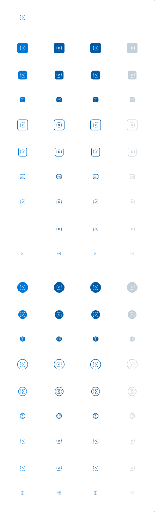

# Icon Button

## Figma
Page **Button** (`3769:50169`).

| Component set | Node id | Variants |
|---|---|---|
| Icon Button - Neutral | `4743:63425` | 72 |
| Icon Button - Primary | `2300:7912` | 72 |
| Icon Button - Inverse | `4743:65038` | 72 |



## Description
Uses the same description as Button ("Buttons are used for interface actions…"). Purpose: a square or circular button that shows only an icon.

## Variant axes
`size: large|medium|small; style: filled|outline|plain; shape: rectangle|circle; state: default|hover|pressed; disabled: false|true` (disabled only with state=default).
Non-variant props: `focus-ring` (bool, default false). The icon is a nested `icon-24` instance, so it can be swapped through the instance.

## Anatomy (default variant = medium/plain/rectangle/default)
```
Icon Button (COMPONENT, H auto-layout, 40x40, padding 0, gap 8, radius 8, stroke 2 inside)
├─ icon-24     INSTANCE (24x24), colour layer "Change Color"
└─ Focus Ring  RECTANGLE (hidden) 48x48, radius 12, 2px focus/default stroke (4px outset)
```
Variables bound: `spacing/selectable/gap/m` (8) and `spacing/selectable/padding/none` (0). Size is not bound to a sizing variable.

## Sizes (these differ, unlike Button)
| size | box | radius rectangle / circle |
|---|---|---|
| large | 48x48 | 8 (`--aec-border-radius-default`) / 384 (`--aec-border-radius-rounded`) |
| medium | 40x40 | 8 / 384 |
| small | 24x24 | 8 / 384 |
The icon is `icon-24` in the default variant. Small (24px box) leaves no padding around a 24px icon.

## Token table (large, rectangle; circle differs only in radius)
Colours are raw hex, not bound to styles. Border is 2px inside.

| Set / style | default | hover | pressed | disabled |
|---|---|---|---|---|
| Neutral filled: bg / icon | secondary/default / icon/inverse | secondary/hover / icon/inverse | secondary/default (= default) | bg/disabled / icon/inverse |
| Neutral outline: border = icon | secondary/default | secondary/hover | secondary/default | border border/disabled, icon icon/disabled |
| Neutral plain: icon | icon/default | secondary/hover | secondary/hover | icon/disabled |
| Primary filled: bg / icon | primary/default / primary/on-default | primary/hover | primary/hover | bg/disabled / icon/inverse |
| Primary outline: border = icon | primary/default | primary/hover | primary/hover | #c3cfd9 (border/disabled) for both |
| Primary plain: icon | primary/default | primary/hover | primary/hover | #c3cfd9 |
| Inverse filled: bg / icon | action/inverse/bg/default / icon/default | action/inverse/bg/hover / icon/default | same as hover | action/inverse/bg/disabled / icon/inverse |
| Inverse outline: border / icon | border/default (#e6e6e6) / icon/inverse | #e6e6e6 / #e6e6e6 | same as hover | #666666 / #666666 |
| Inverse plain: icon | icon/inverse | #e6e6e6 | #e6e6e6 | #666666 |

Focus: `focus-ring` boolean, 2px `focus/default`, radius 12, 4px outset.

## Notes
- Hover = pressed in Primary and Inverse. In Neutral, filled/outline pressed goes back to the default colour (#262626) while hover is #1a1a1a. Neutral plain is the odd one out: its pressed state *does* stay at #1a1a1a.
- Primary disabled outline/plain uses #c3cfd9 for the icon; Neutral uses #b3b3b3 (icon/disabled).
- Unlike Button, the sizes really differ (48/40/24).
