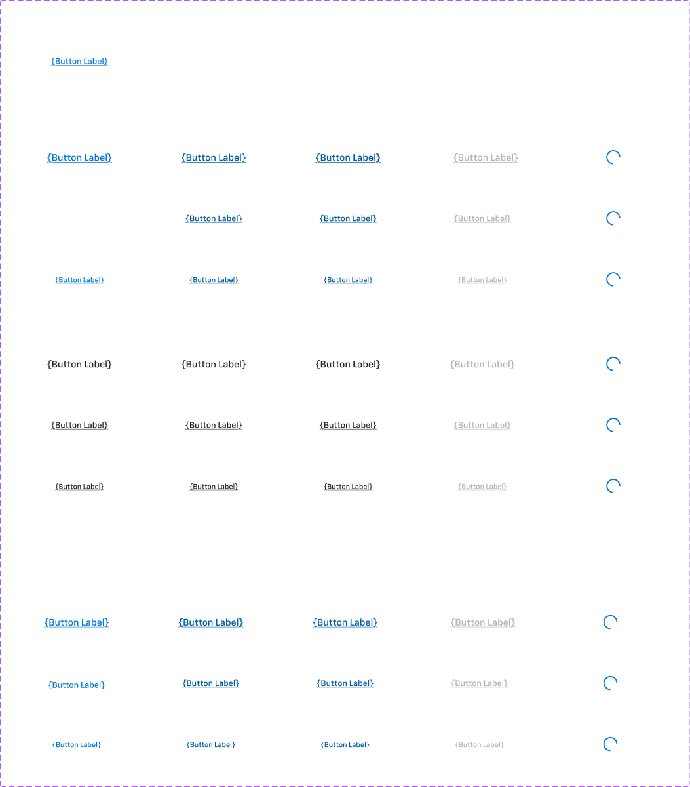

# Link

## Figma
Page **Link** (`3769:50217`).

| Component set | Node id | Variants |
|---|---|---|
| Link | `4063:66179` | 45 |
| Link - Inverse | `4972:45834` | 15 |



## Description
No Figma descriptions. Purpose: an inline, underlined navigational text action.

## Variant axes
- **Link**: `size: large|medium|small; style: primary|neutral|brand; state: default|hover|pressed|loading; disabled: false|true` (disabled only with state=default).
- **Link - Inverse**: `size; state: default|hover|pressed|loading; disabled`.
- Props (both): `left-icon`, `right-icon`, `focus-ring` (bool, all false).

## Anatomy (Link, medium/primary/default)
```
Link (COMPONENT 98x24, H auto-layout, padding 0, gap 8, radius 8, no fill/stroke)
├─ left-icon  INSTANCE icon-24 (hidden)
├─ Edit Text  TEXT "{Button Label}" 14px Chevy Sans Medium, UNDERLINE
├─ right-icon INSTANCE icon-24 (hidden)
└─ Focus Ring RECTANGLE (hidden) 106x32, radius 4, 2px focus/default (4px outset)
```
Loading replaces the text with a 24px spinner ("Ellipse 2", primary/default). Variables: `sizing/selectable/xs` (24) and `spacing/selectable/gap/m` (8).

## Sizes (these differ)
| size | text | line | height |
|---|---|---|---|
| large | 16px Chevy Sans Medium | 24 | 24 |
| medium | 14px | 22 | 24 |
| small | 12px | 20 | 24 |

## Token table (colour of underlined text)
| Style | default | hover = pressed | disabled | loading spinner |
|---|---|---|---|---|
| primary | primary/default | primary/hover | text/disabled | primary/default |
| brand | primary/default | primary/hover | text/disabled | primary/default |
| neutral | text/default (#262626) | text/default (no change) | text/disabled | primary/default |
| Inverse | text/inverse | #b3b3b3 (inverse/text/variant) | #666666 (text/subtle) | primary/default |

## Notes
- **brand is identical to primary** (same colours everywhere).
- Hover and pressed share the same colour. Neutral has no hover change at all.
- The Inverse loading spinner is blue (primary/default), not white.
- Height stays 24 for every size, but the text size scales (16/14/12).
