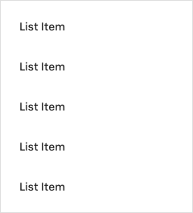
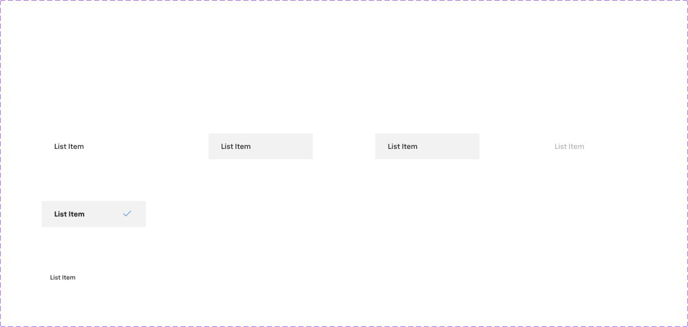

# Menu

## Figma
Page **Menu** (`3769:50175`).

| Component | Node id | Variants |
|---|---|---|
| Menu (component) | `2870:41872` | 1 (240x266) |
| .Menu List (hidden base, list item) | `2859:41739` | 6 |




## Description
Menu description field: `--aec-box-shadow-s` (i.e. the menu uses the small shadow token). Purpose: a dropdown/popover list of selectable options, optionally with search.

## Variant axes
- **Menu**: non-variant prop `search` (bool, false).
- **.Menu List** (item): `state: default|hover|pressed; selected: true|false; disabled: false|true; header: false|true`. Props: `description` (bool, false), `left-icon` (bool, false), `tick-icon` (bool, true).

## Anatomy
```
Menu (COMPONENT 240 wide, V auto-layout, padding 8/0, gap 0, fill bg/default, 1px border #dedede, 2 drop shadows)
├─ Search (hidden)  FRAME V, padding 0/16, bg/default: Search Text (48 tall) + 1px bottom rule #d2d2d2
├─ .Menu List × 5   visible items (fill width 240)
└─ .Menu List × 5   hidden extra items

.Menu List item (H auto-layout, padding 12/24, gap 8, 50 tall)
├─ left icon (hidden)       icon-24
└─ Description Container    V
    ├─ Label Container      H, padding-y 2 → Edit Text "List Item" 14px Chevy Sans Medium
    └─ Edit Text (hidden)   "{Descriptive text}" 12px Avenir Next Regular, text/subtle
   (+ tick icon when selected)
```
Bound variables: `spacing/selectable/gap/m` (8), `gap/none`, `padding/none`, `border/radius/none` (0). The menu and its items have square corners.

## Token table
| Item variant | Bg | Label | Other |
|---|---|---|---|
| default | transparent | text/default, 14px Medium | — |
| hover | bg/variant (#f2f2f2) | text/default | — |
| pressed | bg/variant (same as hover) | text/default | — |
| selected | bg/variant | text/default, **14px Bold** | tick icon in primary/default |
| disabled | bg/default | text/disabled | — |
| header | transparent | text/default, 12px Medium | padding 4/16, 32 tall |

Menu container: bg/default; border 1px #dedede (no exact token; closest is border/default #e6e6e6); shadow `--aec-box-shadow-s` (per the description; the effect isn't bound to a style); radius 0.

## Notes
- Hover = pressed = selected background. Selected adds bold text and a blue tick.
- No focus state on items.
- The menu border (#dedede) and search rule (#d2d2d2) don't match any token.
- The description text uses Avenir Next instead of Chevy Sans.
- `.Menu List` is a hidden base, but it's the only way to see the item states, so it's documented here.
