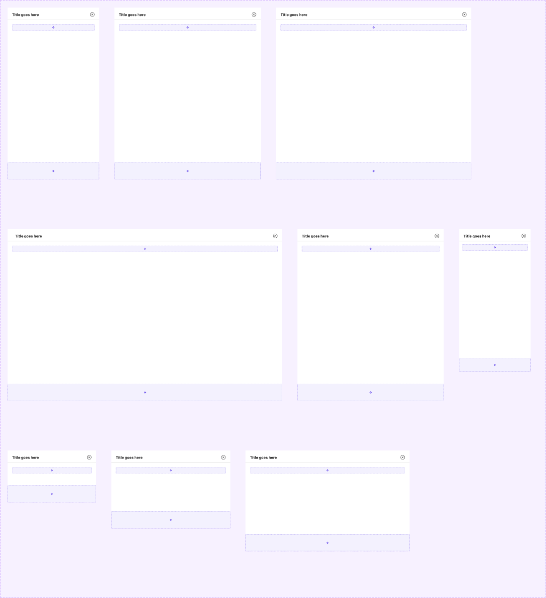

# Modal (Sheets and Modal)

## Figma
Page **Sheets and Modal** (`3769:50205`), file `ilpJ5K66cGR85o287K4HDD`.

| Component set / component | Node id | Variants |
|---|---|---|
| Sheets and Modal | `2954:46269` | 9 |
| .Header (hidden base component) | `2954:46144` | – |



## Description
No Figma description. Purpose: overlay containers. The set covers a centred pop-up **modal**, a **right-sheet** (side panel), a full-width **bottom-sheet**, and a tablet bottom-sheet. Each has a header (title and close) and a content slot.

## Variant axes and props
- `small-screen: off|on`
- `type: bottom-sheet|right-sheet|modal|768px tablet bottom-sheet`
- `size: lg|md|sm`
- Non-variant prop: `Bottom CTA bar` (boolean, true), the footer slot.

Existing combinations (all `small-screen=off` except the last):

| type | size | W x H |
|---|---|---|
| modal | sm / md / lg | 464x272 / 624x408 / 860x528 |
| right-sheet | sm / md / lg | 480x900 / 768x900 / 1024x900 |
| bottom-sheet | lg | 1440x900 |
| 768px tablet bottom-sheet | md | 768x900 |
| bottom-sheet (small-screen=on) | sm | 375x748 |

## Anatomy (type=modal, size=md)
```
Modal (COMPONENT, V auto-layout, 624x408, bg white, radius 0)
├─ .Header   INSTANCE, H, 624x64, padding 24/24/16/24, gap 16, bottom border 1px
│  ├─ Title frame  → "Title goes here" TEXT 20 Bold
│  └─ icon-24      close icon (24/Close)
├─ Replace the content slot inside   FRAME V, padding 24, gap 24
│  └─ content-slot  INSTANCE (purple placeholder)
└─ content-slot (footer / Bottom CTA bar)  INSTANCE 624x88, padding 24, gap 8
```
- Sheets use content padding 24/24/0/24.
- The large bottom-sheet header has 40 left padding.
- The small-screen bottom-sheet uses padding 16 and gap 16, with a 72px footer and padding 16.

## Token table
| part | value |
|---|---|
| surface | `bg/default` (#ffffff), radius 0, no border, no shadow on the component |
| header | height 64; padding 24/24/16/24 (`--aec-spacing-container-padding-m` = 24); gap 16 |
| header divider | 1px bottom, #d2d2d2 (md modal / sheets) or #dedede (other sizes). Neither is a token; nearest `border/default` #e6e6e6 |
| title | `text/default` 20 Bold (no style bound; nearest `heading/5`/`heading/6`, unverified) |
| close icon | 24x24, `icon/default` (#262626) |
| content padding / gap | 24 / 24 (`--aec-spacing-container-padding-m`, `--aec-spacing-container-gap-l`); small-screen 16 / 16 |
| footer (CTA bar) | 88 tall, padding 24, gap 8; small-screen 72 tall, padding 16 |
| backdrop | not part of the component; use `backdrop/default` (#000 @ 52%) |

## Notes
- The content and footer areas are `content-slot` placeholders (#664cea at 8% with a #664cea border). Swap in real content.
- The header divider colour is inconsistent (#d2d2d2 vs #dedede) and off-palette.
- There is no corner radius on any type (sheets and modals are square). There is no shadow or backdrop in the set.
- Several combinations are missing (e.g. modal on small screens, bottom-sheet sm/md desktop).
- No spacing variables or text styles are bound. All values are raw.
