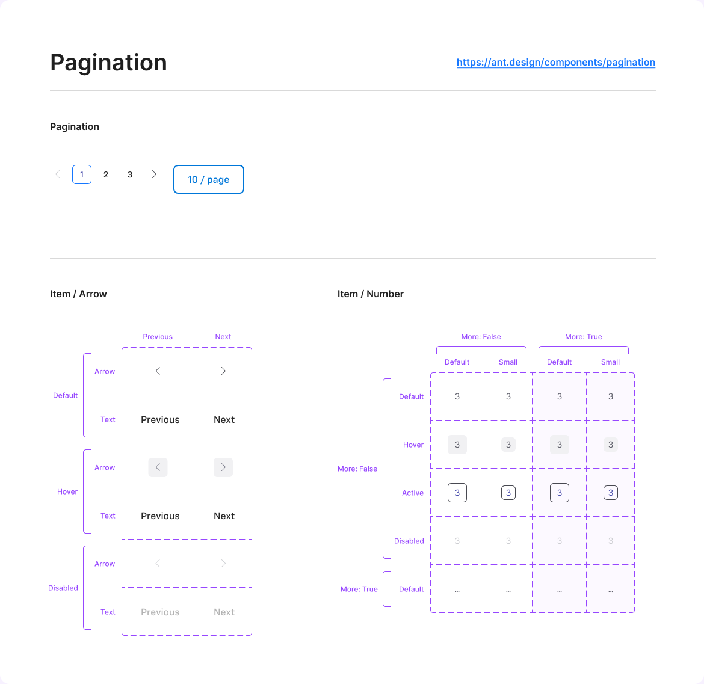

# Pagination

## Figma
Page **Pagination** (`3769:50219`), file `ilpJ5K66cGR85o287K4HDD`. Everything lives inside frame `ThemeDefault` (`2709:16431`).

| Component set / component | Node id | Variants |
|---|---|---|
| Item / Arrow | `2709:16495` | 12 |
| Item / Number | `2709:16594` | 10 |
| Pagination (component) | `2709:16441` | – |



## Description
No Figma description. Purpose: navigates between pages of a list or table, with a page-size selector.

## Variant axes and props
- **Item / Arrow**: `Type: Arrow|Text; Direction: Next|Previous; State: Default|Hover|Disabled`
- **Item / Number**: `State: Default|Hover|Active|Disabled; Size: Default|Small; More: True|False`. `More=True` ("…") exists only with State=Default. Non-variant props: `Text` (text, "3"), `More` (boolean).

## Anatomy (Pagination)
```
Pagination (COMPONENT, H auto-layout, 326x48, gap 16)
├─ Basic  FRAME H, gap 8
│  ├─ Item / Arrow  (Arrow, Previous, Disabled)  32x32
│  ├─ Item / Number (Active)   32x32
│  ├─ Item / Number (Default) x2
│  └─ Item / Arrow  (Arrow, Next, Default)
└─ Button - Standard (size=small) "10 / page"  118x48, padding 0/24, radius 8, 2px border
```
- Item / Number: V auto-layout, 32x32 (Small 24x24), centred, radius 6.
- Item / Arrow (Arrow): 32x32, radius 6, with a chevron icon 16x16. The Text type wraps `Inline Button - Secondary` (size large) with padding-x 8 (bound to `Space/Padding/paddingXS`).

## Token table
| element / state | background | border | text / icon |
|---|---|---|---|
| Number default | none | none | #60616c (no token, nearest `text/subtle`) |
| Number hover | #f1f1f3 (no token, nearest `bg/variant`) | none | #60616c |
| Number active | none | 1px inside #484951 in the set; the Pagination instance binds variable `Primary/colorPrimary` | **#494dac** (no token; legacy indigo) |
| Number disabled | none | none | #cccdd1 (no token, nearest `text/disabled`) |
| Arrow default | none | none | chevron #484951 |
| Arrow hover | #f1f1f3 | none | chevron #787987 |
| Arrow disabled | none | none | chevron #cccdd1 |
| Text arrow default/hover | none | none | `text/default` 16 Medium (hover is identical to default) |
| Text arrow disabled | none | none | `text/disabled` |
| Page-size button | `bg/default` | 2px `primary/default` | `primary/default` 16 Medium |

Number text uses text style **`Desktop/Normal`** (legacy style from another library); "…" uses 14 "9pt Regular". Radius 6 has no token (nearest `rounded-rect` 4 or `default` 8).

## Notes
- **This is a legacy component.** It uses an older palette (#494dac, #484951, #60616c, #f1f1f3, #cccdd1), older variables (`Space/Padding/paddingXS`, `Primary/colorPrimary`) and the `Desktop/Normal` text style. Only the page-size button and the text arrows use current tokens. Re-map when building: active `primary/default` text + `action/border/active` border, hover `bg/variant`, default `text/subtle`, disabled `text/disabled`.
- Text-arrow Hover is identical to Default.
- The page-size "button" is a Standard button, not a dropdown/select.
