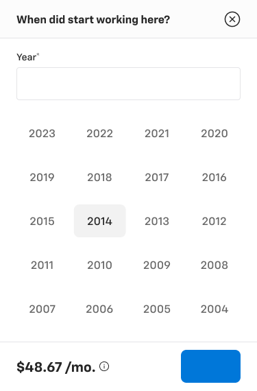
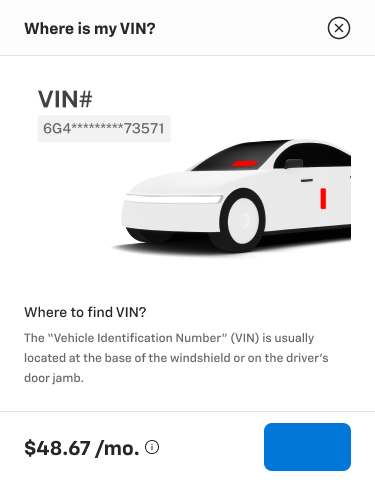

# Bottom sheets (mobile)

**Figma**: page *Sheets and Modals* (`5613:20297`). Two standalone components (not sets):
| Component | Node | Size |
|---|---|---|
| Bottom sheet - Financing | `5741:48899` | 375×570 |
| Bottom sheet - Trade-in | `5759:38115` | 375×483 |

**Purpose**: mobile-only helper sheets that slide up from the bottom of the screen. *Financing* collects a year ("When did start working here?") in the
credit application. *Trade-in* explains where to find the VIN.

 

## Anatomy (both)
```
V gap 0, bg/default, radius 0, no shadow (no overlay inside the component)
├─ Sidesheet - Header 375×56  (padding 16/24, bottom border 1px border/default, heading/5 title, Icon Button - Neutral close)
├─ _Bottom sheet - Content - <Financing|Trade-in>  V padding 16/24/24/24 gap 24 bg/default (hidden base sets)
└─ Sidesheet - Footer 375×72 (Web variant; padding 16/24, top border) — Price - Monthly "$48.67 /mo." + info icon | Button group
```
See [sheet-anatomy.md](sheet-anatomy.md) for the header, footer and price parts.

### Financing content (variant `Financing=Year selection`)
- **Standard Text Input - Outlined** (`.aec-field`) with label "Year*" (`body/2/medium`, required asterisk) and an empty 48px input (radius 4, 1px `border/default`).
- **Dropdown - Year**: a 327×304 grid. V gap 16 rows, each row H gap 8 of 4 × `_Dropdown - Options` (76×48). The years run 2023 → 2004, and the
  active option (2014) has a radius 4 `bg/variant` highlight with `text/default` text. Other years use `text/subtle`.

### Trade-in content (variant `Trade-in=Where is my VIN`)
- Illustration card 327×205 (radius ≈8, white). It shows an isometric windshield image with a red (#ff0000, no token) marker and a VIN label chip
  "VIN#" + masked "6G4*********73571" (bg `bg/variant`). This is an image/illustration slot.
- Details V gap 4: "Where to find VIN?" `body/2/medium text/default` + "The *Vehicle Identification Number* (VIN) is usually located at the base of the
  windshield…" `body/3/medium text/variant`.

## Variants & states
None. Each sheet is a single component. The hidden content sets (`_Bottom sheet - Content - …`) carry further variants that are not inspected here.

## Responsive
Mobile only (375). There is no desktop counterpart. On desktop the same content appears in a modal or sidesheet.

## Notes
- The footer uses the **Web** footer variant at 375 width, so its padding is 16/24 instead of the Mobile variant's 16 all round.
- The footer primary button has an **empty label** (the Button group shows a blank blue button in the screenshot).
- The Financing title has a grammar typo: "When did start working here?" (missing "you").
- Trade-in illustration uses raw values (`#424242` VIN# text, `#ff0000` markers, a fractional 8.2 radius) that are not tokens. Export it as an SVG illustration if needed.
- The sheet top has no radius, but the other mobile dialogs (Dialog - Share, Switch vehicle) use a 16/16/0/0 top radius.
