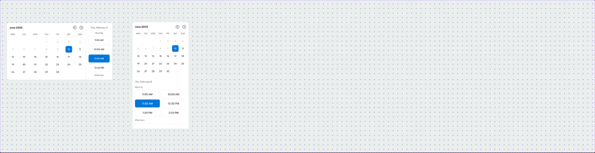

# Calendar (date + time-slot picker)



## Figma
Page `Form` (5613:20164). Set **Calendar** `5742:51202`, 2 variants: `Mobile=False` (5502:7585, 640×345), `Mobile=True` (5742:51203, 342×647). Prop `Time` (bool, true) shows the time-slot column.
Unpublished parts: `_Header - Calendar` (5502:7569), `Legend - Calendar (Day)` (5502:7574), `Button - Calendar (Date)` (5502:7576, 4 variants).

## Purpose
Appointment scheduling (test drive, delivery, first service): month grid to pick a date plus a scrollable list of time slots grouped by day-part.

## Anatomy (Mobile=False)
```
Calendar  H, r8, bg bg/default, 1px border/default
├─ _Calendar (date)  480×345  V, padding 16, gap 8
│  ├─ Calendar Header  H gap 16: Month "June 2025" body/1/bold text/default (fill) + nav (2 × icon-24 chevrons, gap 16)
│  └─ Calendar Body  V gap 6
│     ├─ Legend row  H space-between: MON TUE WED THU FRI SAT SUN (40×40 cells, body/3/regular text/subtle)
│     └─ 5 × Row - Dates  H space-between, gap 8: 7 × Button - Calendar (Date) 40×40 r8
├─ Line 1px border/default (vertical divider)
└─ _Calendar (time)  160×345  V, padding 16, gap 8
   ├─ Date Header "Thu, February 8" body/2/medium text/subtle
   └─ Date Body V gap 8 (scrolls)
      ├─ "Morning" body/3/medium text/variant
      ├─ Toggle group tab-item (medium, 128×48, r8, 1px border/default) "9:00 AM", "10:00 AM", "11:00 AM" (selected), "12:30 PM"
      ├─ "Afternoon" … more slots (17 more siblings)
```
Time slots reuse the atomic Toggle tile [.aec-toggle-group item]; selected = primary bg (#0077d9) with inverse text.

## Date cell states (`Button - Calendar (Date)`)
| State | bg | text |
|---|---|---|
| Default | bg/default | body/2/regular text/default |
| Active (selected) | primary/default | body/2/medium text/inverse |
| Disabled (past) | bg/default | body/2/regular text/disabled |
| Hidden (outside month) | bg/default | text hidden (placeholder "X") |
Example in default: 1–9 disabled, **10 selected**, 11–30 enabled; leading/trailing blanks hidden.

## Responsive
Mobile (342 wide): stacked vertically — date part (342×334, r8) above time part (342×313), each padding 16.

## Notes
- Header shows "June 2025" while time column says "Thu, February 8" and base header says "February 2023" — inconsistent sample data.
- No hover state for date cells; no explicit "today" marker.
- Empty state frame "No slots available" (2769:113848, icon-40 + text) exists loose on the page.
