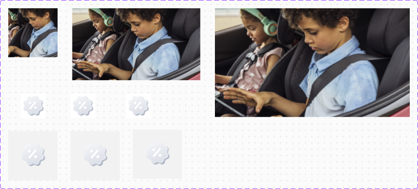
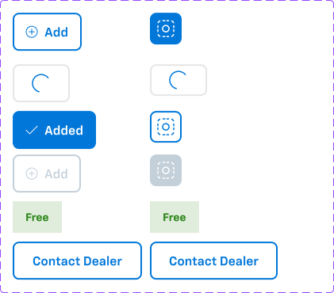
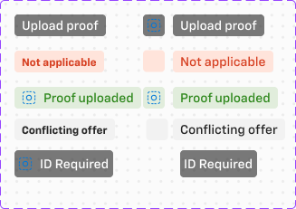
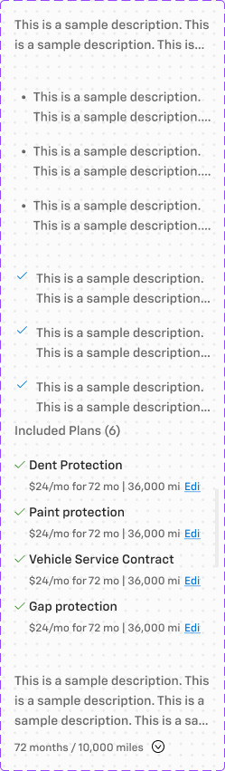
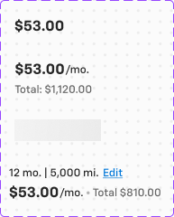

# Card anatomy — shared card parts (Card page)

**Figma**: DR 2.0 – SC GM Chevy Components (`g5hh34klkdaAOzyjoDRDgJ`), page **Card** (`228:105161`).
All parts below live in the section **`_Unpublished base components`** (`2062:75536`) and are NOT published on
their own — they are the building blocks that the published cards (see `card-product.md`, `card-finance.md`,
`card-payment.md`, `card-trade-in.md`, `card-delivery.md`, `card-documents.md`, `card-misc.md`) are made of.
Implement them once as sub-parts (e.g. `.aec-card__media`, `__price`, `__cta`, `__chip`, `__action`).

  
 

## The universal product card shell (`_Card Universal`)
Used by Rebates / Accessories / Charger / Subscription (and, with a header bar, Protection Plans / Packages).

| Region | Desktop (244w) | Mobile (343×128) |
|---|---|---|
| Root | col, bg `bg/default`, 1px `border/default` (drawn as an absolute "Border" rectangle on desktop), radius 0, no shadow | row, same bg/border |
| Media | `Card Media` (top) | `Card Media` 128×128 left column (`Media & CTA`, gap −16 so a chip overlaps the image bottom) |
| Section | col, padding 16 (`container/padding/s`), gap 4–8, space-between: **Main** (Title row + optional `Card - Content`), optional `Terms/mileage`, `CTA` link | col, padding 16, gap 24: Main + Actions |
| Chips | row gap 4, absolutely placed top-right of the card, holds `Card - Chip` | overlaid bottom of media |
| Footer | col: 1px divider (`line`: 16px side inset, `border/default`, r4) + **Actions** row (padding 16, gap 8, align center): `Card price detail` (left) + `card-Button` (right) | Actions row inside Section |

Title: `body/1/bold` `text/default` ("Title"), optional 16px trailing info / external-link icons (hidden by default).
**Selected** state: root border → `action/bg/default` (#0077d9) 1px (Rebates, Charger, Subscription) — Accessories keeps
`border/default` (inconsistency). Card button switches to "Added".

## Card Media — `228:107414` (9 variants)
Axes: `Media type = Icon | Mobile Image | 3 column Image | 2 column Image`, `Mobile`, `Selected`, `Disabled`.
- Icon desktop: 72×56 frame, padding 8/16/0/16, centred icon (generic product glyph). Mobile icon: 96×96 (128×128 in cards), bg `bg/variant`.
- 3 column Image: 244(249)×141, image fill. 2 column Image: 379×213. Mobile Image: 96×96 (128 in cards).
- Base layer `_Card -Media` bg `bg/default`; image slot = product photography (do not export).
- Selected / Disabled variants only exist for Icon type (disabled = faded icon).

## Card price detail — `228:107394` (4 variants)
`Type = Price | Price & Total | Month & miles | Loading`; boolean `Info icon`.
- **Price**: "$53.00" `heading/5` `text/default` (+ hidden 16px info icon). Rebates use "$53 off".
- **Price & Total**: "$53.00" `heading/5` + "/mo." `body/3` `text/subtle`; second line "Total price: $420.00" `body/3` `text/subtle`.
- **Month & miles**: line 1 "12 mo. | 5,000 mi." + `Link` small/primary "Edit"; line 2 "$53.00 /mo. • Total $810.00".
- **Loading**: grey skeleton bar (128×24).

## CTA — `228:107409`
`Type = Link Button | Contained Button`. Link Button = atomic **Link** (size small, style brand) "More details" / "Learn More"
→ `.aec-link`. Contained = `Button - Primary` → `.aec-btn`.

## card-Button — `2369:57044` (12 variants)
Built on atomic **Toggle Button Option 1** (size large) → reuse `.aec-toggle` / `.aec-btn`.
Axes: `Icon button`, `Default`, `Selected`, `Disabled`, `Contact dealer`, `Loading`, `Free`.
| State | Look |
|---|---|
| Default | outline: 2px `primary/default` border, `primary/default` text, ⊕ 16px icon + "Add", h48, padding 16, r8 |
| Selected | filled `action/bg/default`, white ✓ + "Added" |
| Loading | outline `border/default`, spinner only (72w) |
| Disabled | `border/disabled` outline, ⊕ "Add" in `text/disabled` |
| Free | `success/subtle` bg tag, "Free" `body/2/bold` `success/default` (not a button) |
| Contact dealer | full-width outline button "Contact Dealer" |
Icon-button variants are 40×40 squares with the same colour logic.

## Card - Chip — `228:106364` (14 variants)
Instance of atomic **Chip - Information** (size small, variant primary, emphasis off) → `.aec-chip` (info).
Labels: `Upload Proof`, `ID Required`, `Conflicting Offer`, `Not applicable`, `Proof uploaded`; each as icon+label,
label only or icon only (24×24). Note: in the cards the chip renders dark (fill `backdrop/default` #000@52%, white text) —
i.e. an overlay chip on top of media, not the light info chip.

## Card - Content — `228:106324` (5 variants)
Body region below the title. Axes: `Standard | Unordered List | Styled List | Image list | Dropdown`; booleans
`Plan/List 1–4`, `Scroll`, `Customize`, `View more`, `Terms/miles`.
- Styled List: rows of 16px check icon + text, gap 8, rows gap 16; text `body/2/regular` `text/subtle`.
- Unordered List: bullet list (used in Protection Plans), padding 16, gap 16.
- Standard: single paragraph (44h). Image list: "Included Plans (6)" + `Protection plan cards` rows (plan name, "$24/mo for 72 mo | 36,000 mi" + Edit link) with a scroll bar. Dropdown: list with an `.aec-field` select.
Sample copy: "This is a sample description. This is a sample description. This is a sample description."

## Other shared base parts (unpublished)
- **summary Card - Action** `228:106355` — `Button - Primary` small: Default / Select / Selected / Disabled (used in Summary cards).
- **Card - Finance** `228:106249` — trade-in valuation row: `tradebook-logo` (KBB/Black Book image slot 120×64) + "Kelley Blue Book" / "$5,000.00" + `Button - Primary` large "Apply Trade-In"; acknowledgement `Checkbox with Label`. Desktop 920×96, mobile 327×160. Border `border/default`, padding 16.
- **Card - Finance CTA** `443:139740` — `Button - Primary` small outline "Apply trade-in" / Selected / link.
- **Media - Trade-In** `228:106521` — vehicle thumbnail slot (88×48 / 160×90, bg `bg/variant`).
- **Selectors** `3047:137827` — 120×64 payment-type tile: 16px icon + label `body/2/bold`; selected = 1px `primary/default` border + drop shadow + primary text.
- **Segment control (with price)** `228:107371`, **Payment method** `228:107378` (select + "Share Offer" link), **package-header-color** `2761:168915` (12 tinted header backgrounds 250×80 with a decorative shield graphic; colour 1 = #ececf8, no token) + **Protection package header** `2761:168973`.
- Delivery: **Delivery Card-Title** `254:21989`, **Delivery Card-Details** `254:21425`, **DeliveryCard-bottom** `254:23911`, **delivery-card-content** `607:58696`, **Map** `228:106828`.
- Documents: **Doc Icon** `228:105507` (Default/Uploaded/Loading/Failed), **Document info** `2481:200477`, **Document status** `2481:200482`, **Signature Row/Status/type**, **List - Upload (+Status)**, **Link - Upload**, **Upload - Illustration**, **File (Dragged)**, **Loader** (16px spinner), **Icon - Upload Menu**.
- Summary rows: **Summary Header**, **_Row / Row**, **Finance Summary Header**, **Row column**, **cell / _cell**.
- OTP: **OTP digit fields** `228:107164`, **OTP Error comp** `228:107177`. **password conditions** `228:106886`.
- Car-angle placeholders `car-*-img` (13 × 260×148) used by `Card - Upload Image`; **Media placeholder illustrations** `228:106635`.

## Notes
- Cards use **radius 0** almost everywhere (exceptions: payment-method (new) r8, Payment Summary r8, Credit app r8, Upload Image r4).
- Atomic instance fills come through as raw hex in the instance (#0077d9, #ffffff) — they map to `action/bg/default`, `bg/default`.
- Mobile variants of Protection Plans / Packages are identical in size (379w) to desktop.
