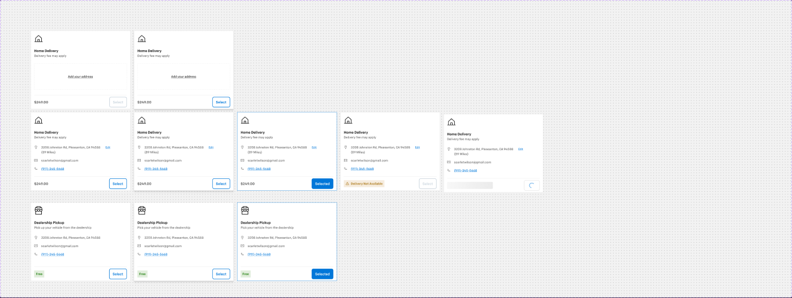
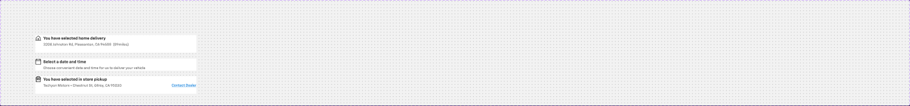
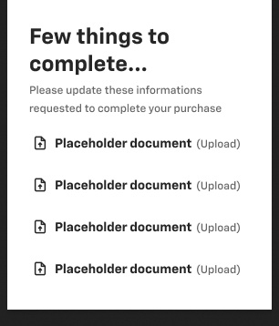
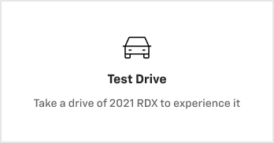
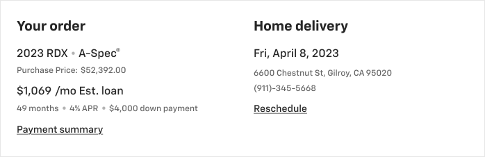

# Delivery & scheduling cards — Card - Delivery Method, Card - Delivery selected, Schedule Delivery-, Schedule Appointment card, Scheduling summary card

**Figma**: page Card (`228:105161`), file `g5hh34klkdaAOzyjoDRDgJ`. Shared parts: `card-anatomy.md` (Delivery Card-Title / -Details / DeliveryCard-bottom, delivery-card-content, card-Button).

| Set | Node | Variants | Axes | Non-variant props |
|---|---|---|---|---|
| Card - Delivery Method | `280:21037` | 10 | Store Pickup, Hover, Selected, Not Available, Add Address, Loading state | — |
| Card - Delivery selected | `228:105647` | 3 | Property 1 = home delivery \| in store \| Date and time | — |
| Schedule Delivery- | `936:62170` | component | — | `scroll bar` |
| Schedule Appointment card | `1139:62092` | component | — | `Selected` (bool) |
| Scheduling summary card | `5929:46706` | component | — | — |

## 1. Card - Delivery Method
**Purpose**: choose Home Delivery vs Dealership Pickup on the Delivery step.
**Anatomy (455×359)**: `DeliveryCard` col p16/16/0/16 gap 24, bg #ffffff (`bg/default`), 1px `border/default`, r0.
- `Delivery Card-Title` (col gap 24): 40px `HouseLine` icon (store icon for pickup), "Home Delivery" `heading/5` `text/default`, "Delivery fee may apply" `body/2/regular` `text/variant`.
- Body: either **Add Address** placeholder (dashed-look box 423×120, 1px `border/default`, p24/32, centred underlined link "Add your address") or `delivery-card-content` Filled: icon rows (16px pin / mail / phone, gap 8) "3208 Johnston Rd, Pleasanton, CA 94588 (89 Miles)" `body/2/regular` `text/subtle` + "Edit" (12px link, underline, `primary/default`), "scarletwilson@gmail.com", "(911)-345-5668" (14px underlined `primary/default` link).
- `DeliveryCard-bottom` (top divider, h65): price "$249.00" `heading/5` `text/subtle` (Pickup: green "Free" tag) + **card-Button** "Select".
**States**: Hover → `shadow/l`; Selected → border `action/bg/default` + button filled "Selected"; Not Available → warning tag "⚠ Delivery Not Available" (`warning/subtle` bg) + disabled Select; Loading state → price skeleton + button spinner; Add Address → Select disabled (Hover variant enabled).
**Content (Pickup)**: "Dealership Pickup", "Pick up your vehicle from the dealership" (hover/selected variants say "Pick your vehicle from the dealership" — copy drift).

## 2. Card - Delivery selected
**Purpose**: compact confirmation line of the chosen delivery option / date prompt.
**Anatomy (640×72)**: row pb24 gap8, `bg/default`, bottom border `border/default`. 24px icon + col gap 2: title `body/1/bold` `text/default`, description `body/2/regular` `text/variant`.
- home delivery: "You have selected home delivery" / "3208 Johnston Rd, Pleasanton, CA 94588 (89miles)".
- in store: "You have selected in store pickup" / "Tachyon Motors • Chestnut St, Gilroy, CA 95020" + `Link` medium brand "Contact Dealer" right.
- Date and time (640×48, no border): calendar icon, "Select a date and time" / "Choose convenient date and time for us to deliver your vehicle".

## 3. Schedule Delivery-
**Purpose**: despite the name, a floating "Few things to complete…" panel listing pending documents to upload before delivery/purchase.
**Anatomy (290×340)**: col p24 gap8, `bg/default`, `shadow/l`. "Few things to complete..." `heading/3`; "Please update these informations requested to complete your purchase" `body/3/regular` `text/variant`; list of 4 `cell` rows (p10/4, gap 8): upload icon + "Placeholder document" (bold) + "(Upload)" `text/variant`. Optional 4px scroll bar.

## 4. Schedule Appointment card
**Purpose**: selectable appointment type tile (e.g. Test Drive).
**Anatomy (348×182)**: col p40 gap8 centred, `bg/default`, **2px** `border/default`. 40px icon, "Test Drive " `heading/5`, "Take a drive of 2021 RDX to experience it" `body/2/regular` `text/variant`. `Selected` boolean shows a hidden overlay rectangle (selected border; expect `action/border/active`).

## 5. Scheduling summary card
**Purpose**: post-scheduling confirmation summary (order + delivery appointment).
**Anatomy (698×226)**: `bg/default`, 1px `border/default`, two columns 309w (absolute positioned, ~24 padding):
- "Your order" `heading/4`: "2023 RDX • A-Spec®" `body/1/regular`; "Purchase Price: $52,392.00" `body/3/regular` `text/variant`; "$1,069 /mo Est. loan" `body/1/regular`; "49 months • 4% APR • $4,000 down payment" `body/3/regular` `text/variant` (bullets `text/disabled`); `Link` medium neutral "Payment summary".
- "Home delivery" `heading/4`: "Fri, April 8, 2023" `body/1/regular`; "6600 Chestnut St, Gilroy, CA 95020", "(911)-345-5668" `body/3/regular` `text/variant`; link "Reschedule".

## Responsive
No mobile variants exist for any delivery card; 455-wide Delivery Method cards are shown in a 2-up grid and should stack on mobile.

## Notes
- Several icon colours are raw #000000 (icons inside instances) → use `icon/default`.
- "Schedule Delivery-" name has a trailing hyphen and does not describe the content.
- Schedule Appointment copy mentions "2021 RDX" (Acura sample data in a Chevy file).
