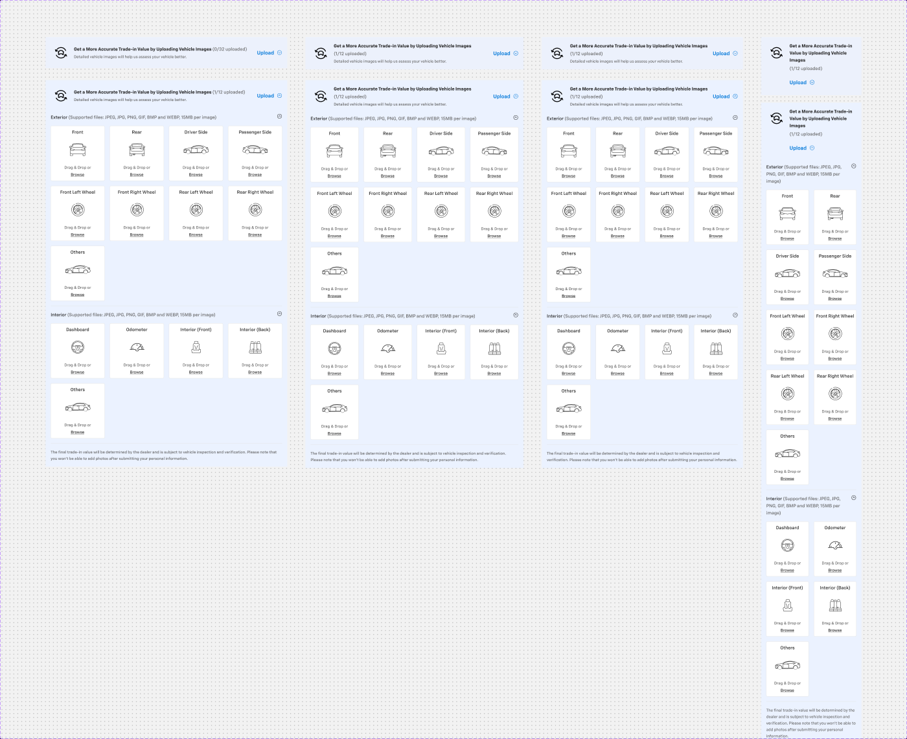
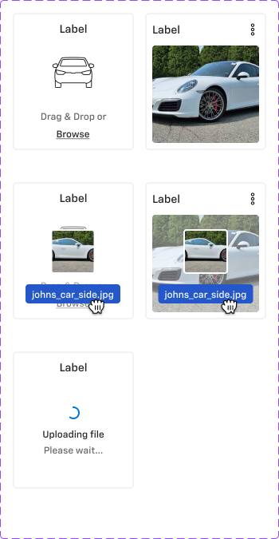

# Document cards — Card - Document Upload, Document Summary, Signature Document card listing, Document sections, Trad-in photo upload, Card - Upload Image

**Figma**: page Card (`228:105161`), file `g5hh34klkdaAOzyjoDRDgJ`. Shared parts: `card-anatomy.md` (Doc Icon, Document info, Document status, List - Upload, Loader, car-angle placeholders).

| Set | Node | Variants | Axes | Non-variant props |
|---|---|---|---|---|
| Card - Document Upload | `228:105548` | 8 | Mobile, Default, Success, Uploading, Error | — |
| Document Summary | `389:87232` | 2 | Mobile | `Edit Signature`, `Co-buyer` |
| Signature Document card listing | `2481:200456` | 2 | Mobile | `Action`, `Document status`, `Doc Icon` |
| Document sections | `2481:201668` | component | — | `Actions`, `Expand/Collapse`, `Seperator` |
| Trad-in photo upload | `9139:94178` | 8 | Web 1440, Web 1366, Tab, Mobile, Expand | `Add photos`, `Photo uploaded count` |
| Card - Upload Image | `9217:149388` | 5 | Added, Drag, Uploading | `Photo count`, `Menu `, `Car Image` (instance swap) |

## 1. Card - Document Upload
**Purpose**: tile for a required document (e.g. Employment Proof) in the Documents step; shows upload progress/status.
**Anatomy (desktop 236×166)**: col p24/16 gap24, centred, bg `bg/variant` (outer frame `bg/default`), no border, r0.
- `Doc Icon` 40×48 (document glyph + status badge: none / green ✓ Uploaded / spinner Loading / red Failed).
- Header: title row "Employment Proof" `heading/6`-ish + 16px info icon; status line.
- Optional 24px kebab (more) icon top-right in Success/Error.
**States / copy**: Default "Offer letter and 3 months payslip" (`text/subtle`); Success "Uploaded" (`success/default`); Uploading "2/2 Uploading..." (`primary/default`) + "View" link; Error "1/3  failed" (`error/default`, double space) + "Re-Upload" link.
**Mobile (343×80)**: horizontal row — doc icon, title + status, trailing chevron-circle (Default/Uploading) or kebab (Success/Error).

## 2. Document Summary
**Purpose**: counters at the top of the e-signature step.
**Anatomy (780×72)**: row of 3 equal sections inside a frame with `bg/default` + 1px `border/default`; each section col p12/8 gap4 centred: count `body/1/bold` `text/default` ("10", "0/10", "10") + label `body/3/regular` `text/variant` ("Total Documents", "Signed by you", "Signed by Dealer"). Hidden 4th section (`Co-buyer`, "0/4") and hidden "Edit Signature" block (148w, `Link` medium neutral). Mobile 343×76.

## 3. Signature Document card listing
**Purpose**: one document row in the signing list.
**Anatomy (780×60)**: row p8/0 gap24 centred. Hidden 40px document icon; details: "Balance Presentation Disclosure" `body/2/medium` `text/default` + `Document info` (Acknowledged) "Acknowledged on 1 Aug, 2023 11:59 PM" (`body/3` `text/variant`); `Document status` (Not Started) "0/3 signed"; **Button - Standard** small "View". Mobile 343×114 (status + button wrap below).

## 4. Document sections
**Purpose**: group header for signing lists (e.g. Completed documents) with expand/collapse.
**Anatomy (780×80)**: `bg/default`; optional top separator; row p16/0 gap24: "Completed documents" `heading/5` + **Button - Primary** medium filled "Start signing" + 32px dropdown-arrow toggle.

## 5. Trad-in photo upload
**Purpose**: trade-in photo-upload prompt that expands into the categorised photo grid.
**Anatomy (Web 1440 collapsed 749×96)**: col p16 gap24, bg **`info/subtle`** (#ebf2ff). Header row gap 8: 64px icon frame with 40px `Tradein` icon; text col: "Get a More Accurate Trade-in Value by Uploading Vehicle Images" `body/2/bold` + "(0/32 uploaded)" `body/2/regular` `text/variant`, "Detailed vehicle images will help us assess your vehicle better." `body/3/regular` `text/subtle`; **Button - Primary** small plain "Upload" + chevron.
**Expanded (749×1198)**: `_Sidesheet - Doc upload Content`: section "Exterior (Supported files: JPEG, JPG, PNG, GIF, BMP and WEBP, 15MB per image)" with collapse caret; 4-column grid of **Card - Upload Image** tiles (Front, Rear, Driver Side, Passenger Side, Front Left Wheel, Front Right Wheel, Rear Left Wheel, Rear Right Wheel, Others); section "Interior (…)" (Dashboard, Odometer, Interior (Front), Interior (Back), Others); footer note "The final trade-in value will be determined by the dealer and is subject to vehicle inspection and verification. Please note that you won't be able to add photos after submitting your personal information."
**Responsive**: Web 1366 676w, Tab 624w (still 4 columns), Mobile 311w (2 columns, header stacked, Upload under text).

## 6. Card - Upload Image
**Purpose**: single photo slot in the photo-upload grid.
**Anatomy (150×170)**: col p8 gap8 centred, **r4**, `bg/default`, 1px `border/default`. "Label" `body/2/medium` `text/default`; content: car-angle placeholder illustration 134×72 (instance-swap `Car Image`) + "Drag & Drop or" `body/3/regular` `text/variant` + `Link` small neutral "Browse".
**States**: Uploading → `Loader` spinner + "Uploading file" (bold) / "Please wait..."; Drag → dragged `File (Dragged)` thumbnail + blue filename pill "johns_car_side.jpg" over the slot; Added → uploaded photo fills the slot (r4) + kebab menu (Re-upload / Delete) and optional photo-count badge "4"; Added+Drag → replace by dropping.

## Exported assets
Car-angle placeholder line illustrations (generic, 260×148 SVG, stroke `#262626` = `icon/default`) exported to
`assets/patterns/card-upload/`: car-front, car-rear, car-driver-side, car-passenger-side, car-front-left-wheel,
car-front-right-wheel, car-rear-left-wheel, car-rear-right-wheel, car-other, car-dashboard, car-odometer,
car-interior-front, car-interior-back (`*-img.svg`). The Figma section background rectangles that leaked into the export were stripped.
Uploaded-photo samples (vehicle photography) are NOT exported.

## Notes
- Set name typo "Trad-in photo upload"; prop "Seperator"; "Menu " has a trailing space.
- Upload count copy inconsistent: "(0/32 uploaded)" vs "(1/12 uploaded)".
- No mobile variant for Document sections / Card - Upload Image.
