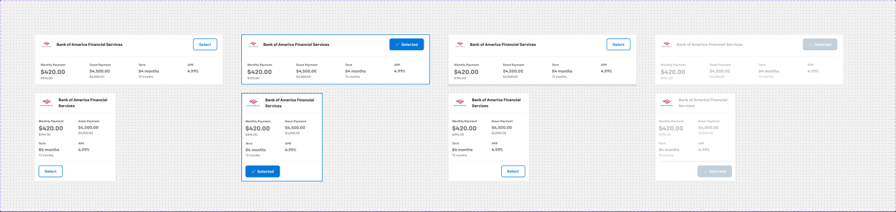
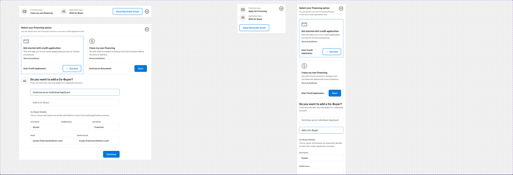
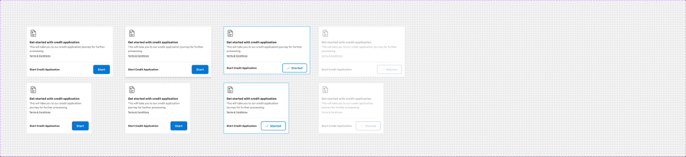
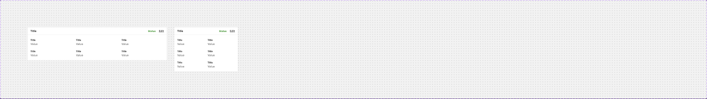
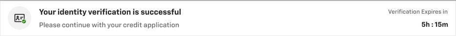
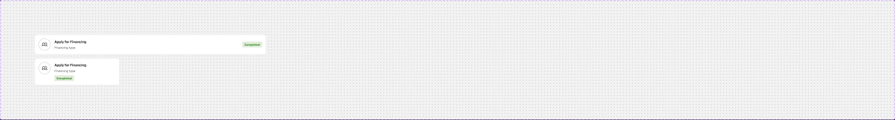
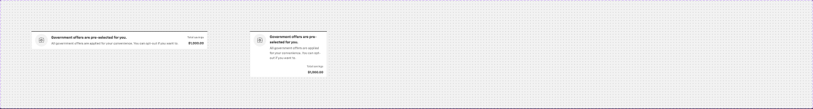

# Finance cards — finance offers, Finance & Payment selection, Financing info, Financing summary table, Finance success info, Credit app card, Offers card selected view

**Figma**: page Card (`228:105161`), file `g5hh34klkdaAOzyjoDRDgJ`. Shared parts: `card-anatomy.md`.

| Set | Node | Variants | Axes | Non-variant props |
|---|---|---|---|---|
| Card - finance offers | `228:105934` | 8 | Default, Hover, Selected, Disabled, Mobile | `Chip`, `Info`, `Disclaimer`, `Expanded`, `CTA` |
| Card - Finance & Payment selection | `408:54875` | 4 | Expanded, Mobile | `Reminder Sent`, `Reminder Email CTA`, `Co-Buyer`, `Buyer`, `2nd-row-icon` |
| Card - Financing info | `360:120187` | 8 | Default, Hover, Selected, tab & mobile, Disabled | `CTA`, `Terms & Conditions`, `CTA Support text` |
| Financing - Summary table | `228:105922` | 2 | Mobile | `2 Rows` |
| Finance success info | `409:62941` | 1 (component) | — | — |
| Credit app selection and status card | `2374:229644` | 2 | Mobile | `Status`, `completed chip`, `Reminder Sent`, `CTA` |
| Offers card selected view | `1152:72633` | 2 | Mobile | `Status` |

## 1. Card - finance offers
**Purpose**: one lender offer (lender logo + monthly / down / term / APR) the shopper selects on the Financing step.
**Anatomy (desktop 760×202)**: root col, padding 16/24, gap 16, bg `bg/default`, 1px `border/default`, r0.
- Top row (712×48, gap 16, centred): `media - available offer` (lender logo slot 48×40, e.g. Bank of America — image slot, do not export) + lender name `heading/5` `text/default`; hidden `info` + `Chip - Information`; **Button - Primary** large outline "Select" (`.aec-btn` secondary-outline style).
- Details (padding-top 24, top divider 1px `border/default`): 4 columns, space-between, gap 40: label `body/3/bold` `text/variant`; value `heading/3` (monthly) / `heading/5` (others) `text/subtle`; previous value `body/3/medium` `text/variant`.
- Hidden full-width `Chip - Information` (disclaimer) at the bottom.

**States**: Hover → `shadow/l`; Selected → border 2px `action/bg/default`, button filled "✓ Selected"; Disabled → all text `text/disabled`, button filled-disabled "Selected", mobile border `border/disabled`. "Selected by dealer" label appears in Default/Selected.
**Content**: "Bank of America Financial Services", "Select", "Monthly Payment $420.00 ($396.00)", "Down Payment $4,500.00 ($3,800.00)", "Term 84 months (72 months)", "APR 4.99% (4.5%)".
**Responsive**: mobile 327×358 — name wraps under logo, details become 2×2 grid, button moves to bottom-left.

## 2. Card - Finance & Payment selection
**Purpose**: collapsible summary/entry card for the financing step (buyer & co-buyer financing type, reminder email); expands into the full "Select your financing option" chooser.
**Collapsed (934×80)**: row, padding 16, gap 16, `bg/default`, 1px `border/default`. Left: Buyer block (24px icon + "Financing type:" `body/3/medium` `text/variant` / "I have my own financing" `heading/6` `text/default`), vertical 1px `border/default` line, Co-Buyer block ("Application type:" / "With Co-Buyer"); right: **Button - Standard** small "Send Reminder Email" (hidden "Email sent" status) + 32px `CaretCircleDown` toggle.
**Expanded (934×963)**: `Form - Header` "Select your financing option" + "You can opt for your own third…", **Toggle group tab-item** (Buyer / Co-Buyer → `.aec-toggle-group`), two `Card - Financing info` cards (Selected + Default) side by side, `Inline footer`.
**Mobile**: 343×208 collapsed (blocks stacked), 343×1608 expanded (cards stacked).

## 3. Card - Financing info
**Purpose**: option card inside the financing chooser (e.g. "Get started with credit application" vs own financing).
**Anatomy (455×269)**: col, `bg/default`, 1px `border/default`, r0.
- Icon row p16/16/0/16: 40px icon (`ApplyCredit`).
- Content p16/16/24/16 gap 2: title row `heading/5`-ish "Get started with credit application", body `body/2/regular` `text/variant` "This will take you to our credit application journey for further processing.", `Link` small neutral "Terms & Conditions".
- Divider 1px `border/default` (16 inset).
- Footer p16 gap 4, right aligned: "Start Credit Application" `heading/6` + **Button - Primary** large filled "Start".
**States**: Hover → `shadow/l` (border token shows `bg/variant` — likely mistake); Selected → border `action/bg/default` 1px, button becomes outline; Disabled → link + button disabled. tab & mobile = 343 wide.

## 4. Financing - Summary table
**Purpose**: read-only summary block of finance details (review/summary page).
**Anatomy (714×172)**: col, 1px `border/default`. `Finance Summary Header` (row p8/16 gap16, bottom border): "Title" `heading/6`, "Status" `body/3/bold` (`success/on-subtle` — token not in our list, map to `success/default`), `Link` medium neutral "Edit". Rows container p8/0: `Row column` ×2 (p8/16, gap 16) each 3× `_Item - Summary` (label "Title" `body/3/bold` `text/default` / "Value" `body/2/regular` `text/variant`).
**Mobile**: 327×230, items stack/wrap. `2 Rows` toggles the second row.

## 5. Finance success info
**Purpose**: status banner after identity verification in the credit app.
**Anatomy (934×74)**: row p12/16 gap16 space-between, `bg/default`, 1px `border/default`. Left: 48px circle (`bg/variant`, r full) with 24px icon + 12px success status badge; text "Your identity verification is successful" `body/1/bold` + "Please continue with your credit application" `body/2/regular` `text/variant`. Right (end-aligned): "Verification Expires in" `body/3/regular` `text/variant` / "5h : 15m" `body/2/bold`.

## 6. Credit app selection and status card
**Purpose**: status row for the credit application task (e.g. "Apply for Financing — Completed").
**Anatomy (934×80)**: row p16 gap16, **r8**, `bg/default`, 1px `border/default`. 48px circular icon frame (r80, 1px `border/variant`, 24px icon, hidden status badge); Information: "Apply for Financing" `heading/6` / "Financing type: …" `body/3/medium` `text/variant`; **Chip - Information** small *success* "Completed" (`success/subtle` bg, `success/default` text → `.aec-chip` info success); hidden `Button - Primary` CTA and "Email sent" status. Mobile 343×108 (chip wraps under text).

## 7. Offers card selected view
**Purpose**: collapsed summary of pre-selected incentives/offers ("Government offers are pre-selected for you").
**Anatomy (782×80)**: row p12/16 gap16, `bg/default`, 1px `border/default`. 56px circle icon (`bg/variant`), content "Government offers are pre-selected for you." `body/1/bold` + "All government offers are applied for your convenience…" `body/2/regular` `text/variant`; right `_Card offers selected view footer` (Price): "Total savings" `body/3/medium` `text/variant` / "$1,000.00" `heading/6`. Mobile 342×206 uses footer type *Timer*.

## Notes
- Primary/standard buttons are atomic: `Button - Primary` (filled/outline) → `.aec-btn--primary` / outline; `Button - Standard` → `.aec-btn` standard (white bg, 2px primary border).
- Root borders on Offers selected view are also reported as `text/default` strokes on the outer frame (hidden/mixed) — implement the inner 1px `border/default`.
- Lender logos (Bank of America etc.) are image slots; do not copy.
