# Misc cards — Summary, Bottom Toast, Contact dealership, communicate card, Not a robot, Conflict Resolution, Mobile Inspection, Vehicle info card, OTP, Image, Tooltip, password conditions

**Figma**: page Card (`228:105161`), file `g5hh34klkdaAOzyjoDRDgJ`. Shared parts: `card-anatomy.md`. (Card - My Garage is in `card-trade-in.md`.)

| Set | Node | Variants | Axes | Non-variant props |
|---|---|---|---|---|
| Summary | `228:105251` | 2 | Device=Desktop\|Mobile | `Alternative BG`, `Actions`, `Estimate amount`, `Image`, `Multiple Actions`, `Loader`, `Secondary Information`, `Icon`, `Description` |
| Bottom Toast | `228:105466` | 6 | Expanded, Mobile, Tab, Web | `Section-2`, `Failed status` |
| Card - Contact dealership | `6057:10251` | component | — | `Show Map`, `Show Border` |
| communicate card | `5785:38773` | component | — | — |
| Not a robot | `228:105778` | component | — | instance-swap (logo) |
| Conflict Resolution  (trailing space) | `228:105314` | 4 | packages, Mobile | `Protection card 2`, `Protection card 3` |
| Conflict Resolution /Summary details | `5813:34734` | component | — | — |
| Card - Mobile Inspection | `5502:5683` | component | — | — |
| Vehicle info card | `2806:165775` | component | — | — |
| OTP | `3199:137651` | 8 | Default, Success, Error, Active, Mobile | — |
| Image | `228:105831` | 5 | Web (1440), Web (1366), Tablet (1024), Tablet, Mobile | — |
| Tooltip | `228:106266` | 2 | Mobile | — |
| password conditions | `5793:39528` | component | — | — |

## Summary
**Purpose**: generic one-line summary row (label + description + action) used for collapsed steps; Card - Payment Summary is a sibling.
**Desktop (600×56)**: row p16 gap16, `bg/default`, layered drop shadow (5 shadows ≈ `shadow/s`), r0. Main: 20px icon + "Label" `heading/6` + "Description" `body/2/regular` `text/subtle` (+ optional ", Secondary Information"); right: `Link` medium neutral "Action" (optional second link). Hidden: image (48×20 `Media - Trade-In`), `Loader`, "Estimate amount", alternative bg.
**Mobile (327×116)**: icon + stacked Label / Description; Action link bottom-right.
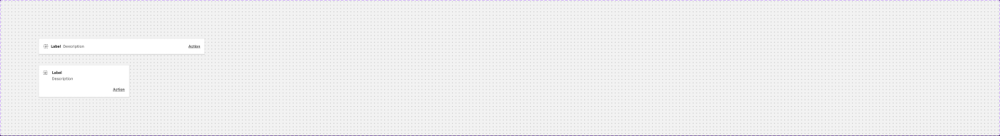

## Bottom Toast
**Purpose**: persistent upload-progress toast (documents upload) at the bottom of the screen.
**Collapsed (327×56; mobile 48h)**: row p16 gap8, bg **`bg/inverse`** (#262626), r0. `Loader` 16px + "2/4" `heading/5` `text/inverse` + "Upload in progress" `body/2/regular` `text/inverse` (+ hidden "1 failed") + 24px chevron-circle toggle.
**Expanded (327×176)**: list header "Reference" + `List - Upload` rows (file icon + "reference_1.pdf" + status `List - Upload - Status`: "Uploaded" green, "44% uploading…" , "Upload failed" red). Web: list above the bar; Tab: list below the bar.
→ similar to `.aec-snackbar` (inverse surface).
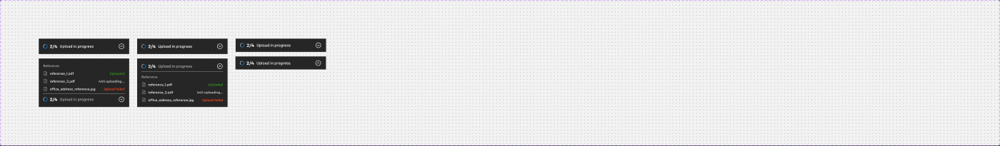

## Card - Contact dealership
**Purpose**: dealership contact details with map.
**Anatomy (714×184)**: row p16 gap24, `bg/default`, 1px `border/default` (Border rect, prop `Show Border`). Content col gap16: "Tachyon Motors" `heading/5` `text/subtle`; list gap8 of icon rows (12px icon, gap16): "6600 Chestnut St, Gilroy, CA 95020" `body/2/regular`, "scarletwilson@gmail.com" `body/2/link`, "(911)-345-5668". Right: `_Map` 226×152 r4 (map image slot; prop `Show Map`).
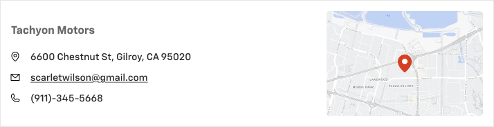

## communicate card
**Purpose**: contact-preference picker. 473×110, p24/0 gap16, `bg/default`, bottom border. "I prefer to communicate via:" `heading/6` `text/subtle`; row gap16 of 3 `_cell` = **Checkbox** + "Text" / "Call" / "Email" (`.aec-checkbox`).
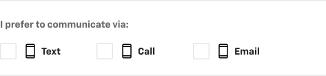

## Not a robot
**Purpose**: captcha placeholder. 257×55, row p8/16 space-between, `bg/default`, 1px `border/default`, drop shadow. **Checkbox** + "I'm not a robot" `body/2/regular`; reCAPTCHA logo (third-party vector, raw blues #1c3aa9/#4285f4 — do not copy; use the real widget).
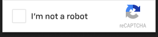

## Conflict Resolution
**Purpose**: inline conflict dialog when a protection selection conflicts with a package (or upsell to complete a package).
**Default (1014×238)**: col p24 gap24, `bg/default`, top border `primary/default` (mixed stroke = 2px top accent), drop shadow. Heading row: "This selection will remove 'Preferred' Package" `heading/4` + 24px close icon. Content 2 cols: "Selected protection Package" `body/2/regular` `text/subtle` / "— Preffered"; "New Selection individual plan" / "+ ThreeForOne Protection". Footer (pt16, top border): **Button - Standard** small "Cancel" + **Button - Primary** large "Confirm".
**packages (1014×466)**: "We recommend you to add these 2 products as well, to make it 'Platinum' package"; 3 product mini-cards (car icon, "Luxcare Surface Protection ↗" bold, "$420.00", "Vehicle protection and convenience when and where you need it.", 1px `border/default`); footer "Platinum Package Price: $1,044*" + `Button - Primary` plain "Learn more" + "Confirm".
**Mobile**: 375 wide, content stacked, buttons 50/50 (default) or link+button.
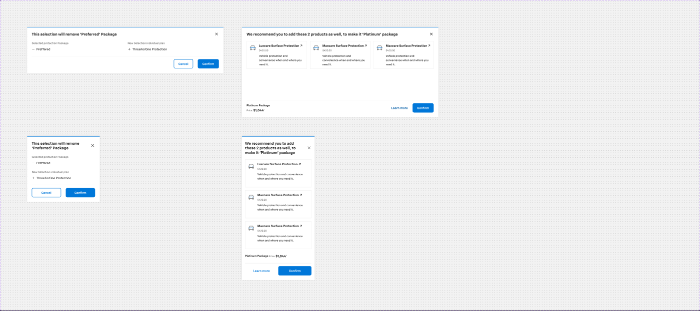

### Conflict Resolution /Summary details (760×384)
`Summary Header` ("Header" + **Chip - Information** "Completed") + "Summary list" of 8 `Row` (p8/0, `bg/default`): "Title" / "Value" pairs, bottom border `border/default`, pb24.
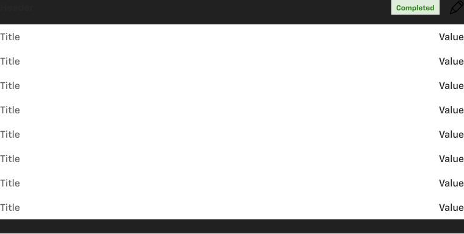

## Card - Mobile Inspection
516×127, row p16 gap12, `bg/default`, 1px `border/default`. "Upload photos from mobile" `body/2/bold`; "Scan the QR and continue. Please ensure that photos/videos are taken under good lighting conditions." 12px regular `text/subtle` (no text style); 95×95 QR code (vector, r4 — placeholder, generate at runtime).

## Vehicle info card
**Purpose**: vehicle + estimated payment summary (review / confirmation).
656×204, row p24 gap8, `bg/default`, 1px `border/default`. Left col gap16: "2025 Blazer EV" + "SS AWD" `heading/5`; "Purchase Price: $60,190" `body/3/medium`; "$1,069" `heading/3` + "/mo Est. loan" `body/1/medium`; "48 months • 5.99% APR • $2000 down payment" `body/3/medium` `text/variant` (bullets `text/disabled`); `Link` medium neutral "Vehicle Details". Right: `Image and share` 300×146 (vehicle photo slot — not exported).
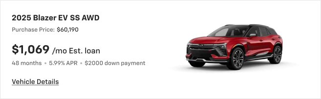

## OTP
**Purpose**: phone verification (OTP entry) block.
**Desktop (694×458)**: col gap24. "Please enter the OTP which was sent to your number (555) 555-1234" `body/1/medium`; white panel (p24/0 gap16, `bg/default`): 200×200 lock-phone illustration (generic), "Enter verification code" `body/3/regular` `text/variant`, `_OTP Error comp` → 6 `OTP digit fields` (square boxes, 1px border), `Link` medium neutral "Resend Code".
**States**: Default empty boxes (`border/default`); Active filled "•" with dark border (`border/variant`/`text/default`); Success boxes `success/subtle` fill + green border, check badge on illustration, "Phone Number Verified" replaces Resend; Error boxes `error/subtle` + `error/default` border, "!" badge, prompt text turns bold.
**Mobile**: 343 wide, smaller boxes.
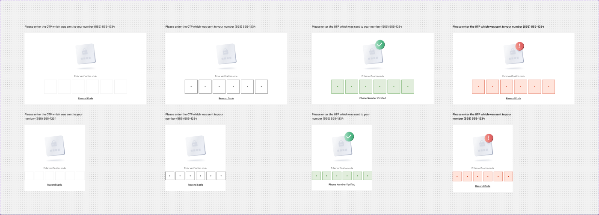

## Image
**Purpose**: hero/vehicle image panel (left column of split layouts). Fill `bg/variant` with a full-bleed IMAGE; sizes 720×844 (1440), 683×844 (1366), 512×768 (1024), 768×312 (tablet), 375×200 (mobile). Content is vehicle photography — screenshot intentionally not saved.

## Tooltip
**Purpose**: "Where to find VIN?" help.
- Desktop (454×122): dark tooltip container row p8 gap18, bg #232323 (no token; nearest `bg/inverse` #262626), 6px arrow at bottom-left; 160×100 VIN illustration (white tile) + "Where to find VIN?" `body/2/medium` `text/inverse` + "The "Vehicle Identification Number" (VIN) is usually located at the base of the windshield or on the driver's door jamb." `body/3/medium` `inverse/text/variant`. → extend `.aec-tooltip` with media.
- Mobile (375×812): bottom sheet over backdrop #000@0.60 (≈ `backdrop/default` 0.52): header "Where is my VIN?" + close (p16/24, bottom border), illustration 327×205 r8, title + description.
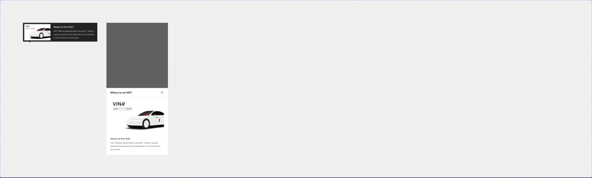

## password conditions
196×68 col gap4: three `_password conditions` rows (icon + text): "Minimum Length: 8 characters", "At least one Uppercase letter (A-Z)", "At 1 number or special character" (sic).
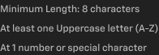

## Notes
- Typos: "Preffered", "At 1 number…", set names "Conflict Resolution " / "Conflict Resolution /Summary details".
- Raw colours without tokens: tooltip #232323, backdrop 60%, reCAPTCHA blues.
- OTP Success variant references a mis-named base variant (`OTP Error comp/False/True/False/False/Fasle`).
