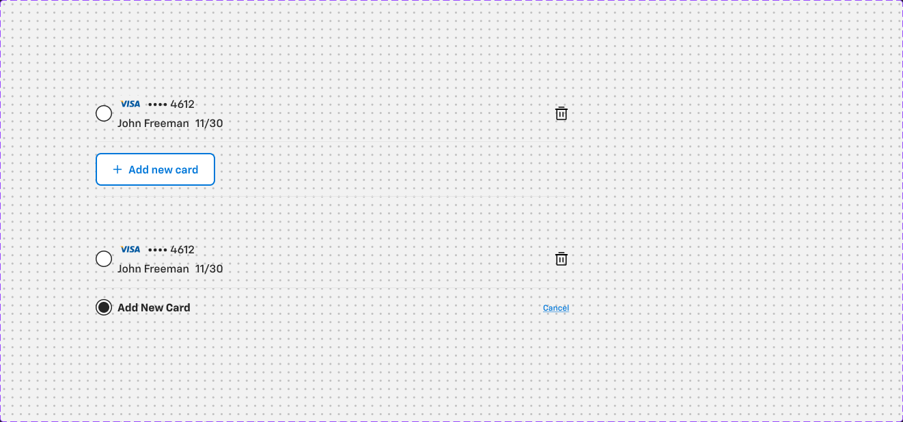
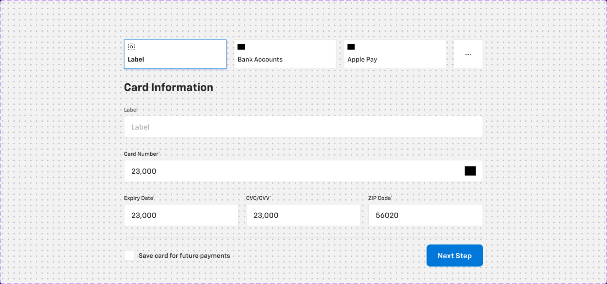
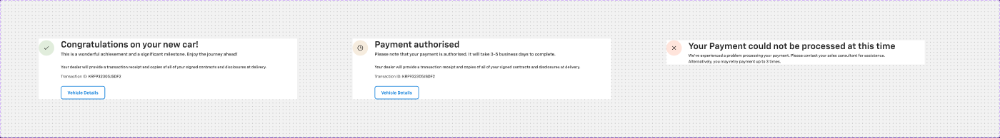
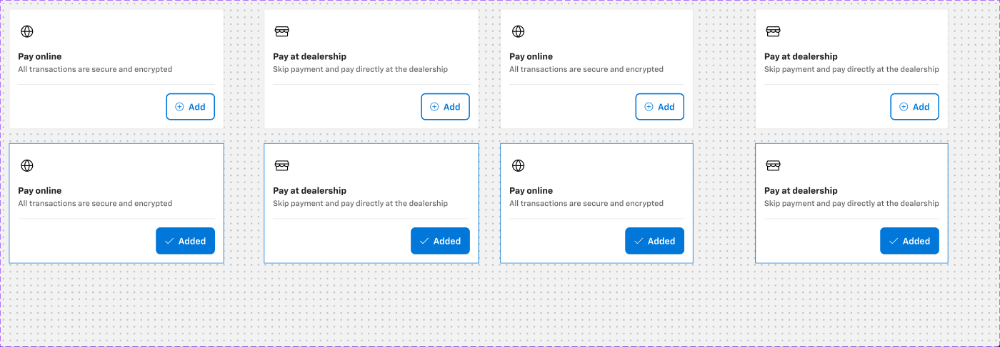
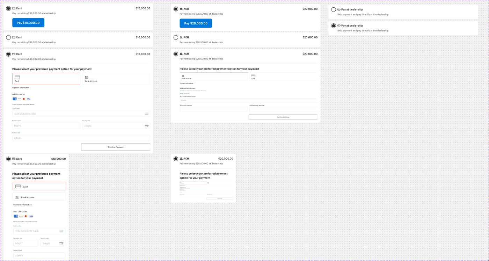
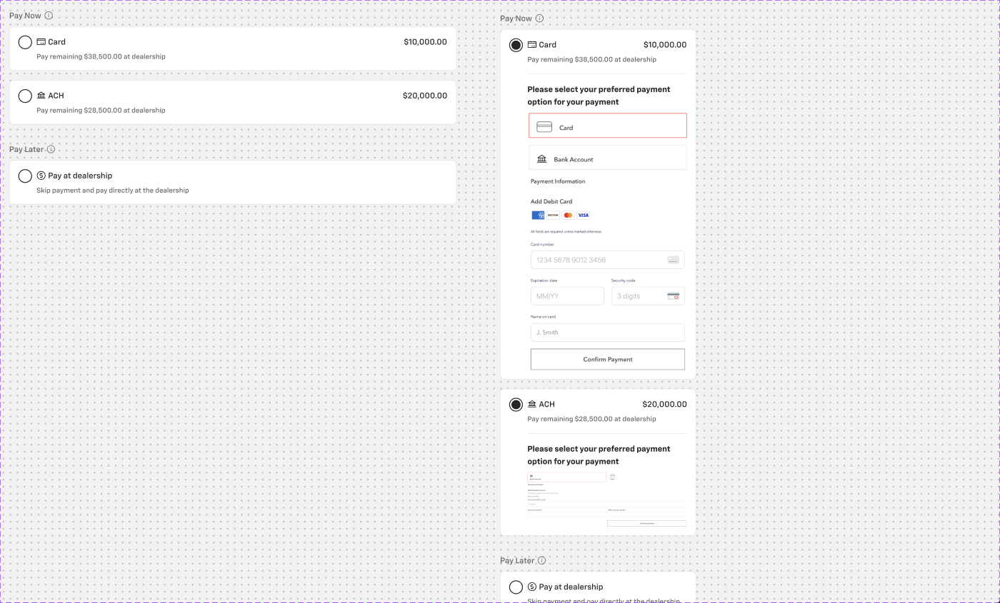
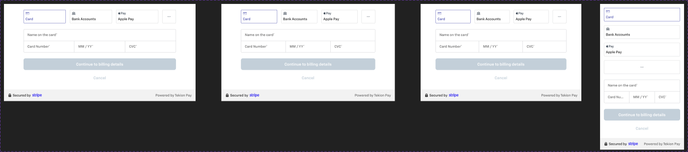
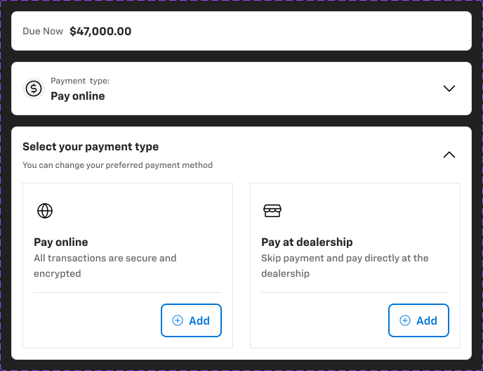

# Payment cards — Card - Payment, Payment-details, Payment type card, Payment processing status, Card - payment method (+ new, CardCollection), Payment - iFrame, Card - Payment Summary

**Figma**: page Card (`228:105161`), file `g5hh34klkdaAOzyjoDRDgJ`. Shared parts: `card-anatomy.md`.

| Set | Node | Variants | Axes | Non-variant props |
|---|---|---|---|---|
| Card - Payment | `850:65469` | 2 | New card added | `Card-2` |
| Payment-details | `3050:159849` | 1 | Property 1=Default | — |
| Payment type card | `862:59885` (and duplicate `2032:16922`) | component | — | `Select` (bool) |
| Payment processing status | `866:61741` | 3 | Success, Warning, Error | — |
| Card - payment method | `3357:38924` | 8 | Pay Online, Selected, Pay at dealership, Mobile | `Card Hover` |
| Card - payment method (new) | `9700:9827` | 10 | Mobile, Type=ACH\|Card\|Pay at dealerahip, Selected, Confirm Payment | — |
| CardCollection - payment method (new) | `9700:12496` | 2 | Mobile | — |
| Payment - iFrame | `3439:42681` | 4 | Web (1440), Web (1366), Tablet (768), Mobile (375) | — |
| Card - Payment Summary | `9164:152738` | 3 | Card variant=Default\|Selected\|Expand | `Prefix`, `Description`, `Icon`, `Secondary Information`, `Multiple Actions`, `Image`, `Loader`, `Actions`, `Alternative BG`, `Estimate amount`, `Expand` |

## 1. Card - Payment (saved cards list)
**Purpose**: choose a saved card or add a new one for the deposit/down payment.
**Anatomy (694×148)**: col, padding-bottom 16, gap 16, bottom border 1px `border/default`.
- Saved card row (row, pb16, bottom divider `border/default`): **Radio button** (`.aec-radio`) + card brand logo slot (VISA) + "•••• 4612" / "John Freeman 11/30" (`body/1/regular` `text/default`) + 24px trash icon (right).
- **Button - Standard** small "+ Add new card" (white, 2px `primary/default` border, r8).
**New card added**: second radio row "Add New Card" (`body/1/bold`, selected) + `Link` small primary "Cancel" right.

## 2. Payment-details
**Purpose**: the card-entry form (inline, non-iFrame) for paying online.
**Anatomy (782×574)**: col gap 24. `Filter` header (782×40); "Payment methods" row gap 16: 3× **Selectors** 223×64 (first selected: 1px `action/bg/default` + drop shadow; others 1px #e4e4e7 — no token, use `border/default`) "Label" / "Bank Accounts" / "Apple Pay" + a 64×64 "More options" kebab tile; "Card Information" `heading/3`; `Text field with button`; **Standard Text Input - Outlined** fields (`.aec-field`): "Card Number*" (with card logo), row of 3: "Expiry Date*", "CVC/CVV*", "ZIP Code*" (gap 16); `Inline footer/Payment`: **Checkbox with Label** "Save card for future payments" + **Button - Primary** large "Next Step" (top border `border/default`, p16/0).

## 3. Payment type card
**Purpose**: small selectable tile (payment type: Card / Bank etc.).
**Anatomy (339×78; duplicate 313×78)**: col p16 gap8, `bg/default`, 1px `border/default`; 24px icon + "Title"/"Card" `body/2/bold` `text/default`. `Select` boolean = selected state (no variant; expected selected border `action/border/active`). Two identical components exist (`862:59885`, `2032:16922`) — duplicate.

## 4. Payment processing status
**Purpose**: result screen block after payment submission.
**Anatomy (934×220)**: col gap 24, `bg/default`. Row gap 24: 56px circular illustration (r128, p16, bg `success/subtle` | `warning/subtle` | `error/subtle`, 24px icon) + title `heading/2` `text/default` + subtitle `body/1/medium`. Indented (pl 80) body `body/2/regular` + "Transaction ID: KRF932305JSDF2" (14px, no style) and **Button - Standard** small "Vehicle Details".
**Variants**: Success "Congratulations on your new car!" / "This is a wonderful achievement and a significant milestone. Enjoy the journey ahead!"; Warning "Payment authorised" / "Please note that your payment is authorised. It will take 3-5 business days to complete."; Error (934×88, no body/button) "Your Payment could not be processed at this time" / "We've experienced a problem processing your payment. Please contact your sales consultant for assistance. Alternatively, you may retry payment up to 3 times." Body copy: "Your dealer will provide a transaction receipt and copies of all of your signed contracts and disclosures at delivery."

## 5. Card - payment method
**Purpose**: choose "Pay online" vs "Pay at dealership" (used inside Card - Payment Summary Expand).
**Anatomy (382×214)**: col p16 gap16, `bg/default`, 1px `border/default` (absolute Border rect), r0. Header: 32px icon (globe / store) + "Pay online" `heading/5` + "All transactions are secure and encrypted" `body/2/regular` `text/variant`. Footer (pt16, top border `border/default`, right-aligned) **card-Button** Default "⊕ Add" / Selected "✓ Added".
Pay at dealership: "Skip payment and pay directly at the dealership". Mobile = 343 wide, same layout. Hidden "Hover" overlay rect (prop `Card Hover`).

## 6. Card - payment method (new) & CardCollection
**Purpose**: newer radio-list payment chooser (Pay Now: Card / ACH; Pay Later: Pay at dealership) with inline payment form.
**Card (782×78 collapsed)**: col p16 gap16, **r8**, `bg/default`, 1px `border/default`. Header row gap 8: **Radio button** + (type icon + "Card" `body/2/medium`, amount "$10,000.00" `body/2/medium` right) + "Pay remaining $38,500.00 at dealership" `body/3/regular` `text/variant`.
- Selected (142h): adds **Button - Primary** large "Pay $10,000.00" (indented 32).
- Confirm Payment (546h Card / 386h ACH): top-bordered section "Please select your preferred payment option for your payment" `body/2/bold` + embedded payment form — in Figma this is a **raster image** ("image 8") of a third-party form (Card/Bank Account tiles, card number, expiry, security code, name; "Confirm Payment"/"Confirm purchase"). Rebuild with `.aec-field`/`.aec-btn` or the real provider iFrame.
- Pay at dealership: "Skip payment and pay directly at the dealership", no button.
**CardCollection (782×342)**: col gap 32; group "Pay Now" (`body/2/regular` `text/variant` + 16px info icon) with Card + ACH cards gap 16; group "Pay Later" with Pay at dealership card. Mobile 343 wide (Confirm Payment variants).
 

## 7. Payment - iFrame
**Purpose**: frame for the hosted payment provider (Stripe via Tekion Pay).
**Anatomy (782×400)**: `bg/default`, 1px `border/default`. Content p24/80 gap 24: method tiles (Card selected in purple #494dac — not a token, provider styling; Bank Accounts; Apple Pay; "…"), fields "Name on the card*", "Card Number*", "MM / YY*", "CVC*" (`body/2/regular` `text/subtle`), disabled full-width button "Continue to billing details" (`action/bg/disabled`), "Cancel". Footer bar 48h p8/16 `bg/variant`: lock + "Secured by" + stripe logo (image slot) / "Powered by Tekion Pay" `text/subtle`.
**Responsive**: 782 (1440) / 708 (1366) / 656 (768) / 343×600 (375; tiles stack vertically).

## 8. Card - Payment Summary
**Purpose**: payment section header on the review page — amount due, chosen payment type, expandable chooser.
**Variants (656 wide, r8, `bg/default`, 1px `border/default`)**:
- Default (56h): row p16 gap16 — "Due Now" `body/2/regular` `text/subtle` + "$47,000.00" `body/1/bold`.
- Selected (76h): 32px $ icon circle + "Payment type:" (`body/3`) / "Pay online" (`heading/6`-ish) + chevron down.
- Expand (332h): "Select your payment type" `heading/5` + "You can change your preferred payment method" `body/3/medium` `text/subtle` + chevron up; two **Card - payment method** cards side by side (Pay online / Pay at dealership).
Same booleans as the generic `Summary` card (see `card-misc.md`).

## Notes
- Typo in variant value: `Pay at dealerahip`.
- Selectors' unselected border #e4e4e7 and iFrame purple #494dac have no token.
- Card brand logos (VISA/Amex/Mastercard/Discover), Stripe and Apple Pay marks are third-party image slots — not exported.
- `Transaction ID` text has no text style (14px).
