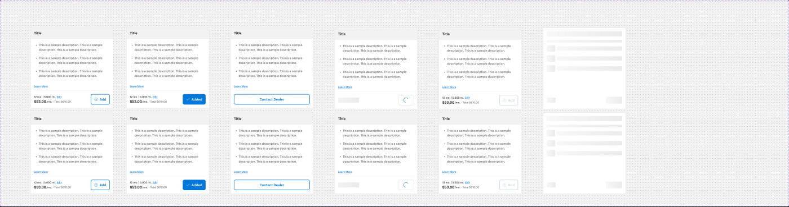
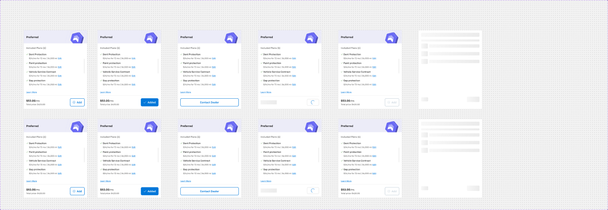
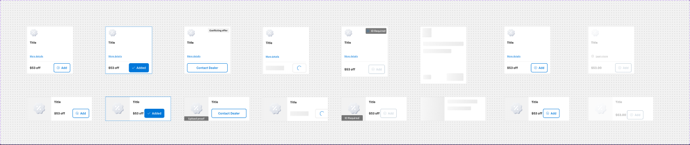
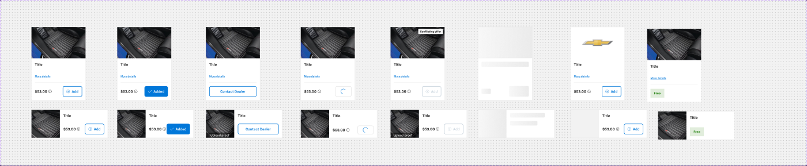
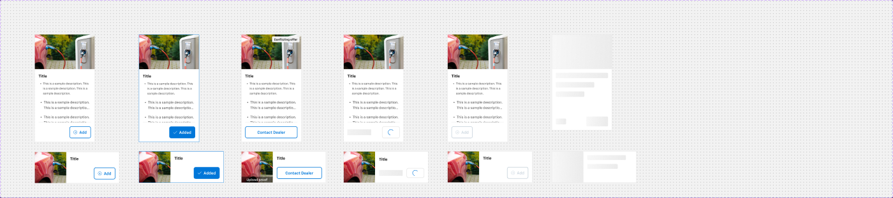
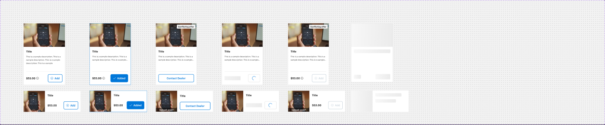

# Product cards — Protection Plans, Protection Packages, Rebates, Accessories, Charger, Subscription

**Figma**: page Card (`228:105161`), file `g5hh34klkdaAOzyjoDRDgJ`. Shared parts are described in `card-anatomy.md`.

| Set | Node | Variants | Axes | Non-variant props |
|---|---|---|---|---|
| Card - Protection Plans | `228:106921` | 12 | Selected, Contact dealer, Price Loading, Default, Conflict, Loading, Mobile | `Card-header` |
| Card - Protection Packages | `2775:45920` | 12 | same as above | — |
| Card - Rebates | `228:106396` | 16 | Mobile, Selected, Contact dealer, Price Loading, Default, Conflict, Loading, With out image, Disable | `External Link`, `Details`, `More details` |
| Card -  Accessories (double space in name) | `228:106450` | 16 | Mobile, Selected, Contact dealer, Price Loading, Default, Conflict, Loading, With out image, Free | `External Link` |
| Card - Charger | `228:107108` | 12 | Mobile, Added, Contact dealer, Price Loading, Default, Loading, With out image | `External Link` |
| Card - Subscription | `228:107058` | 12 | Mobile, Added, Contact dealer, Price Loading, Default, Conflict, Loading | `Show Chip`, `External Link` |

**Purpose**: selectable add-on cards in the "Protection & Accessories / Incentives" steps — the shopper adds/removes
F&I protection plans, packages, rebates/incentives, accessories, home chargers and connected-service subscriptions.

## Anatomy
### A. Header-bar cards (Protection Plans, Protection Packages) — 379 wide
```
Card (col, bg/default, 1px border/default, r0)
├─ Title bar 379×56  row p16 gap4, bg bg/variant — "Title" body/1/bold text/default (+2 hidden 16px icons)
│    (Packages: instance "Protection package header" 379×80 = package-header-color tint + "Preferred" + shield graphic)
├─ Card - Content (Unordered List | Image list) p16 gap16/8
├─ Terms/mileage (hidden)
├─ CTA = Link small/brand "Learn More"  (p8/16)
├─ Chips (hidden by default; Card - Chip "Conflicting Offer")
└─ Footer: divider + Actions row p16 gap8 → Card price detail (Month & miles | Price & Total) + card-Button
```
### B. Universal cards (Rebates, Accessories, Charger, Subscription)
Desktop ≈ 244 wide (Subscription 245–249), mobile 343×128 horizontal — see `_Card Universal` in `card-anatomy.md`.
- **Rebates**: `Card Media` Icon (72×56) on top; Section: Title + `CTA` "More details"; Footer price "$53 off" (`Card price detail/Price`) + card-Button. 244×249.
- **Accessories**: `Card Media` 3 column Image (244×141); Section: Title + "More details"; Footer "$53.00" + Add. 244×330.
- **Charger**: 3 column Image; Section: Title + `Card - Content` styled list (3× "This is a sample description.") ; Footer Add only (no price; Actions aligned right). 244×438.
- **Subscription**: 3 column Image; Section: Title + one description line; Footer "$53.00" + Add. ~249×370.

## Visual spec
- Background `bg/default`; border 1px `border/default`; radius 0; no shadow (none of these cards use a hover shadow).
- Title `body/1/bold` `text/default`; descriptions `body/2/regular` `text/subtle`; price `heading/5` `text/default`; sub-labels `body/3` `text/subtle`.
- Footer divider 1px `border/default` inset 16px; Actions padding 16 (`container/padding/s`), gap 8 (`container/gap/s`).
- Protection Plans title bar bg `bg/variant` (#f2f2f2). Packages header tint #ececf8 (package-header-color 1; no token — 12 tints exist).

## Variants & states
| State | Change |
|---|---|
| Default | card-Button Default "⊕ Add" (outline primary) |
| Selected / Added | card-Button Selected "✓ Added" (filled `action/bg/default`); Rebates/Charger/Subscription root border → 1px `action/bg/default`. Plans/Packages/Accessories keep `border/default` |
| Contact dealer | price hidden; full-width outline "Contact Dealer"; mobile shows "Upload proof" chip |
| Price Loading | price → grey skeleton; card-Button Loading (spinner) |
| Conflict | Plans/Packages: button Disabled. Rebates: chip "ID Required" (top-right), button disabled; Accessories/Subscription: chip "Conflicting offer" |
| Loading | whole card replaced by skeleton blocks (grey gradient bars), same footprint |
| Disable (Rebates) | everything faded (`text/disabled`), "Learn more" with info icon, price "$53.00", button disabled |
| Free (Accessories) | price/button replaced by `Free` green tag (`success/subtle` / `success/default`) |
| With out image | media slot falls back to the placeholder icon |

## Content (default variants)
Plans: "Title", 3 bullets "This is a sample description…", "Learn More", "12 mo. | 5,000 mi. Edit", "$53.00 /mo. • Total $810.00", "Add".
Packages: header "Preferred"; "Included Plans (6)"; rows "Dent Protection / Paint protection / Vehicle Service Contract / Gap protection" each "$24/mo for 72 mo | 36,000 mi Edit"; "$53.00 /mo." "Total price: $420.00".
Rebates: "Title", "More details", "$53 off", "Add". Accessories/Subscription: "Title", "$53.00". Contact dealer: "Contact Dealer", chips "Upload proof", "Conflicting offer", "ID Required".

## Responsive
- Plans/Packages: Mobile=True variants are identical (379 wide); cards just stack.
- Universal cards: mobile = horizontal 343×128 (media 128×128 left, Section right with Title + price/button row); CTA link hidden on mobile.

## Notes
- Naming inconsistency: Charger/Subscription use `Added` axis, the others `Selected`.
- "Card -  Accessories" has a double space; Rebates axis "Disable", "With out image".
- Selected border colour is inconsistent across the family (see table).
- Product images / package shield art are image slots — not exported.

## Screenshots






