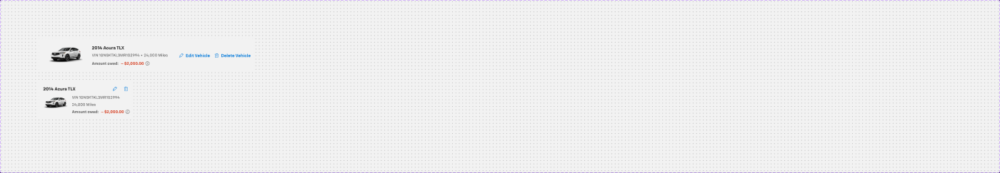
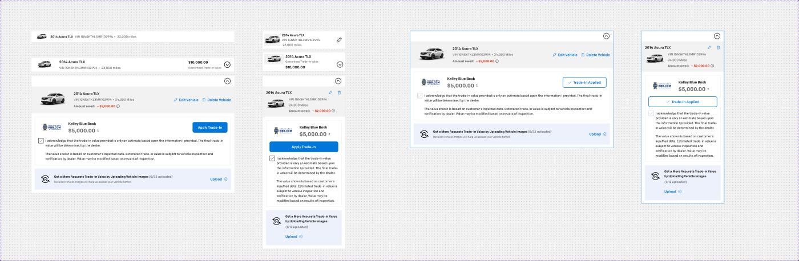
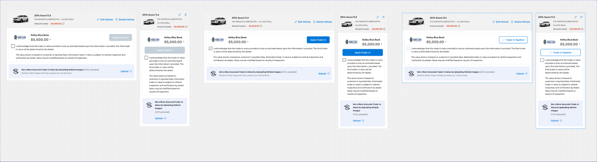
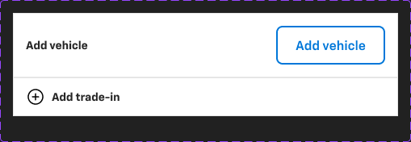
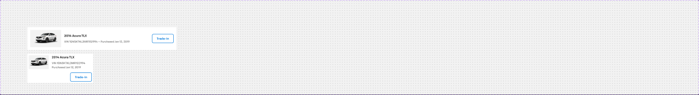

# Trade-in cards — Card - Trade-in info, Card - Trade-In, Card - TradeIn - summary, Card - Trade-In - Add, Card - My Garage

**Figma**: page Card (`228:105161`), file `g5hh34klkdaAOzyjoDRDgJ`. Shared parts: `card-anatomy.md` (Media - Trade-In, Card - Finance, tradebook-logo).
Photo upload (`Trad-in photo upload`) is documented in `card-documents.md`.

| Set | Node | Variants | Axes | Non-variant props |
|---|---|---|---|---|
| Card - Trade-in info | `407:52800` | 8 | Default, Trade in done, Trade summary, Mobile, Selected | `Image`, `Icon`, `CTA` |
| Card - Trade-In | `228:106089` | 2 | Mobile | `Show Chip`, `Miles`, `Selected`, `Action`, `Remove` |
| Card - TradeIn - summary | `228:106132` | 6 | Mobile, Selected, State=Default\|Checked\|Selected | `collapse`, `Alert`, `Lender Tab`, `Photo Upload`, `Disclaimer text` |
| Card - Trade-In - Add | `2484:84932` | 2 | Property 1=Default\|Variant2 | — |
| Card - My Garage | `724:62924` | 2 | Mobile | — |

There is also a documentation frame "📋 Card - TradeIn - summary - Component Documentation" (`10171:37078`) on the page.

## 1. Card - Trade-In (vehicle row)
**Purpose**: the shopper's trade-in vehicle with owed amount and edit/delete actions.
**Anatomy (782×122)**: row p16 gap16, bg **`bg/variant`**, no border. `Media - Trade-In` 160×90 (vehicle photo slot) + content row: "2014 Acura TLX" `heading/5` `text/default`; "VIN 1GNSKTKL3MR102994 • 24,000 Miles" `body/2/regular` `text/subtle`; "Amount owed:" `body/2/bold` `text/subtle` + "– $2,000.00" `heading/6` **`error/default`** + 16px info icon; hidden `Chip - Information`; right: 2× **Button - Primary** small *plain* with icons "✎ Edit Vehicle", "🗑 Delete Vehicle" (`.aec-btn` plain).
**Mobile (343×138)**: title row with two **Icon Button - Primary** small plain (edit, delete); thumbnail left, VIN / miles on separate lines.

## 2. Card - Trade-in info
**Purpose**: collapsible trade-in row in checkout; expands into the full trade-in summary.
**Trade in done (920×66)**: col p8/16, `bg/default`, 1px `border/default`. Row gap 24: thumbnail 88×48, info ("2014 Acura TLX" `heading/5`; "VIN … • 23,000 miles" `body/2/regular` `text/variant`), value block (left border 1px `border/default`, pl 24): "$10,000.00" `heading/5` + "Guaranteed Trade-In Value" `body/3/regular` `text/variant`; 32px `CaretCircleDown` toggle.
**Default (921×52)**: same without value. Mobile Default adds an edit **Icon Button - Neutral** (medium plain).
**Trade summary (920×532)**: expanded — caret-up header + nested `Card - TradeIn - summary` (Checked). Selected → outer border 1px `primary/default`.

## 3. Card - TradeIn - summary
**Purpose**: full trade-in panel: vehicle row + valuation (KBB) + acknowledgement + photo upload prompt.
**Anatomy (900×484)**: col, `bg/default`, 1px `border/default` (absolute Border).
- `Card - Trade-In` row (bg `bg/variant`, see §1).
- Main col p16 gap16: hidden `Segment Control` (lender tabs, prop `Lender Tab`); **Card - Finance** (868×218, p16, 1px `border/default`): `tradebook-logo` KBB slot + "Kelley Blue Book" / "$5,000.00" + info; **Button - Primary** large "Apply Trade-In"; **Checkbox with Label** "I acknowledge that the trade-in value provided is only an estimate based upon the information I provided. The final trade-in value will be determined by the dealer."; disclaimer "The value shown is based on customer's inputted data. Estimated trade-in value is subject to vehicle inspection and verification by dealer. Value may be modified based on results of inspection."; hidden `Inline notification` (prop `Alert`); **Trad-in photo upload** (collapsed, `info/subtle` bg — see `card-documents.md`).
**States**: Default → checkbox unchecked, "Apply Trade-In" disabled (`action/bg/disabled`); Checked → checkbox on, button enabled filled; Selected → button outline "✓ Trade-In Applied", checkbox disabled-checked, outer border `primary/default`.
**Mobile (343×802)**: stacked; valuation button full width; photo-upload prompt centred.

## 4. Card - Trade-In - Add
**Purpose**: entry point to add a trade-in vehicle.
- Default (477×80): row p16 gap8, `bg/default`, 1px `border/default`: "Add vehicle" `heading/6` + **Button - Standard** small "Add vehicle".
- Variant2 (477×48): ⊕ 24px icon + "Add trade-in" (`heading/6`) as a full-row clickable item.

## 5. Card - My Garage
**Purpose**: a vehicle the customer owns (garage) that can be used as a trade-in.
**Anatomy (774×122)**: row p16 gap16, `bg/default`, 1px `border/default`. Thumbnail 160×90 (`bg/variant`), info "2014 Acura TLX" `heading/5` / "VIN 1GNSKTKL3MR102994 • Purchased Jan 12, 2019" `body/2/regular` `text/variant`, **Button - Standard** small "Trade-In". Mobile 343×156 (button below text).

## Notes
- Vehicle thumbnails and KBB / Black Book logos are image slots — not exported.
- VIN text has a trailing space in several layers ("VIN 1GNSKTKL3MR102994 ").
- Mileage copy is inconsistent ("23,000 miles" vs "24,000 Miles").
- Card - Trade-In uses `bg/variant` as card fill (no border) while sibling cards use white + border.
