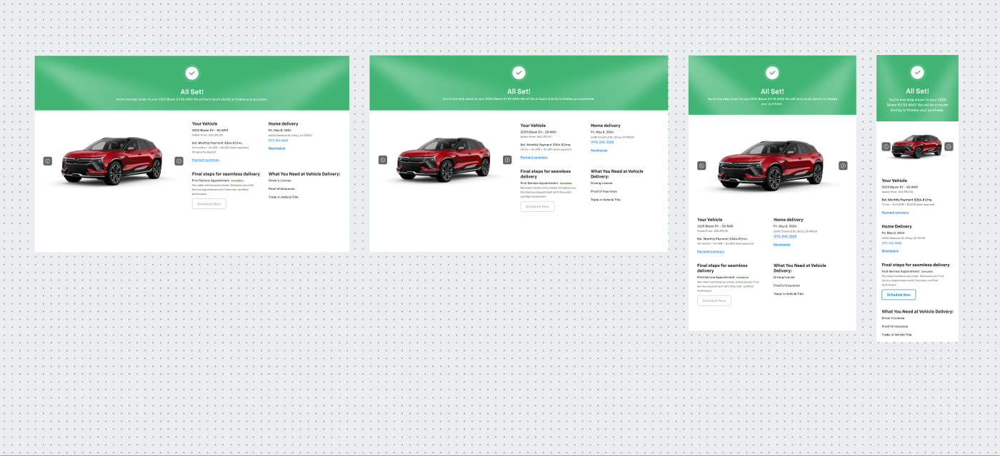

# Congratulations (order confirmation page)



## Figma
Page `Misc.` (5616:19713). Set **Congratulations** `2558:114779`, 4 variants (exclusive booleans `Web (1440)`, `Web (!366)` [sic], `Tab`, `Mobile`):
Web 1440 (2558:114630, 1440×900), Web 1366 (2558:114780, 1366×900), Tab (2558:115654, 768×1261), Mobile (2558:116062, 375×1315). A loose example frame `Congratulations` (9968:57701, 375×1300) also exists.
Built from published **Top banner** (3568:79662) and **Vehicle Image** (3569:79678) — see gallery.md.

## Purpose
Final "All Set!" confirmation after secure checkout: success banner, vehicle image, deal recap, delivery appointment, final steps and delivery checklist.

## Anatomy (Web 1440)
```
Page  V, gap 48, center, bg #ffffff
├─ Top banner (1440×250)  — green success hero (see gallery.md#top-banner)
│   checkmark 80×80 · "All Set!" heading/2 text/inverse · subtitle body/2/regular text/inverse
└─ Content  H, padding 0/40, gap 40
   ├─ Vehicle Image (640×370) — IMAGE slot + 2 × Icon Button - Inverse (40×40, filled; prev/next)  [.aec-icon-btn inverse]
   └─ Info grid  H wrap, gap 40, 680 wide — 4 blocks (each V gap 8, title heading/4 text/default, body V gap 16)
      1. Your Vehicle (310)          3. Final steps for seamless delivery (310)
      2. Home delivery (330)         4. What You Need at Vehicle Delivery: (330)
```

## Content (default)
1. **Your Vehicle** — "2025 Blazer EV • SS AWD" (body/2/regular; bullet body/3 text/subtle); "Dealer Price: $52,392.00" (body/3/regular text/subtle); "Est. Monthly Payment" "$364.81/mo." (body/2/regular); "49 months • 4% APR • $4,000 down payment" and "$0 security deposit" (body/3/regular text/subtle); Link (medium, primary) "Payment summary".
2. **Home delivery** — "Fri, May 8, 2024" body/2/regular; "6600 Chestnut St, Gilroy, CA 95020" body/3/regular text/subtle; phone link "(911)-345-5668"; Link "Reschedule".
3. **Final steps for seamless delivery** — "First Service Appointment" body/2/regular + status "Complete" body/3/bold success/default; description "We make maintenance simple. Schedule your First Service Appointment with Chevrolet-certified technic…" body/3/regular text/subtle; Button - Standard (small, **disabled**) "Schedule Now" [.aec-btn standard].
4. **What You Need at Vehicle Delivery:** — list "Driver’s License", "Proof of Insurance", "Trade-in Vehicle Title" (body/2/regular, gap 16).

Banner copy: title "All Set!" (layer name hints at "Congratulations on your new {Year Name Trim Drivetrain}!"); subtitle "You’re one step closer to your 2025 Blazer EV SS AWD! We will be in touch shortly to finalize your purchase."

## Responsive
| Variant | Banner | Content container |
|---|---|---|
| Web 1440 | 1440×250 | H, padding 0/40, gap 40 (image 640×370) |
| Web 1366 | 1366×252 | H, padding 0/40, gap 40 |
| Tab 768 | 768×272 | V, padding 40/40/0/40, gap 40 (image on top, blocks below) |
| Mobile 375 | 375×304 | V, padding 24, gap 50; image 327×184; blocks stacked V gap 40 |

## Notes
- Variant name typo `Web (!366)` → 1366.
- Page bg raw #ffffff (bg/default). Banner green #41b473 has no token (see gallery.md).
- Image prev/next icon buttons are shown disabled (#666666 = action/inverse/bg/disabled) in the Web instance.
- Vehicle photography slot — not exported.
