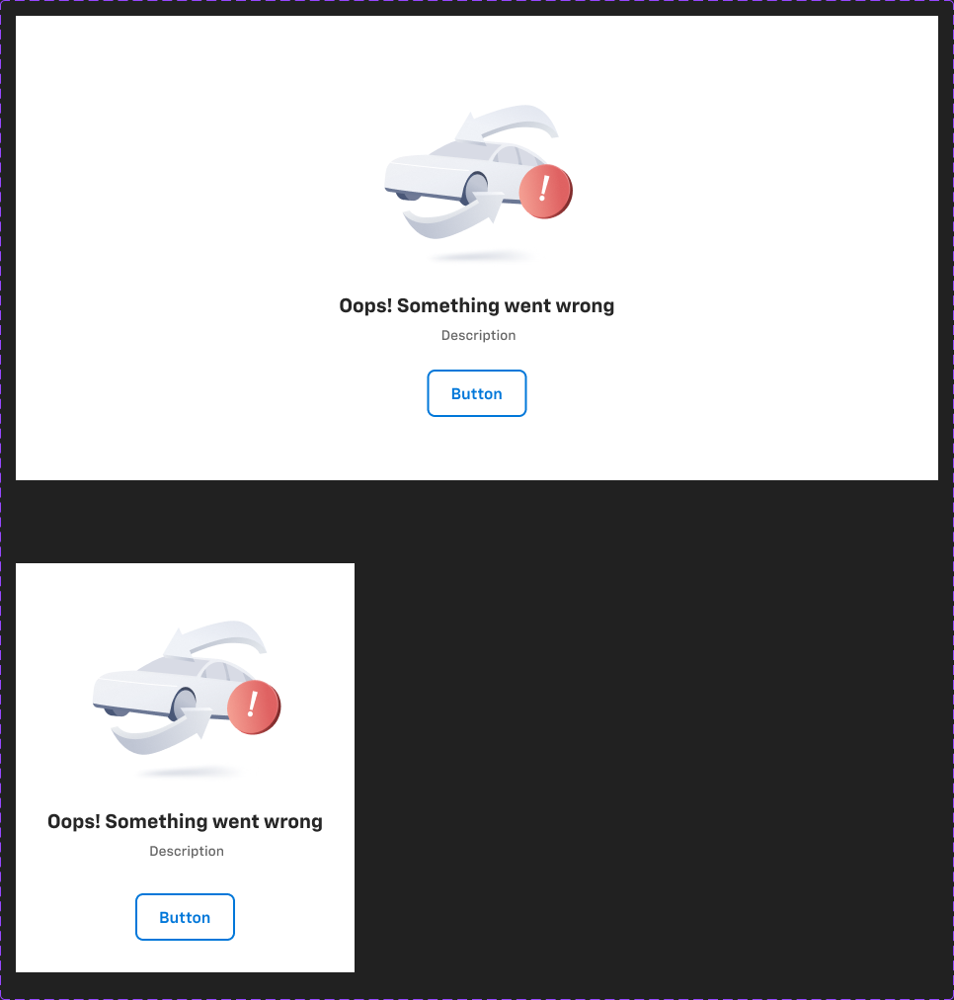

# Error & Empty state / error state Content




## Figma
Page `Error State` (187:20684).
- **Error & Empty state** `2865:111774` — 2 variants, axis `Mobile: False|True` (187:48026 934×470; 2865:111775 343×414). Props: `Illustration` (instance swap, default `Trade-in-illustration` 9661:118303), `CTA` (bool, true), `Secondary` (bool, true), `Primary` (bool, false), `Tooltip` (bool, false).
- **error state Content** `2803:163829` — 3 variants (each 934×54), mutually exclusive booleans `Default content`, `Success content`, `Error content`. Props `Status chip` (bool, false), `Info` (bool, false).

## Purpose
Full-section empty / error / success message block (illustration + heading + description + CTA), used e.g. when a checkout step's data fails to load or there is nothing to show.

## Anatomy (Mobile=False)
```
Error & Empty state  V, padding 64/0/64/0, gap 24, center, bg bg/default, 934 wide
├─ Frame  V, gap 16, center
│  ├─ Illustration slot 200×200 (instance swap; default Trade-in-illustration)
│  └─ error state Content  V, gap 24 → inner V gap 8, center
│     ├─ Heading  heading/4
│     └─ Description  body/2/regular text/variant
└─ CTA row  H, gap 16, center
   └─ Button - Standard (large, outline, 48h, padding 0/24, r8) label "Button"   [.aec-btn standard outline]
      (hidden Primary button slot: Button - Primary, toggled by `Primary`)
```

## Variants & states
| error state Content variant | Heading | Heading colour |
|---|---|---|
| Default content | "Oops! Something went wrong" | text/default |
| Success content | "Submitted successfully" | success/default |
| Error content | "Oops! Something went wrong" | error/default |
Description text everywhere: " Description" (placeholder; layer named "Please enter your email to continue").

## Visual spec
bg/default, no border/shadow/radius. Text centred. Button - Standard: white bg, 2px primary/default border.

## Responsive
Mobile: 343 wide, padding 32/0/32/0, gap 32 (vs 64/24 on desktop); same content.

## Notes
- Copy is placeholder ("Button", " Description" with a leading space).
- `Tooltip` / `Status chip` / `Info` booleans exist but nothing visible in default state.
- Illustration is a generic placeholder art component (Trade-in-illustration) — exportable if needed; not exported here.
- In-store `Funding opt` (Failed variant) reuses this pattern with "We're having trouble loading funding options. Please hit retry to try again" + "Retry".
