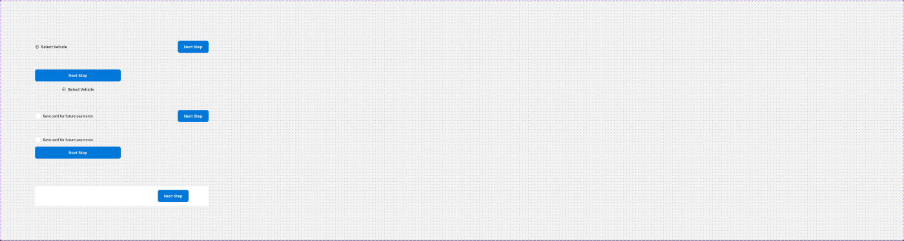
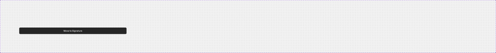
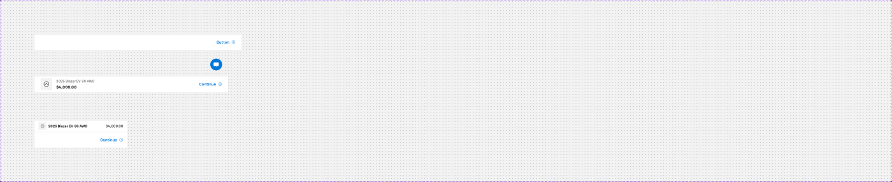

# Footers: Inline footer, Mobile bottom button, Bottom Navigation Bar

Page **Navigation** (`5607:20490`), file `g5hh34klkdaAOzyjoDRDgJ`. Each set is built from the foundation `Button - Primary` / `Button - Neutral` (→ `.aec-btn`) and `Checkbox with Label` (→ `.aec-checkbox`).

---

## 1. Inline footer (`44:78976`), 6 variants
Axes: `Mobile`, `In-line footer`, `Payment`, `Hide`, `Login footer` (True/False). Booleans: `Back CTA` (true), `Check Box` (true).



**Purpose**: the end-of-form action row inside the page content (Back + Continue), the payment-consent row, and the login footer.

| variant | size | layout | contents |
|---|---|---|---|
| In-line footer (desktop) | 694x72 | H, padding-top 24, gap 8, right-aligned, wrap; top 1px `border/default` | left: `Button - Neutral` large **plain** (Back); right: `Button - Primary` large filled |
| Login footer | 694x80 | H p16/80/16/0, `bg/default`, top border | only `Button - Primary` large filled (right) |
| Login footer + Hide | 0x0 | same as in-line, Primary uses `bg/inverse` (#262626) | collapsed/hidden variant |
| Payment (desktop) | 694x80 | H p16/0, top border | left: `Checkbox with Label` (mobile=off); right: Primary large |
| Payment (mobile) | 343x120 | V, padding-bottom 24, gap 8, **bottom** border | Checkbox (full width) above the full-width Primary |
| In-line footer (mobile) | 343x128 | V, padding-top 24, gap 8, top border | full-width Primary **above** full-width Neutral plain |

Visual: no background (except Login), 1px `border/default` divider, buttons 48 tall (`size=large`), radius 8.
Responsive: desktop right-aligns the buttons; mobile stacks them full width with the Primary first.
Notes: the button labels are instance defaults (not read). The Login+Hide variant is 0x0, and its Primary is dark (`bg/inverse`) rather than `primary/default`. Payment-mobile has its divider on the bottom, while the other variants have it on top.

---

## 2. Mobile bottom button (`433:125893`), 2 variants (`Mobile: False|True`)



**Purpose**: a single sticky primary CTA.
- `Mobile=False` (782x32): H, gap 24, right-aligned. It contains a **hidden** `Button - Primary` size=medium (40 tall) whose fill is overridden to `text/default` #262626 (a dark button). The variant is empty by default.
- `Mobile=True` (782x48): a full-width `Button - Neutral` **size=large, style=filled**, fill #262626 (dark), 48 tall, r8.

Notes: the dark "neutral filled" button maps to `.aec-btn--neutral` filled. The set name says "Mobile" but both variants are 782 wide.

---

## 3. Bottom Navigation Bar (`2046:374466`), 3 variants
Axes: `Web`, `Tab`, `Mobile` (one true per variant). Boolean: `Skip button` (false).



**Purpose**: the sticky step footer at the bottom of the content column, with Continue (and an optional Skip). Tablet and mobile also show a vehicle/price summary.

### Web=True (838x64)
```
H p8/24, gap 8, right-aligned, bg/default, top 1px border/default
├─ "Step 1 / 3"  (hidden) body/2/regular text/variant
├─ Content (hidden): "2023 RDX A-Spec®" body/2/regular text/variant ; "$1,069" heading/5 + "/mo" body/1/medium
├─ Button - Neutral  medium plain   (hidden; "Skip")
├─ Button - Primary  medium **plain** (text button with arrow, e.g. "Button →")
└─ Progress Bar (hidden) 10 × 4px lines: 1st primary/default, rest primary/subtle
```
By default the desktop bar shows only a right-aligned text-style Primary button (see the template screenshot "Button ⊕").

### Tab=True (784x64)
H p8/24, space-between. Left Section (gap 16):
- a 48x48 `bg/variant` vehicle thumbnail (icon-24 placeholder)
- "2025 Blazer EV" + "SS AWD" body/2/regular `text/variant`
- "$4,000.00" heading/5 (tablet/heading/5) `text/default`

Right: Neutral plain (hidden) + Primary medium plain. A `Live Chat` 48x48 floating button instance is also present.

### Mobile=True (375x112)
V, two rows, `bg/default`:
1. **Bottom bar** (48): p8/16, top border. A 32x32 `bg/variant` thumb (icon-16), "2025 Blazer EV SS AWD" mobile/heading/6 (14 Bold) `text/default`, and "$4,000.00" body/2/medium on the right. A hidden "Total: $34,450" body/2/regular `text/variant`.
2. **Action row** (64): p8/16, top border, right-aligned. Primary **large** plain (and Skip hidden).

Progress Bar is hidden (38px segments). Live Chat is hidden.

### Notes
- The progress bar is a second progress indicator (10 equal segments, 4px, `primary/default` = done, `primary/subtle` = todo). It differs from the dot Stepper.
- The vehicle names are data-bound placeholders (`["Vehicles"]["Year"][0]` …). The desktop hidden copy is Acura ("2023 RDX A-Spec®"), a leftover.
- Desktop/tablet Primary is `style=plain` (text + arrow), not filled.
- The vehicle thumbnail is an image slot; do not export vehicle photos.
