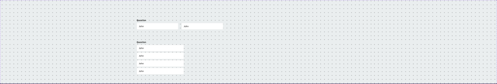
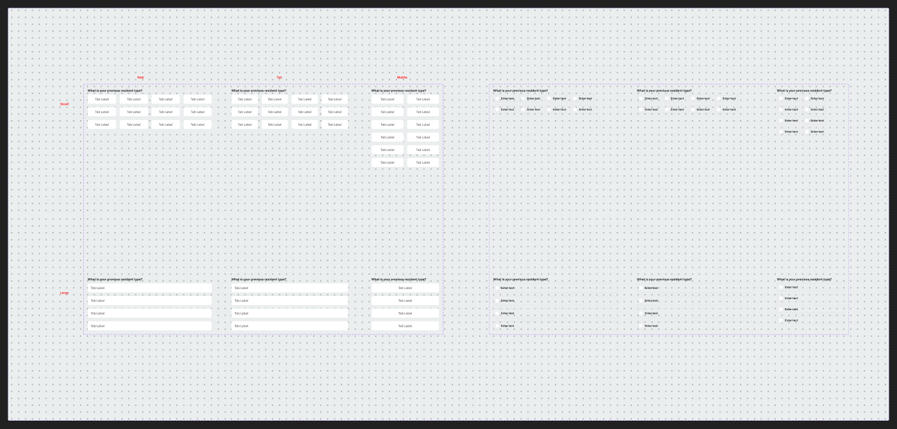

# Form patterns — Form - Input, Form - Question v2, Form - Checkbox v2, Basic form




## Figma
Page `Form` (5613:20164).
| Set | Node | Variants | Axes | Other props |
|---|---|---|---|---|
| **Form - Input** | 6065:16772 | 2 | `Mobile: True/False`, `Input: True` | `Question` (true), `Options` (true), `Row-2` (false), `Mandatory` (false), `Show Icon` (false), `Check box answer` (false) |
| **Form - Question v2** (SECTION "Form" 3553:8457) | 3553:8458 | 6 | `Size: Small/Large` × `Web` / `Tablet` / `Mobile` | `3 & 4th option` (true), `5 & 6th option` (false), `7 & 8th option` (false), `mandatory icon` (false) |
| **Form - Checkbox v2** (SECTION "Form") | 3553:8609 | 6 | same as above | same + `Mandatory Icon` (false) |
| Basic form (SECTION "Section 1", component) | 616:19822 | 1 | — | — |

Unpublished base parts on the page (SECTION `_Unpublished base components` 6089:30717): `Form-Options` (610:69575, Horizontal=True/Horizontal2), `Form - Single line Sentence option` (969:26314), `Dropdown - Options` (5502:4462: Active/Hidden), `_Icon Status` (5836:46410: Success/Error/Status4/Info), plus calendar and YMM parts (see calendar.md, vehicle-selector.md).

## Purpose
Question-style form building blocks for the credit application / trade-in / customer-info steps: a bold question label followed by text inputs, single-select option tiles, or multi-select checkbox tiles.

## Anatomy
### Form - Input (Mobile=False, 628×80)
```
V, gap 8
├─ Header  H, gap 4: "Question" body/1/bold text/default  (+ optional mandatory icon / Show Icon)
└─ Options  H wrap, gap 24
   └─ 2 × Standard Text Input - Outlined (302×48, label-less, r4, 1px #e6e6e6=border/default, padding 0/16)  [.aec-field]
```
Mobile=True (343×248): Header + 4 stacked full-width inputs (343×48), gap 8.

### Form - Question v2 (single select; Size=Small, Web, 628×208)
```
V, gap 8
├─ Header H gap 4: "What is your previous resident type?" body/1/bold text/default
└─ Options V gap 16
   └─ rows H gap 16 of 4 × "Toggle group tab-item Option 1" (large, 145×48, padding 0/16, r8, bg #ffffff, 1px #e6e6e6) "Tab Label"  [.aec-toggle-group item]
```
- Size=Large (628×272): 4 full-width stacked tiles (628×48, left-aligned label), gap 16.
- Rows of 2 options are toggled via `3 & 4th option`, `5 & 6th option`, `7 & 8th option` booleans.

### Form - Checkbox v2 (multi select; Size=Small, Web, 628×128)
```
V, gap 8
├─ Header H gap 2: question body/1/bold
└─ Options H wrap gap 16
   └─ 8 × "Checkbox with Label" (Checked=False; 115×40, padding 8, gap 8, r4, 2px border/default) "Enter text"  [.aec-checkbox inside bordered tile]
```
Size=Large: 4 full-width tiles 628×48 stacked, gap 16.

### Basic form (746×264)
3 rows (H, gap 24) × 2 `Standard Text Input - Outlined` (361×72, with label), rows gap 24:
First Name "John" | Last Name "Freenam"; Phone Number "(555) 555-1234" | Email "john.freeman@gmail.com"; DOB (MM/DD/YYYY) "12/30/1975" | Social Security Number "686097859".

### Form - Single line Sentence option (base, 309×50)
H padding 14/16, r4, 1px border/default: "Continue as an Individual Applicant" body/2/regular — a sentence-style radio tile.

## Visual spec
- Question label: `body/1/bold`, `text/default`.
- Tiles: bg `bg/default` (raw #ffffff), border `border/default` (raw #e6e6e6 in toggle instances), radius 8 (toggle) / 4 (checkbox tile, input).
- No shadows. Selection styling comes from the atomic Toggle / Checkbox components.

## Variants & responsive
| Breakpoint | Width | Question v2 Small | Checkbox v2 Small |
|---|---|---|---|
| Web | 628 | 4 per row | 8 tiles wrap (4 per row approx.) |
| Tablet | 590 | same layout, narrower | same |
| Mobile | 343 | 2 per row, 6 rows (400h) | wrap, 240h |
Large size is always 1 per row.

## Notes
- All option copy is placeholder ("Tab Label", "Enter text").
- "Freenam" in Basic form is likely a typo for "Freeman" (email is john.freeman@…).
- Basic form exposes a sample SSN value — replace with masked placeholder in implementation.
- Toggle-tile instances use raw hex (#ffffff / #e6e6e6) rather than styles — map to bg/default / border/default.

## Section 1 (2706:236241) — other items (brief)
Loose working area, not a clean published set:
- `Form - Header` (5502:4484): "Header text" heading/5.
- `Address Dropdown` (1115:63062): address autocomplete list (5 × "3208 Johnston …" body/1/regular) + "Add address manually" link.
- `Form-Placeholder` (611:16965): "Replace with page content using ⇧⌘+R" placeholder.
- `Emailer template` (2706:235430, Mobile False/True, 832×1748): transactional email — "Hi john, (subject)" heading/4, body "Thank you for your interest in <<Vehicle Name>>…", vehicle block (2025 Blazer EV • SS AWD, Stock#/VIN), "Please contact us at <<Dealership Phone no.>>…", footer links "Copyrights and Trademark", "Privacy Statement". Sub-component `content` (2706:235423).
- `Component 1` (2777:128332): vehicle detail vs vehicles-compared header for the email.
- Text `<<Transaction id, Transaction Date and Time, Mode of Payment, Amount Authorised>>` and frame "Icon & lable" ("Secure Checkout") — email payment-receipt pieces.
- Loose frame "No slots available" (2769:113848) — calendar empty state (icon-40 + text).
