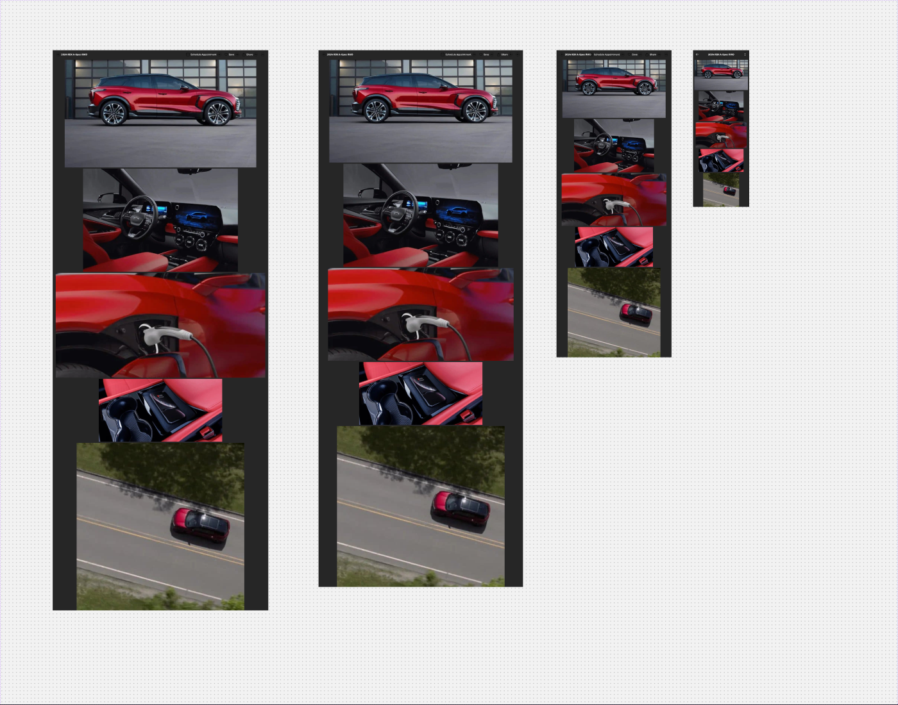
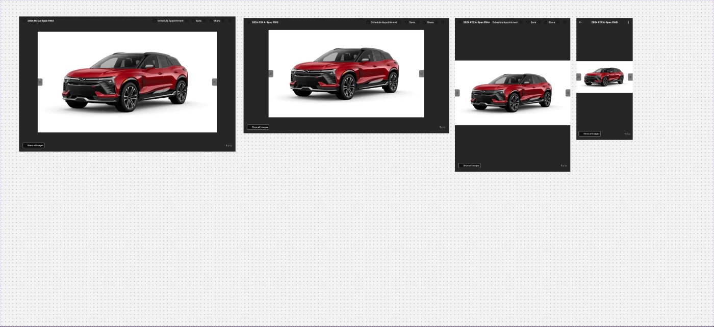
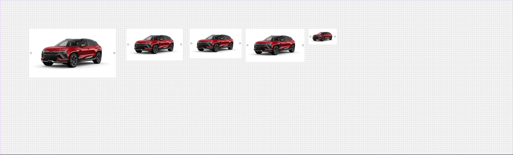
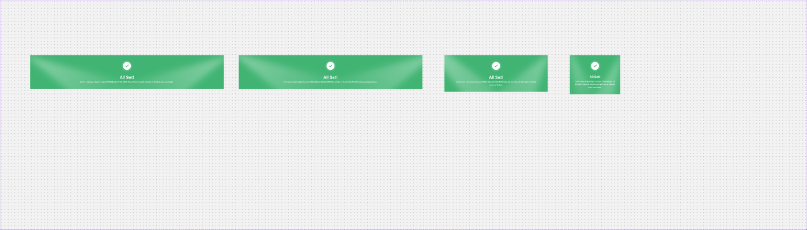

# Gallery, Gallery Preview, Vehicle Image, Top banner

Page `Misc.` (5616:19713). All vehicle images are IMAGE slots bound to data (`["Vehicles"]["Image (Gallery n)"][0]`) — vehicle photography is not exported.

---
## Gallery — `3388:80030` (4 variants)


Axes (exclusive booleans): `Web (1440)` (3388:80080, 1440×3745), `Web (1366)` (3388:80061, 1366×3588), `Tablet` (3388:80042, 768×2053), `Mobile` (3388:80031, 375×1047).
**Purpose**: full-screen dark "all photos" view — a vertical stack of all vehicle images.

**Anatomy (Web 1440)**
```
V, gap 8, center, bg inverse/bg/default (#262626)
├─ Top controls  H space-between, padding 16/24, bg inverse/bg/default, 56h
│  ├─ left: icon-24 (back) + title "2024 RDX A-Spec RWD" heading/5 text/inverse (gap 8)
│  └─ right (gap 24): Quick controls — 3 × Inline Button - Inverse (large): "Schedule Appointment", "Save", "Share" + icon-24 (close)   [.aec-btn inverse inline]
└─ 5 image slots of mixed sizes, centred: 1280×720, 1034×689, 1400×700, 824×420, 1120×1120
```
**Mobile**: header 56h padding 16, `icon-ArrowLeft` · title (inverse/text/default) · `icon-DotsThreeVertical`; images 359×202, 300×200, 340×170, 300×153, 240×240. Quick-control buttons collapse into the kebab.

---
## Gallery Preview — `3388:79929` (4 variants)


Axes: `Desktop 1920` (3388:80003, 1440×900 — named 1920 but sized 1440), `Desktop 1366` (3388:79976, 1366×768), `Tablet` (3388:79949, 768×1024), `Mobile` (3388:79930, 375×812).
**Purpose**: lightbox / single-image carousel.

**Anatomy (Desktop)**
```
V, space-between, center, bg inverse/bg/default
├─ Top controls — same as Gallery
├─ Stage 1193×671: image slot + arrow bar (H space-between) with 2 nav buttons:
│     32×48, padding 16/8, bg backdrop/default (#000@0.52), icon-16 chevron
└─ bottom controls  H space-between, padding 24, 82h
   ├─ "all images" pill: H padding 6/8, gap 8, r4, bg inverse/bg/overlay, 1px inverse/border/default; icon-16 + "Show all images" body/2/medium inverse/text/default
   └─ counter "1 of 32" (mixed styles)
```
**Mobile**: image 375×211; bottom controls padding 24/16.

---
## Vehicle Image — `3569:79678` (5 variants)


Variants (axes `Web 1440`, `Web 1366`, `Tablet 768`, `Mobile 375`; the set throws no axis list): Web 1440 658×370 (3569:79685), Web 1366 610×343 (3569:79876), Tablet 688×387 (3569:79679), all-false 1014×570 (3569:79691), and a mobile variant oddly named `["Vehicles"]["Image"][0]` 327×184 (3569:79697).
**Anatomy**: V, centre, bg bg/default; full-bleed image slot (16:9) + 2 × `Icon Button - Inverse` (medium, filled, 40×40, r8, white) as prev/next arrows overlaid. [.aec-icon-btn inverse]

---
## Top banner — `3568:79662` (4 variants)


Variants: `Web 1440` (3568:79661, 1440×250), `Web 1366` (3568:79660, 1366×252), `Tablet 768` (3568:79659, 768×272), `Mobile 375` (3568:79658, 375×290).
**Purpose**: success hero at top of Congratulations page.
```
H, padding 40/32, centre, bg #41b473 (no token), clip
├─ top content  V, gap 24, centre
│  ├─ Checkmark 80×80: white circle (r78) with check vector (inner shadow)
│  └─ Text  V gap 4 (mobile gap 8), 800 max width, centred
│     ├─ "All Set!" heading/2 (mobile: mobile/heading/2) text/inverse
│     └─ "You’re one step closer to your 2025 Blazer EV SS AWD! We will be in touch shortly to finalize your purchase." body/2/regular text/inverse
└─ 2 decorative gradient vectors (Vector 216/217, linear gradient, LAYER_BLUR) behind content
```
Mobile: text width 311, title 32h, subtitle wraps to 3 lines.

## Notes
- Sample title "2024 RDX A-Spec RWD" and nav icons are Acura leftovers, not Chevrolet.
- Banner green #41b473 and decorative blurred gradients have no token; consider success/default or a new decoration token.
- `inverse/bg/overlay`, `inverse/border/default`, `inverse/text/default` are used in Gallery Preview/mobile but are not in our token list (closest: inverse/bg/variant, inverse/border/variant, text/inverse).
- Gallery Preview "Desktop 1920" variant is 1440 wide.
