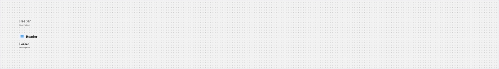

# In-page Header

## Figma
Page **Navigation** (`5607:20490`), file `g5hh34klkdaAOzyjoDRDgJ`.

| Set | Node id | Variants |
|---|---|---|
| In-page Header | `44:86734` | 2 (`Mobile: False\|True`) |
| Welcome Header (published, in "Section 1") | `17:22450` | 1 component |
| Filter (published, in "Section 1") | `218:96158` | 1 component |

In-page Header non-variant booleans (defaults): `Description` (true), `Back` (false), `Stepper` (false), `CTA` (false), `Skip CTA` (false), `Secondary actions` (false), `Global message Chip` (false).
Welcome Header: `Description` (true). Filter: `Information` (true), `Filter` (true), `Dropdown` (false).



## Purpose
The title block at the top of every checkout step (e.g. "Trade-In Vehicle", "Accessories"). It holds an optional back link, a step counter, a skip/secondary action and a global info chip. Welcome Header is the first-page greeting, and Filter is the tab + info-chip row under a header.

## Anatomy: In-page Header, Mobile=False (785x58)
```
In-page Header  V auto-layout, gap 8, fills width
├─ Back (hidden)   H gap 8, centre
│  ├─ icon button 32x32, r4, bg/variant, icon-16 (arrow)          → .aec-icon-btn-like (square, grey)
│  └─ "Back to trade-in"  body/2/medium, text/variant
└─ Main  H gap 8, fill
   ├─ Title texts  V gap 4, fill
   │  ├─ "Header"       heading/3 (24 Bold) text/default
   │  └─ "Description"  body/2/regular (rendered Medium 14) text/variant
   └─ Section  V gap 16, right-aligned, hug
      ├─ Stepper (hidden)               → stepper.md (Step 4, desktop)
      ├─ Link (hidden)                  → .aec-link size=medium style=neutral, right icon ("Skip" CTA)
      ├─ Secondary Actions (hidden)     → base set, see below
      └─ Global message → Global message Chip (hidden)
```

## Anatomy: Mobile=True (327x118)
```
V auto-layout, gap 16
├─ Mobile Left Nav  H p6/0, gap 8, centre
│  ├─ _expand-collapse  40x40 bg primary/subtle, icon-24 (opens the left nav drawer)
│  ├─ Content → "Header" heading/3 (24 Bold)
│  └─ Link (hidden) size=small neutral
├─ Main  H gap 8, right-aligned
│  ├─ Title texts V gap 4 → "Header" heading/4 (20 Bold) + "Description" body/2/regular text/variant
│  ├─ Stepper (hidden) Mobile Step 4 (label above dots)
│  └─ Link (hidden) medium neutral
├─ Secondary Actions (hidden, full width)
└─ Global message Chip (hidden)
```

## Base parts used
- **Secondary Actions** (`44:86713`, unpublished, 3 variants):
  - `Upload via phone=True`: H p8, gap 8, icon-24 + "Upload via phone" body/2/bold text/default.
  - `Dropdown=True`: "Pricing:" body/2/regular text/variant + "Per month" text/default + 16px caret icon.
  - `Summary=True`: V gap 8, right-aligned. "$52/mo" heading/5, then "Total: $3,044, 4 Plans" body/2/medium text/variant and `.aec-link` primary "View details".
- **Global message Chip** (`44:86717`): 218x32, H p0/8, gap 8, r4 (`--aec-border-radius-rounded-rect`), bg `bg/variant`. It has icon-16 and "Inclusive of installation charges" body/3/regular text/default. It is NOT the foundation `Chip - Information` (that one is blue). It is a grey 32px chip.
- **_expand-collapse** (`44:80685`): 40x40 square, bg `primary/subtle`, icon-24. States `default|collapse`.
- **Filter / Dropdown** (`195:49542`): 34px tall, p6/8, gap 4. Label body/2/regular + caret 16. `Active=on` adds bg `bg/variant` and makes the label Medium.

## Welcome Header (17:22450), 785x94
V, gap 8, padding-bottom 24, bottom 1px `border/default`.
- "Welcome aboard **John!**": heading/2 (32 Demi) `text/default`. The name is in `primary/default`.
- "Customize, protect, secure your **2021 RDX A-Spec** and collaborate with **CarDealer**, all under one roof.": body/2/regular `text/variant`. The vehicle name is body/2/bold, and the dealer name is bold `text/default`.

## Filter (218:96158), 782x48
H, space-between, gap 16:
- `Underlined - Inset` tabs (size=large, count=2) "Tab Label" → `.aec-tabs` underlined.
- `Chip - Information` (small, primary) "Prices are inclusive of installation/labor…" → `.aec-chip` info.
- `.Filter / Dropdown` (hidden) "Pricing: **Per Month**" with a caret.

## Visual spec
No background, border or shadow on In-page Header. All type is bound to text styles: heading/3 desktop, heading/4 mobile title, body/2/regular description, `text/default` and `text/variant`.

## Variants & states
Only Mobile. All optional parts are booleans; the default shows only Header and Description.

## Content
"Header", "Description", "Back to trade-in", "Upload via phone", "Pricing: Per month", "$52/mo", "Total: $3,044, 4 Plans", "View details", "Inclusive of installation charges".

## Responsive
Desktop 785 wide (fills the content column), right cluster aligned right. Mobile 327 (375 − 2×24): the hamburger/expand button + 24px title row is added on top, the page title drops to heading/4, and the secondary actions/chip go full-width below.

## Notes
- Mobile shows "Header" twice (the 24px bar title and the 20px section title). This is probably intended: app title vs. step title.
- The Description layer is bound to `body/2/regular` but the font is Medium. Use the style.
- Welcome Header uses `border/default` #e4e4e7 (not #e6e6e6).
- Back button: a 32px square `bg/variant` icon button with r4. It does not match `.aec-icon-btn` sizes exactly; check it.
