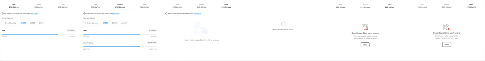
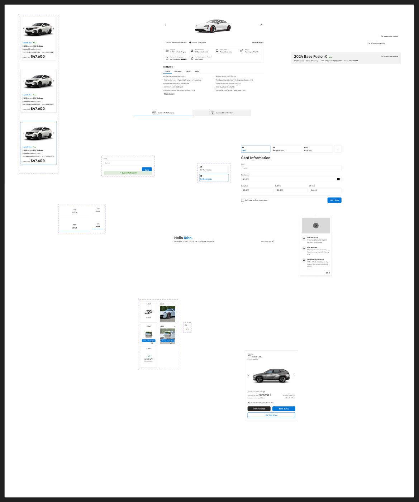

# In-store patterns




Page `In-store` (2934:147373). Patterns for the dealership kiosk / tablet (1024-wide) in-store retail experience.

| Item | Node | Type |
|---|---|---|
| Funding opt | 2934:148050 | set, 6 variants |
| Segment control | 2934:177341 | set, 1 variant (`Mobile=False`) |
| Vehicle Gallery header | 3146:94837 | component 1024×82 |
| SECTION **In-store cards** | 2934:154236 | see list below |

---
## Funding opt — `2934:148050`
Axes (booleans): `cash`, `Finance`, `Lease`, `Loading`, `Failed`, `API Failed`. Variants (all 758 wide): Cash (2934:148051, 374h), Finance (2934:148391, 502h), Lease (2934:148731, 434h), Loading (2934:149071, 494h), Lease+Failed (2934:149429, 590h), Lease+Failed+API Failed (2934:149769, 590h).
**Purpose**: choose payment type and configure deposit/term/mileage on the in-store deal screen.

**Anatomy (Cash)**
```
_Funding option - universal  V, gap 24, 758 wide
├─ Segment control (758×88) — 3 × _Segment control elements (253×88)
├─ info row  H gap 4: icon-24 + "Not sure about the payment type. Please check" body/3/regular + Link (small, primary) "What is PCP?"
└─ Options  V gap 40
   ├─ "Your cash deposit" heading/6 text/subtle
   │  H gap 16: Standard Text Input - Outlined (164×48, prefix "₤", placeholder "Enter Manually") [.aec-field]
   │            + 3 × Selectable Chip (medium, 40h) "₤2,000" "₤3,000" "₤4,000"  [.aec-chip selectable]
   └─ Slider - Steps (preset=2) "Term": 48 months (value), 12 months / 60 months (ends)  [.aec-slider]
```
**Variant differences**
- Finance: selected segment = Finance; deposit chips with "₤2,000" selected (body/1/bold primary/default); sliders "Term" (48 months; 12–60) and "Annual mileage" (10,000 Miles; 6,000–30,000 miles).
- Lease: "You are choosing to pay €33,390 for this car purchase" body/2/regular text/subtle (currency mixes € and ₤).
- Loading: "Hang On! Information is loading." body/2/medium text/variant (spinner/skeleton area).
- Failed / API Failed: Error-state block — "Oops! Something went wrong" heading/4 text/subtle, "We're having trouble loading funding options. Please hit retry to try again" body/2/regular text/variant, button "Retry" (see error-states.md).

## Segment control — `2934:177341` / `_Segment control elements` (2934:177328, 4 variants)
H row of equal cells (253×88 desktop; 99×70 mobile), each V, padding 0/16, gap 4, centred, bottom/outline border (mixed strokes).
| State | Border | Type label | Value |
|---|---|---|---|
| Selected | primary/default | heading/6 text/default | mobile/heading/4 text/default |
| Unselected | border/default | body/2/medium text/variant | mobile/heading/4 text/variant |
Mobile: type body/3/medium, value mobile/heading/6. Content: "Cash" / "Finance" / "Lease", value "₤98.84/mo".

## Vehicle Gallery header — `3146:94837` (1024×82)
H, padding 16/24, centred, bg #141414 (no token, ≈ inverse/bg/variant #1a1a1a), bottom border #3c3c3c.
Segmented switch 368×50 (padding 6, gap 8, r4, bg bg/inverse): 2 options 174×38 r4 — selected "Dealership" (bg primary/default, 3 drop shadows, heading/6 text/inverse), "OEM" (transparent, heading/6 text/inverse). Right: icon-24 (close).

---
## SECTION "In-store cards" (2934:154236)
### VSR Card — `3100:90338` (3 variants: Selected × Hover)
Vehicle search-result card, 315×383, V, padding-bottom 16, gap 8, r8, bg #ffffff.
- Default: 1px border/default; Hover: border/default + `shadow/l`; Selected: 1px primary/default.
- Vehicle Image area 315×209 (padding 0/16; IMAGE slot 283×209) with overlay arrows (left/right 40×40, icon glyph 24, icon/default).
- `.vehicle details` V padding 0/16 gap 8:
  - Badges H gap 4: "Available Now" body/3/bold primary/default • `_Vehicle Category` "New" body/3/bold success/default.
  - "2022 Acura RDX A-Spec" body/1/bold; "Acura of Brooklyn" body/2/regular + "(21.1 mi)" body/3/regular text/variant;
  - "VIN: 5FRYD4H48EB019800 • Stock: EB019800P" body/3/regular (labels text/variant).
  - Pricing: "Dealer Price" body/3/regular text/subtle + "$47,600" heading/2.

### Vehicle show — `2927:44772` (880×738)
VDP body: image gallery (880×240 IMAGE slot + arrows) and colour row ("Exterior: Performance Red Pearl", "Interior: Sporty Black", "Vehicle Gallery" link); **overview** card (padding 16, gap 24, r8, bg/default, 1px border/default) of `.overview_item`s (40px round icon container + label body/3/regular / value body/3/bold): Engine "2.0L I-4 Cylinder Engine", Transmission "10 Speed Automatic", Drive train "Front-Wheel Drive", Torque "Max torque of 145 Nm", Vehicle history report "Car Fax Report", Vehicle Inspection Report "View Report"; **Features** section: "Features" heading/4 + "Explore Features" body/1/link, `Underlined - Inset` tabs (medium, count 4: Exterior/Technology/Interior/Safety) [.aec-tabs], bulleted list body/2/regular (e.g. "Heated Power Door Mirrors", "Power Moonroof with Tilt Feature"…) + "Show 13 More".

### payment — `2953:57266` (880×584)
Payment-method step: `Filter` (40h) → Payment methods row (gap 16) of `Selectors` tiles 256×64 (padding 8, gap 8, r4; selected: 1px primary/default, label body/2/bold primary/default; unselected: border/default, body/2/regular) — "card", "Bank Accounts", "Apple Pay" (Apple Pay logo = third-party image slot, not exported), 64×64 "More Options" kebab tile → "Card Information" heading/2 → fields (Standard Text Input - Outlined 72h): Text field with button, "Card Number", row of "Expiry Date" / "CVC/CVV" / "ZIP Code*" (283 each, gap 16) → Inline footer (padding 16/0, top border): Checkbox with Label "Save card for future payments" + Button - Primary (large) "Next Step". [.aec-field, .aec-checkbox, .aec-btn primary]
`Selectors` set `2953:57710` (Selected True/False) uses `neutral/bg/base` (not in token list → bg/default).

### Welcome Header — `3006:60574` (880×64)
"Hello John," heading/2; row: "Welcome to your digital car buying experience!" body/1/medium text/variant + right "Find this later in" body/3/regular text/subtle + icon-16.

### Help & Resources — `3010:137076` (279×524)
Card padding 16, gap 24, `shadow/l`, white with 1px border/default. Video thumbnail placeholder 247×138 (#d9d9d9) with 48px play circle (#040404@0.5). Three items (40px round icon on bg/variant + title body/2/bold + text body/3/regular): "One stop shop" — "Trade-in, add-ons, signing and payment. All right here."; "Live sessions" — "We’re together on this journey. Sales concierge available at every step."; "Vehicle walkthroughs" — "All the details—inside out on your screen. Your vehicle images and videos." Divider + Link (neutral) "FAQs".

### vehicle details header — `2931:147372` (960×102)
V, padding 16/24, gap 16, bg bg/variant. Row: "2024 Base FusionX" heading/2 + badges; right "Browse other vehicles" (icon-16 + body/3/medium). Info row (gap 8): "24,200 Miles" • "Base of Ramsey" (body/2/medium) • "VIN: 5FRYD4H48EB019800" • "Stock: EB019800P" (labels body/2/regular text/subtle). Separators use text/inverse (invisible on light bg — likely bug).

### In-store segment control group — `2948:19158` (1024×56)
2 × `Segment Control` (512×56, H padding 12/16, gap 16, centred): selected → bg/default, primary/default bottom border, body/2/bold text/default; default → bg/variant, border/default, text/variant. Each with 32px status icon. Label sample "License Plate Number" (trade-in lookup: plate vs VIN tabs).

### Other items (brief)
- `Card - Upload Image` (3169:14417, 5 variants Added × Drag × Uploading; 150×184 tiles): "Label" body/2/medium + "Browse" body/3/link; uploading: "Uploading file" / "Please wait..."; added: image preview. Used for trade-in photo upload.
- `Tag - Note` (3169:14536): Added=False 16×16 icon / Added=True 36×24 count badge "2".
- `Car / Card AL` (3195:99431, 468×616): model-line card — "HYUNDAI", "2022 Tucson • SEL", "4 Trims available", "Price starts at $26,500", "Gateway Dealership", "Stock: 212460", "Finance starts at $315/mo" heading/4, "Exclusive of taxes and fees", "29 MPG Combined, 26 City / 33 Hwy", actions "View Features", "Build & Buy", "Test Drive".
- `Component 15` (3131:7482): share panel — "Text field with button" (Label + "Send") and "_share - compo" success "Successfully shared".
- `save+share+compare` frame, loose `Link` instance, 2 loose `Card - Accessories` instances, and example screens (frames 3101:95496, 3125:5849, 3124:5720, 3128:6171) — not components.

## Notes
- Currency inconsistent (₤ and € in a US Chevrolet file); "What is PCP?" is UK finance terminology — template leftovers.
- Sample vehicles are Acura/Hyundai, not Chevrolet.
- Raw colours without tokens: #141414, #3c3c3c (gallery header), #d9d9d9, #040404@0.5 (Help & Resources), #bfbfc1 (VSR separator).
- Tokens referenced but absent from our list: `neutral/bg/base`, `neutral/border/base`, `mobile/heading/4`, `mobile/heading/6`.
- Vehicle photography and the Apple Pay logo are image slots; nothing exported.
