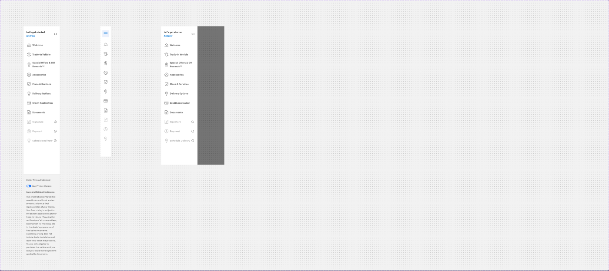

# Left Navigation Bar

## Figma
Page **Navigation** (`5607:20490`), file `g5hh34klkdaAOzyjoDRDgJ`.

| Set | Node id | Variants |
|---|---|---|
| Left Navigation Bar | `9067:7870` | 4 |

Axes: `Web`, `Tablet`, `Mobile Expand`, `Hidden` (all False/True). The real combinations are:
- `Web=True` (216x1387) desktop
- `Tablet=True` (64x775) icon rail
- `Mobile Expand=True` (375x823) drawer over a backdrop
- `Tablet=True, Mobile Expand=True, Hidden=True` (0x0) an empty/hidden placeholder

There are no non-variant props.



## Purpose
The checkout journey's section navigation: the list of deal steps (Welcome → Trade-In → Offers → … → Schedule Delivery). It has a greeting header and a dealer legal footer.

## Anatomy (Web=True)
```
Left Navigation Bar  V, padding-top 24, gap 24, space-between, 216 wide, bg/default, right 1px border/default
├─ Frame  V gap 24
│  ├─ Journey bar (Collapse=False)  H p0/16, gap 8, 44 tall
│  │  ├─ Content V: "Let’s get started" body/2/bold text/default + "Andrew" body/2/bold primary/default
│  │  └─ icon-24 (collapse ←|)
│  └─ Content  V gap 16 → Navigation Item × n (40 tall each)
└─ Left Nav Footer (Property 1=GM)  V p24/16, gap 16, bg/variant, top+right 1px border/default
```

### Navigation Item (`9085:20713`, base, 7 variants)
Axes `Active`, `Disabled`, `Icon Only`, `Multi-Step`, plus boolean `Show Icon Status` (false).
```
Item  H p0/12, gap 8, 238x40 (216 inside the nav)
└─ Main  H p0/8, gap 8, centre
   ├─ icon-24
   ├─ Label  body/2/bold (14 Bold)
   └─ Icon Status 16 (hidden unless Show Icon Status)
```
| state | Main bg | label | extra |
|---|---|---|---|
| default | `bg/default` | `text/variant` | |
| active | `bg/variant` | `text/default` | **2px right border `primary/default`** on the item |
| disabled | `bg/default` | `text/disabled` | Icon Status `Info` shown (ⓘ) |
| icon only | 64x40, Main 40x40 | no label | same active/disabled styling |
| multi-step (active) | V gap 8 | parent row + 6 × Nav sub Item | 238x328 |

### Nav sub Item (`9085:20397`, base): `State: Default|Hover|Selected`
H, padding p0/12/0/**52** (indented past the icon), gap 8, 40 tall. Label body/2/bold `text/variant`, with an optional hidden icon-24 and status. Selected = `bg/variant`, `text/default`, 2px right `primary/default`. **Hover is identical to Default** (no visible hover).

### Icon Status (`9067:12697`, base): `Success|Error|Info|Status4|Status5`
16px status glyphs. Status5 is a 12px `Loader` (spinner).

### Journey bar (`9067:12688`): `Collapse=False|True`
Collapsed (64x40): a 40x40 `primary/subtle` square with a hamburger icon-24 (custom colour on).

### Left Nav Footer (`9067:15433`): `Property 1: DR 2.0|GM|Acura`, boolean `Show Privacy Policy`
- **GM** (used, 216x508): bg `bg/variant`. "Dealer Privacy Statement" body/3/link `text/subtle`. "Your Privacy Choices" with the CCPA toggle glyph (image slot). "Sales and Pricing Disclosures" body/3/bold `text/subtle`. The disclaimer paragraph is body/3/regular `text/subtle`.
- DR 2.0: "© 2024 Tachyon DRS" + "Privacy Policy" body/3/regular `text/subtle`. Acura: helpful-links list (not for Chevrolet).

### Card - Nav / Media - Card Nav (`5502:7046`, `5502:7232`)
These are older card-style nav items (256x68, active = `primary/subtle` with a 4px right `primary/default` bar). They are **not used** by Left Navigation Bar.

## Visual spec
| part | token |
|---|---|
| nav background | `bg/default`, right border 1px `border/default` |
| item height / gaps | 40; items gap 16; item padding 12 + 8 inner |
| active indicator | `bg/variant` fill + 2px right `primary/default` |
| label | `body/2/bold`; `text/variant` / `text/default` (active) / `text/disabled` |
| greeting | `body/2/bold`, name in `primary/default` |
| footer | `bg/variant`, `body/3/*` in `text/subtle` |
| mobile backdrop | `backdrop/default` (#000 @ 52%) |

## Content (Web default)
Journey bar: "Let’s get started" / "Andrew". Visible items: Welcome, Trade-In Vehicle, Special Offers & GM Rewards™, Accessories, Plans & Services, Delivery Options, Credit Application, Documents, Signature (disabled), Payment (disabled), Schedule Delivery (disabled). Hidden items: Payment Options, Request Vehicle (multi-step active), Personal Information. The footer is the GM disclaimer ("This information is intended as an estimate and is not a sales contract. It is not a final representation of your pricing. …").

## Responsive
- **Desktop** (≥1280 in the templates): 216 (or 238) wide, labels visible.
- **Tablet** (768): a 64px icon rail. The Journey bar is collapsed to the hamburger square, items are icon-only, and the footer is hidden.
- **Mobile**: the nav is hidden. The In-page Header mobile shows an `_expand-collapse` button, and tapping it opens `Mobile Expand`: the full 216px Web nav over a `backdrop/default` overlay on a 375 screen.

## Notes
- Width is inconsistent: the component is 216 wide but the item components are 238. The templates use 216 (L 1440, XL 1920) and 238 (XL 1600, M 1280, M 1024).
- Disabled items show an info status icon (presumably "complete earlier steps first"). There is no tooltip spec for it.
- Nav sub Item Hover = Default, so no hover style is defined for items. Add a hover (e.g. `bg/variant`) in code.
- The template screenshot labels differ ("Delivery Mode", "Protection Plans", "Financing"), so copy varies by instance.
- Do not export the CCPA "Your Privacy Choices" icon or OEM logos; treat them as image slots.
