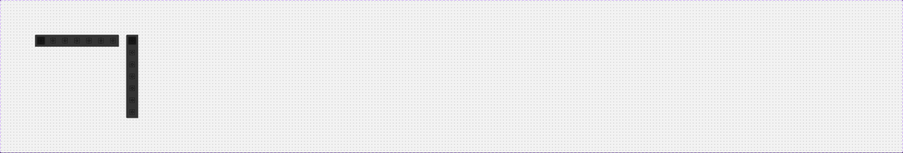

# Live (live-session toolbar)

## Figma
Page **Navigation** (`5607:20490`), file `g5hh34klkdaAOzyjoDRDgJ`.

| Set | Node id | Variants |
|---|---|---|
| Live | `228:105852` | 2 (`Mobile: False\|True`) |
| Live screen footer (published, "Section 1") | `228:105869` | 1 component |

Related: **Live Banner** on the Notifications page (`notifications.md`). The 32px item is an instance of another `Live` set (`228:107196`, `Active: True|False`) that is not on this page.



## Purpose
A floating dark toolbar shown during a "Live Personal Session" with the dealer (co-browse/video): a vertical rail of 7 tool icons on desktop and a horizontal bar on mobile.

## Anatomy
Desktop (`Mobile=False`, 48x336):
```
Live  V auto-layout, padding 8, gap 16, bg dark-grey/strong (#343434), radius 4/0/0/4 (left corners), shadow/s
└─ Live item × 7  (32x32)
   ├─ Rectangle 32x32 r4: active = #000 @ 52% (backdrop/default), inactive = #343434
   └─ icon-24 (glyph from icon font; colour per instance)
```
Mobile (`Mobile=True`, 336x48): H, padding 8, gap 16, radius 4/4/0/0 (top corners), same fill and shadow.

**Live screen footer** (336x34): `bg/default` with a 134x5 "Home Indicator" bar (r100, `bg/inverse`). This is the iOS home indicator strip shown under the mobile live screen.

## Visual spec
| part | token |
|---|---|
| bar background | `dark-grey/strong` (#343434) |
| shadow | `shadow/s` (`--aec-box-shadow-s`) |
| radius | 4 on the screen-inner side only (`--aec-border-radius-rounded-rect`) |
| item | 32x32, r4; active bg `backdrop/default`, inactive `dark-grey/strong` |
| padding / gap | 8 / 16 |

## Variants & states
Desktop is docked to the right edge (vertical) and mobile is docked to the bottom (horizontal). The first item is `Active=True`; the other six are `Active=False`. There are no hover or disabled states.

## Content
Icon-only (7 tools). The icon glyphs are swapped per instance and their names were not exposed. Add an `aria-label` per tool in code.

## Notes
- The icon colour in the item is #000 by default (custom-colour off). On the dark bar the glyphs need `icon/inverse`. Check this against the screenshot (the glyphs render light grey).
- The active state darkens the item rather than highlighting it, which gives low contrast.
