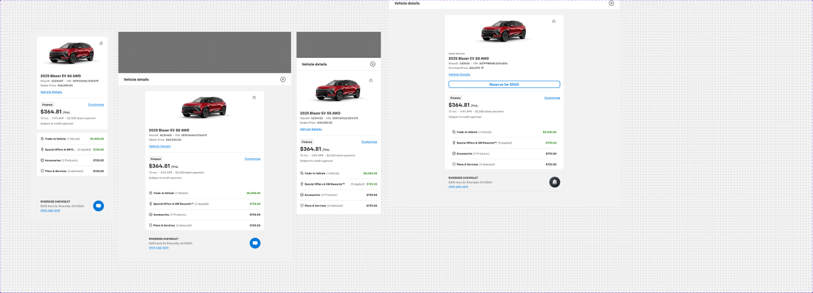

# Mathbox (vehicle details)



## Figma
- Page `Mathbox (vehicle details)` (5842:898). Published set **Mathbox (vehicle details)** `6516:90005`, 5 variants.
- Variant axes (boolean-style): `Web`, `Tablet`, `Mobile`, `Hide`, `In-store` (True/False). Only 5 combos exist:

| Variant | Node | Size |
|---|---|---|
| Web=True (desktop side panel) | 6516:90004 | 362×844 |
| Tablet=True | 6516:90002 | 768×1024 |
| Tablet=True, In-store=True | 2889:65628 | 1024×768 |
| Mobile=True | 6537:98219 | 375×812 |
| Mobile=True, Hide=True (collapsed, 0×0) | 6542:101978 | 0×0 |

- Non-variant props: `Lease Offer` (bool, false), `Summary` (bool, true — shows the Summary rows), `Live Chat` (bool, true — shows dealer/live-chat footer).
- Built from unpublished parts in SECTION `_Unpublished Trax components` (6153:81370): `vehicle - Details` (5502:4932), `Image and share` (485:102572, 2 variants), `Payment type` (5835:77735, 3 variants), `Summary - mathbox` (6516:24822), `_Summary Chip` (5502:5051), `Summary Amount` (5502:5059, 2 variants), `_Summary Text type` (6516:23503, 3), `Reservation status chip` (5502:5160, 5), `_Timer chips` (59:104432, 4), `Live Chat / Desktop` (5502:4916), `Live Chat` (2929:137024, 2).
- Page also has a documentation "Variants Grid"/"Spacing View" (10164:43499) with redlines 16/16/24/24/16/2/16/8/24/80/16/16.

## Purpose
Persistent vehicle + price summary ("math box") shown beside every secure-checkout step on desktop, and as a side/bottom sheet on tablet/mobile: vehicle photo, YMMT, stock/VIN/price, selected payment type with monthly payment, running deal summary (trade-in, offers, accessories, plans) and dealer contact / live chat.

## Anatomy (Web variant, 362×844)
```
Mathbox  V, padding 24, gap 16, bg bg/variant
├─ Frame (card stack)  V, gap 16, fill
│  ├─ vehicle - Details  V, gap 0, bg bg/default, 314×412
│  │  ├─ Image and share  V, gap 8, centered, 314×146
│  │  │  ├─ Vehicle image slot 282×146  (IMAGE — vehicle photography, do not export)
│  │  │  └─ Icon Button - Neutral (small, plain, rectangle) → share icon, top-right  [.aec-icon-btn]
│  │  ├─ Details  V, padding 16, gap 8, bg #ffffff
│  │  │  ├─ Row: Year+Name "2025 Blazer EV" + Trim/Drivetrain "SS AWD"  H gap 4  heading/5 text/default
│  │  │  ├─ Row: "Stock#:" A23X45Z  •  "VIN:" 3G1FJ3456L1234575   H gap 4  body/3/medium
│  │  │  ├─ Row: "Dealer Price:" $48,500.00   body/3/medium
│  │  │  └─ Link (medium, primary) "Vehicle Details"   [.aec-link]
│  │  └─ Payment type (Finance)  V, padding 0/16/16/16, gap 4, bg bg/default
│  │     ├─ Line 1px border/default
│  │     └─ V gap 4:
│  │        ├─ Row space-between: Chip - Information (small, grey) "Finance" [.aec-chip info]  +  Link (medium, primary) "Customize"
│  │        ├─ Row baseline: "$364.81" heading/3 + "/mo." body/1/medium
│  │        ├─ Row wrap gap 4: "72 mo." • "5.9% APR" • "$2,500 down payment"  body/3/medium text/variant, bullets text/disabled
│  │        └─ "Subject to credit approval"  body/3/regular text/variant
│  └─ Summary - mathbox  V, padding 4/16/4/16, gap 0, bg bg/default, 314×192
│     └─ 4 × _Summary Chip (V, padding-top 4, gap 8; inner row H padding 8/0, gap 8; bottom 1px divider border/default)
└─ Live Chat / Desktop  H, padding 12/16, gap 16, centered, 1px border/default, 314×84
   ├─ Content V: dealer name body/3/bold · address body/3/regular text/subtle · Link (small, primary) phone
   └─ Live Chat 48×48 circle #0077d9 (= primary/default) with 24px white chat icon
```

### _Summary Chip (row)
`[icon-16] Title (body/3/bold text/default) "(" Quantity ")" (body/3/medium text/variant) …… Summary Amount (right-aligned)` + divider line.
`Summary Amount` variants: `Negative=False` → "Price" body/3 text/default; `Negative=True` → "-" + price in `success/on-subtle` (the Web instance renders credit amounts bold in `success/default`).

## Content — exact price rows (default)
| Row | Title | Qualifier | Amount | Colour |
|---|---|---|---|---|
| 1 | Trade-In Vehicle | (1 Vehicle) | $5,000.00 | success/default (credit) |
| 2 | Special Offers & GM Rewardsᵀᴹ | (3 Applied) | $720.00 | success/default (credit) |
| 3 | Accessories | (2 Products) | $720.00 | text/default |
| 4 | Plans & Services | (4 Selected) | $720.00 | text/default |

Each row has a 16px leading icon. Credit rows use `Summary Amount Negative=True`: a separate sign text node (success/on-subtle) — in these instances its content is an empty/non-printing glyph (overridden from "-"), so verify in Figma whether credits should show "-"; the amount itself is green. Amounts are body/3/bold.

Vehicle block: "2025 Blazer EV" "SS AWD"; Stock#: A23X45Z; VIN: 3G1FJ3456L1234575; Dealer Price: $48,500.00; link "Vehicle Details".
Dealer footer: "RIVERSIDE CHEVROLET" / "8200 Auto Dr, Riverside, CA 92504" / link "(951) 400-5219".
Data-binding layer names are used (e.g. `["Vehicles"]["Year"][0] ["Vehicles"]["Name"][0]`, `["Dealerships"]["Name"][0]`).

### Payment type variants (`Payment type` 5835:77735)
| Variant | Chip | Big value | Detail row | Footnote |
|---|---|---|---|---|
| Finance | Finance | $364.81 /mo. | 72 mo. • 5.9% APR • $2,500 down payment | Subject to credit approval |
| Lease | Lease | $523 /mo. | 48 mo. • 12,000 miles/yr. • $3,343.62 due at signing | $0 security deposit. Subject to credit approval |
| Cash | Cash | $33,399.29 | — | — |
All have the "Customize" link on the right of the chip row.

### Status parts (available for composition, not placed in the default variants)
- **Reservation status chip** (Chip - Information small, r4): "Vehicle reserved (expires in 15 days)" success/subtle bg; "Reservation expires in 2 days" warning/subtle; "Reserve now by paying $100" success/subtle; "Reserve again by paying $100" error/subtle (text error/default); `Reserve CTA` → Button - Standard (small) "Reserve for $500".
- **_Timer chips** (420×52, padding 16/16/0/16; inner bar padding 8, r4, space-between): "Reserved" + "Submit credit app. in **1h 30m**" on success/subtle (green), "**30m**" on warning/subtle (orange), "**15m**" on error/subtle (red); expired: "Vehicle reservation expired" error/default on error/subtle. Label body/3/regular in the status colour, time body/3/medium text/default.
- **Image and share** `Vehicle fallback image=True`: bg/default box with border/default, "No Image Available" heading/5 text/disabled + share icon button.
- **_Summary Text type** (Heading body/2/regular / Sub heading body/3/regular / Body text body/3/regular text/subtle, each with right "$5000" + optional 16px icon) — alternative row style.
- **Live Chat** `Property 1=In-store` uses a linear-gradient circle instead of solid blue.

## Visual spec
- Panel bg `bg/variant` (#f2f2f2); cards `bg/default`; Details frame uses raw #ffffff (same value as bg/default).
- Dividers `border/default` 1px. Live-chat footer: 1px `border/default`, no radius, no fill (sits on bg/variant).
- No shadows on the web variant. Cards have no radius on web; tablet/in-store inner card `r8`.
- Text: headings heading/5, monthly price heading/3, meta body/3/medium (labels text/variant, values text/default), separators "•" text/disabled.

## Responsive
- **Tablet (768×1024)** and **In-store (1024×768)**: rendered as a side sheet over `backdrop/default` scrim: `Sidesheet - Header` (56px, padding 16/24, title "Vehicle details" heading/5 + close icon), body bg/variant padding 24/16/40/16 (in-store 24/16/64/16), card 528 wide `r8` bg/default, Live Chat footer 528×84.
- **In-store** content differences: "Used Vehicle" label (body/3/regular text/variant), Stock 23053A, VIN 3GTP9BEK8LG324856, label **"Purchase Price:" $60,895** (instead of Dealer Price), and a "Reserve for $500" button (Reservation status chip `Reserve CTA`).
- **Mobile (375×812)**: full-screen sheet with `Sidesheet - Header` + bg/default body padding 16, content 343 wide, gap 4; no Live-Chat footer.
- **Hide**: collapsed 0×0 variant (sheet closed).

## Notes
- Live-chat circle uses raw #0077d9 (matches `primary/default`), and Chip grey uses raw #f2f2f2 (`bg/variant`) inside instances.
- `Summary Amount` base defines body/3/regular, but instances override to body/3/bold — implement amounts as bold.
- Components use `success/on-subtle` for the minus sign — not in our token list; map to `success/default`.
- "Hide" variant has 0×0 size (degenerate); mobile variant has `Hide=True` as the default prop value.
- Vehicle photography slot only — not exported.
