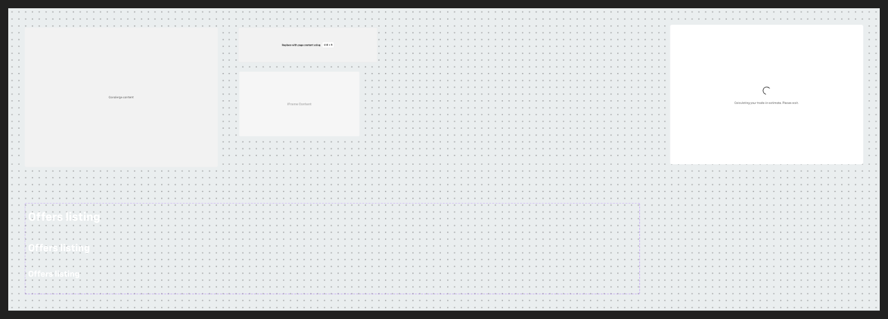

# Misc patterns — Titles, Loading screen, Concierge content, Placeholder, iFrame, data-table cell kit

Page `Misc.` (5616:19713), SECTION **Misc** `6175:21149` (components inside a normal, published section).

## Titles — `6549:102864` (6 variants)
Axes: `Desktop` / `Tablet` / `Mobile` × `Hidden` (True/False).
Large page titles on dark/hero backgrounds: text "Offers listing", white (#ffffff, raw — no text style).
| Variant | Size | Font size | Padding |
|---|---|---|---|
| Desktop | 458×93 | 56 | 10/0 |
| Desktop Hidden | 1440×125 | 96 | — |
| Tablet | 356×114 | 48 | 26/0 |
| Tablet Hidden | 1440×125 | 72 | — |
| Mobile | 255×84 | 40 | 16/0 |
| Mobile Hidden | 1440×125 | 56 | — |
Note: no typography style applied (display/1–2 would be closest); "Hidden" variants are oversized 1440-wide versions.

## Loading screen — `455:147107` (934×675)
V, padding 80/0, gap 32, centred, r8, bg bg/default. `icon-40` (64×64, custom-color on — spinner/animated icon) + "Calculating your trade-in estimate. Please wait." body/2/regular text/subtle (layer name "Please enter your email to continue" — copy-paste leftover). Use with `.aec-spinner` if implementing.

## Concierge content - Frame — `5748:40066` (934×675)
Same frame as Loading screen but bg bg/variant with centred "Concierge content" body/2/regular text/variant — a placeholder area for the embedded concierge/video session.

## Placeholder — `5502:5234` (672×168)
H, centred, gap 8, r4, bg bg/variant, 1px border/default. "Replace with page content using" body/3/bold + keycap chip (bg/default, 1px border/default, r4, padding 10/8) showing "⇧⌘ + R" (vector). Designer-only slot.

## Acura- iFrame — `774:19679` (581×312)
r4, bg #f6f6f6 (no token, ≈ bg/variant) with centred "iFrame Content" heading/5 inverse/text/variant. Placeholder for third-party embeds; Acura naming is a leftover.

## Section 1 (3290:19563) — data-table cell kit (unpublished, `_`-prefixed; summary only)
Building blocks for a custom data table:
- `_row-container` (5 variants: `No of column` = 1–5; 1032 wide).
- `_cell-text` (6: font size Regular/Small × decoration None/Bold/underlined), `_cell-numerical-value` (8: Default/Blue/Green/Red × Large/Small), `_cell-icons` (1–3 icons), `_cell-rating` (10 boolean-named variants), `_cell-user` (Large/Small), `_cell-tags`, `_cell-button`, plus two `_cell/…` boolean-named single cells (150×48).
- Two example frames assembling rows (1000×384, 712×48).
Prefer the existing `.aec-table` for implementation; this kit is not published.
