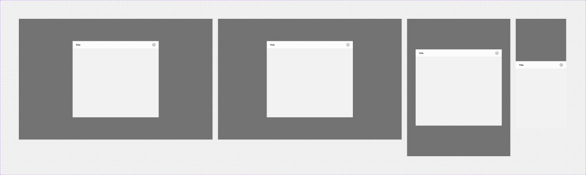
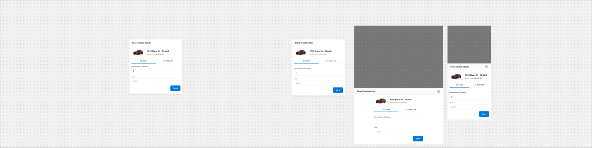
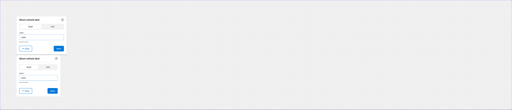
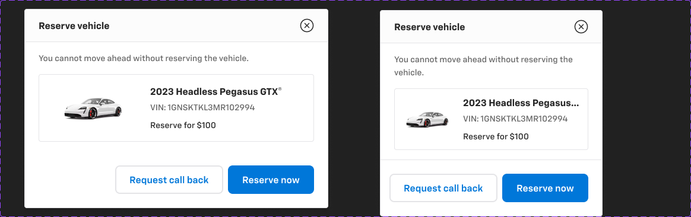
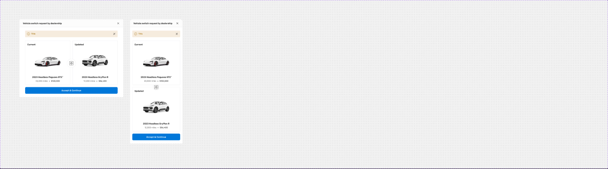
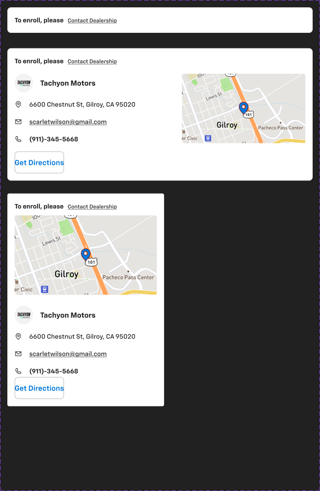

# Modals & dialogs

Figma page *Sheets and Modals* (`5613:20297`), file `g5hh34klkdaAOzyjoDRDgJ`. Shared header/footer parts are described in [sheet-anatomy.md](sheet-anatomy.md).
The atomic `.aec-modal` already exists. These patterns are its content compositions.

| Set | Node | Variants | Axes / props |
|---|---|---|---|
| Modal | `6575:25527` | 4 | `Web (1440)` / `Web (1366)` / `Tablet` / `Mobile` (+ `Absolute`=False); bools Footer, Header, Keypad |
| modal - content *(unpublished, used by Modal/Share)* | `284:92400` | 26 | `Small` × `Mobile` × `Type` (12 types); bools Email, Text, Text Field, Text Area, Info icon |
| Share | `2860:109395` | 4 | `Web (1440)` / `Web (1366)` / `Tab (768)` / `Mobile (375)`; bools Footer, Header, Keyboard |
| Dialog - Share | `5803:35472` | 2 | `Property 1` = web / mobile; bool Toast |
| Reserve vehicle | `5748:37898` | 2 | `Property 1` = web / Mobile; bool Reserve Amount |
| Switch vehicle | `6471:104019` | 2 | `Property 1` = web / mobile; bools Car comparison, Deals |
| Contact Dealership | `258:89111` **and** `9212:137131` | 3 each | `Collapse` / `Expand web` / `Expand mobile` |
| Keyboards | `3386:99777` | 4 | `Device` Tablet/Mobile × `Case` Upper/Lower. **Device mock only** (iOS keyboard shown under mobile modals). Do not implement |

## 1. Modal (`6575:25527`)
**Purpose**: a generic centred modal frame. Its body is an instance of `modal - content` (swap the Type).



**Anatomy (Web 1440, `6575:25528`)**: 1440×900 frame, content centred (x 400, y 166)
```
Overlay Rect (backdrop/default)
content 640×568 V gap 0 bg/default  (radius 0, no shadow)
├─ Sidesheet - Header 640×56 — "Title" heading/5, close Icon Button - Neutral, bottom border 1px border/default
├─ modal - content (Type=Placeholder) 640×512 — grey bg/variant placeholder rect
└─ Sidesheet - Footer (hidden; bool Footer)
```
**Mobile (`6575:25540`)**: full-width bottom-anchored stack (header at y 316, content 375×440, then hidden iOS keyboard (`Keypad`), then hidden footer).
It has no radius.

### modal - content types (`284:92400`)
Sizes: regular 640 wide (some 768), `Small=True` 464 wide, Mobile 375 (343 for dealer cards). Typical body padding is 24, gap 8–16.
| Type | Desktop node / size | Content |
|---|---|---|
| Placeholder | `284:92397` 640×512 (Small `284:92398` 464×278, Mobile `284:92399`) | grey `bg/variant` block |
| Default | `284:93312` 640×132 (Small `284:93663`, Mobile `284:93495`) | confirm copy `body/2/regular text/subtle`: "There are multiple files uploaded under 'References' Do you want to delate all or select individual files to delete? This process cannot be undone." + "john.doe@mymail.com" + **Link** (medium, neutral) "Edit". Hidden text field and "Reason" textarea (bools Text Field / Text Area) |
| Modify accessories | `6471:108345` 768×512 / M `6552:110225` | "Please choose the payment type from below…", table "Accessories (4) / Price Details / Payment Option", 3 × `_Modifying accessories card` (image + "19-in Glint Black Alloy Wheels" $178), **Radio button** pairs "Pay Monthly ($20/mo)" / "Pay Upfront", "Total Monthly Payment" |
| Modify payments | `5502:7787` 768×318 / M `6551:104589` | same table for "Products (2)": "GardX Vehicle Protection System" $130, Pay Monthly ($15/mo) / Pay Upfront |
| Payment | `861:68262` 768×527 / M `866:61634` | "Card Information" (John Freeman, card-logo image slot, ••••4612), "Billing Details" + **Link** "Edit", address, email, phone |
| Confirm your deal | `1010:40676` 768×268 / M `1011:39819` | "You have selected the option from …", comparison rows Monthly Payment $420.00 → $396.00, Down Payment $4,500.00 → $3,800.00, Term 84 months; Chip - Information |
| Share vehicle | `375:90052` 456×429 / M `2015:109680` | see **Share** below |
| Individual Protection plan | `2310:73936` 640×582 / M `2310:73938` | F&I filter dropdowns "Months" (All/12/18/24 mo) and "Miles", **Checkbox with Label** ×4, 7 × `F&I coverage list Items` with **Radio button** ("GM Care Near New 88 mo. 88,888 mi.") |
| Packages Protection plan | `2310:73942` 640×646 / M `2310:73940` | adds **Underlined - Inset** tabs "ThreeForOne Protection / Vehicle Service Contract / Luxcare Surface Protection / Exterior Protection" |
| login-otp | `3268:115104` 640×410 / M `3268:115196` | `_login-otp` (State Default/OTP/Error): brand logo slot, "Lets Get Started", "Please enter your email to continue", Email field "john.freeman@tekion.com", **Button - Primary** "Continue". The OTP state uses `_OTP digit fields` (`3187:95878`) + `_OTP Error comp` (resend link) |
| Contact Dealership | `9224:154990` 668×294 / M `9224:154989` 343×484 | same as Contact Dealership (§6) |
| Dealer Verification Pending | `9631:19351` 668×328 / M `9631:19383` | "To proceed to Signature, please wait for…" + same dealer card |

## 2. Share (`2860:109395`), "Share Vehicle details"

- **Web 1440 (`2832:73188`)**: Overlay + centred `content` 456×469, **radius 8, shadow/l**. It has Sidesheet - Header ("Share Vehicle details", header fill raw `#ffffff`)
  + `modal - content` Type=Share vehicle (V padding 24/16 gap 16, bg/default):
  - "top content" 424×64 radius 8 `bg/variant`: 120×64 vehicle image slot + "2025 Blazer EV" / "SS AWD" / "Purchase Price: $33,392.00".
  - **Underlined - Inset** tabs (large, count 2): "Email" | "Copy Link" → `.aec-tabs`.
  - `share - compo` (`384:97916`, 3 variants): **Textfield** = "Enter Recipient Full Name" + email field (`Text field with button`) + **Button - Primary** "Send";
    **Copy link** = link field + check "Link copied"; **Email sent** = Chip - Information "Email Sent".
- **Mobile (`2832:73206`)**: bottom-anchored with scrim `#000000 @0.50` (raw; ≈ backdrop/default 0.52), header + content 375×429, hidden Keyboards.

## 3. Dialog - Share (`5803:35472`), "Share vehicle deal"

**Web (`5502:7474`)** 428×322, V, **radius 4, 1px border/default, shadow/l**, bg/default:
- Header 62 high, H padding 16/24 gap 16. Title "Share vehicle deal" `heading/4` + Icon Button - Neutral (close). There is also a hidden leading back icon button.
- Content V padding 0/24 gap 16: **Segment Control** (380×50, padding 6, radius 4, bg `bg/variant`; active option bg/default + shadow/xs, radius 4)
  + **Standard Text Input - Outlined** (label "Label", focused border `primary/default`, assistive text).
- `_Dialog - Actions` (`5502:7515`, Interstitial true/false) 96 high, padding 24, gap 16. Left: **Button - Standard** (medium) "Copy link". Right:
  **Button - Primary** (medium). Interstitial=True puts two buttons on the right (Standard + Primary).
- Hidden Toast (bool Toast) → `.aec-snackbar`.
**Mobile (`5803:35473`)** 375×352: top radius 16/16/0/0, header bottom border, same content at 327 wide.

## 4. Reserve vehicle (`5748:37898`)

**Web (`5748:37833`)** 512×336, radius 4, 1px `border/default`, `shadow/l`, bg/default:
- Sidesheet - Header "Reserve vehicle".
- Content V padding 16/24 gap 16: "You cannot move ahead without reserving the vehicle." `body/2/regular text/subtle`, then **Card - Trade-In** 464×114
  (H padding 12 gap 16, radius 4, 1px border/default). The card has a 160×90 vehicle image slot (radius 4), the title "2023 Headless Pegasus GTX™" `heading/5`, a description row,
  and "Reserve for $100" `body/2/medium` (bool Reserve Amount).
- `_Dialog - Actions` (Interstitial=True): **Button - Standard** (large) + **Button - Primary** (large). Labels come from the instance (not captured).
**Mobile (`5748:38922`)** 375×348: card 327 wide, actions get a top border.

## 5. Switch vehicle (`6471:104019`), "Vehicle switch request by dealership"

**Web (`6471:104020`)** 743×559, radius 4, bg/default (no border or shadow on the component):
- Header 56: H padding 16/24, bottom border 1px border/default. Title `heading/5`, hidden subtitle and back button, close Icon Button - Neutral.
- Body H padding 24/40, holding a 663-wide column (V gap 24):
  - **Inline notification** Kind=Warning (`warning/subtle`, padding 12, radius 4, "Title" + dismiss) → `.aec-alert` warning.
  - Two comparison cards (324×319 each, padding 16, radius 4, 1px border/default, gap 16): "Current" ("2023 Headless Peguses GTX", "23,000 miles • $100,500")
    and "Updated" ("2023 Headless Gryffon R", "12,000 miles • $86,400"), with vehicle image slots. A 64×64 round (radius 1000) swap-icon badge sits between the cards
    (1px border/default, 32px icon).
  - **Button - Primary** (large, full width) "Accept & Continue".
**Mobile (`6471:104068`)** 375×894, top radius 16/16/0/0. The cards stack vertically with the swap badge between them, at 343 wide with padding 24/16.

## 6. Contact Dealership (`258:89111` / `9212:137131`)

An expandable inline card that also appears as modal content (Type=Contact Dealership) and as the "Contact dealer - collapsed" slot in sidesheet content.
- **Collapse=True** (`258:89144`) 668×56: H padding 16, radius 8, 1px border/default, bg #ffffff. It reads "To enroll, please" `body/2/bold` + **Link** (small, primary) "Contact Dealership".
- **Expand web** (`258:89112`) 668×290: V padding 16 gap 16, radius 8, 1px border/default, bg/default. Row H gap 40:
  - Details (326 wide, gap 16): dealer logo slot 40×40 + "Tachyon Motors" `body/1/bold`. Then 16px icon rows (gap 16): "6600 Chestnut St, Gilroy, CA 95020" `body/2/regular`,
    "scarletwilson@gmail.com" `body/2/link`, "(911)-345-5668" `body/2/bold`. Then **Button - Primary** (large, **plain** style, 1px `border/variant`) "Get Directions".
  - **Map** (`250:82392`) 270×152, radius 4, image slot with `primary/default` location pin (Zoom / Full-screen icon booleans).
- **Expand mobile** (`258:89148`) 343×466: details stack above the map.

## Notes
- **Contact Dealership duplicates**: `258:89111` and `9212:137131` are node-for-node identical (111 nodes, 0 differences). The unpublished
  `250:81818` is also identical apart from a 3px text-width difference. Keep one (suggest `258:89111`) and flag the other two for deletion in Figma.
- Elevation and radius are inconsistent across dialogs. Modal has radius 0 and no shadow. Share has radius 8 + shadow/l. Dialog - Share and Reserve have radius 4 + border + shadow/l.
  Switch vehicle has radius 4 with no shadow. Mobile is 16/16/0/0 (Dialog - Share, Switch) or square (Modal, Share). Recommend radius 8 + shadow/l desktop and 16 top on mobile.
- Dialog - Share uses `heading/4` for the title, while every other header uses `heading/5`.
- Raw values: Share header fill `#ffffff` (= bg/default), Share mobile scrim `#000 @0.50`, Contact Dealership collapsed bg `#ffffff`, and map pin stroke `#970000`.
- Typos: "delate" (Default modal copy), "Peguses" (Switch vehicle), layer "Vehciel detail + Pricing".
- Images (vehicle photos, dealer logo, map, card-network logo, login brand logo) are slots. Do not export them.
- Keyboards (`3386:99777`) is an iOS keyboard device mock. It is documented only so you know to ignore it.
