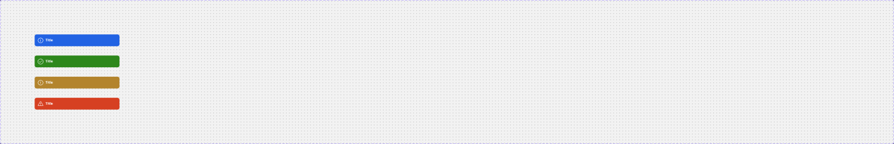
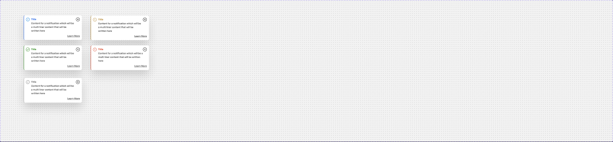
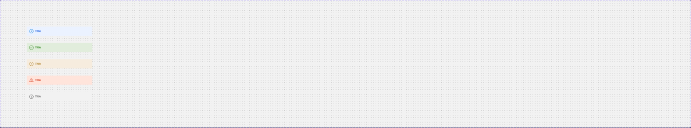
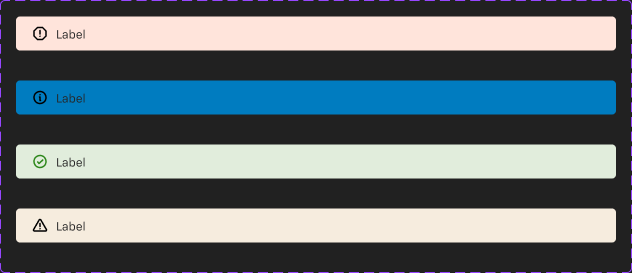

# Notifications & Alerts

Page **Notifications & Alerts** (`3921:3231`), file `g5hh34klkdaAOzyjoDRDgJ`. There are five published sets. The only unpublished part is `_Card offers selected view footer` (`524:117743`; Price/Timer/CTA), which none of these sets use.

| Set | Node id | Variants | Axes / props |
|---|---|---|---|
| Live Banner | `223:101632` | 1 component | none |
| Banner notification | `2338:119771` | 4 | `Kind: Informative\|Positive\|Warning\|Negative`; booleans `Description`, `Actions`, `Close` (all false) |
| Toast notification | `2338:120068` | 5 | `Kind: … \| Secondary`; `Description`, `Actions`, `Close` (all **true**) |
| Inline notification | `2338:119903` | 5 | `Kind: … \| Secondary`; `Description`, `Actions`, `Close` (all false) |
| In-page Alert Banner | `512:52686` | 4 | `Status: Information\|Success\|Error\|Warning` (wraps `_Alert/Universal`) |

All three "notification" sets share **one anatomy** (343 wide, mobile-first):
```
Root  H (Toast: V) auto-layout, padding 12, gap 8
├─ Section  V, fill
│  ├─ Title and Icon  H gap 8 → Icon 24 (status glyph, icon font) + "Title" heading/6 (14 Bold)
│  └─ Description (prop)  H padding-left 32 (aligns under the title) → body text 14 body/2/regular
├─ Button (prop "Actions")  V right-aligned → Link (neutral, medium) / Link - Inverse — "Learn More"
└─ icon-24 close (prop "Close")
```
Toast puts the Section and close in one H row, with the Link row below it right-aligned.

---

## 1. Live Banner (223:101632)


**Purpose**: an alert that the dealer is online and a Live Personal Session can be joined (pairs with `live-session.md`).
```
H, padding 16, gap 16, space-between, centre; 710x104; bg success/default; shadow 0 4 4 rgba(0,0,0,.25) (raw); radius 0
├─ Left H gap 16
│  ├─ 48x48 circle (r80) bg/default, padding 8 → icon-32 (custom colour)
│  └─ Message V gap 4: "Live Personal Session Active" heading/5 text/inverse ; body body/2/regular text/inverse
└─ Right H gap 24: Link - Inverse "Dismiss" + Button - Inverse (medium, filled) "JOIN NOW"
```
Copy: "Live Personal Session Active" / "Your dealer is online, please join the Live Personal Session now." / "Dismiss" / "JOIN NOW".
Reuse: `.aec-link` inverse, `.aec-btn--inverse`. No mobile variant. The shadow is raw (it is not a shadow token).

## 2. Banner notification (2338:119771): solid, high emphasis


| Kind | background | icon |
|---|---|---|
| Informative | `info/default` (#2263e3) | Info |
| Positive | `success/default` | CheckCircle |
| Warning | `warning/default` (#b3842d) | Warning |
| Negative | `error/default` | Warning (vector icon, not the icon font) |

343x48 by default, radius 8 (`--aec-border-radius-default`), no border/shadow. Title is heading/6 and `inverse/text/default`, description is body/2/regular `text/inverse`, and icons use `icon/inverse`. Action uses `Link - Inverse`. White text on `warning/default` #b3842d has a contrast of about 3.0:1. That fails AA for 14px text.

## 3. Toast notification (2338:120068): floating card


343x146 with every prop on by default. It is a white card: `bg/default`, radius 8, **2px left accent** in the kind colour, shadow `0 30 60 rgba(0,0,0,.15)` (raw effect, not a shadow token). Padding 12, gap 8.

| Kind | left accent | title colour | icon colour |
|---|---|---|---|
| Informative | `info/default` | `info/on-subtle` (#2263e3) | `primary/on-subtle` (#0077d9) |
| Positive | `success/default` | `success/on-subtle` | `success/on-subtle` |
| Warning | `warning/on-subtle` (#b3842d) | `warning/on-subtle` | `warning/on-subtle` |
| Negative | `error/default` | `error/on-subtle` | `error/default` |
| Secondary | `dark-grey/weak` (#afafaf) | `text/variant` | `icon/variant` |

Body is body/2/regular `text/default`, the action is `Link` neutral medium "Learn More", and the close is icon-24 (#000). Copy: "Title" / "Content for a notification which will be a multi liner content that will be written here" / "Learn More".
The page also has a loose instance `3625:918` (Informative, all props on).

## 4. Inline notification (2338:119903): tinted, in-flow


343x48, padding 12, gap 8, **radius 0**, no border or shadow. It has the same text and icon colours as Toast.

| Kind | background |
|---|---|
| Informative | `info/subtle` |
| Positive | `success/subtle` |
| Warning | `warning/subtle` |
| Negative | `error/subtle` |
| Secondary | `bg/variant` (icon `secondary/on-subtle` #262626) |

Action uses `Link` neutral.

## 5. In-page Alert Banner (512:52686): slim one-line strip


600x34. It wraps `_Alert/Universal` (V, padding 6/16, gap 12, radius 4). Hidden props in the base include `Subheading`, `Multiline`, `Mobile`, `Actions`, `Secondary Action`, `Action icon` and `Label value`. Content row: 16px icon + "Label" body/3/regular (12) `text/default`.

| Status | background | icon |
|---|---|---|
| Error | `error/subtle` | WarningOctagon `error/default` |
| Success | `success/subtle` | success icon `success/default` |
| Warning | `warning/subtle` | Warning `warning/default` |
| Information | **#007cc0 bound to `decoration/02`** | Info #007cc0 bound to `decoration/01` |

**Bug**: Information has a saturated blue background with a blue icon and dark text. This is unreadable and inconsistent with the other three statuses (they use subtle tints). It should be `info/subtle` + `info/default`. In this file the decoration tokens hold different values than the foundation list (decoration/01 is #f2bc18 there).

---

## Compared with the foundation (`specs/alert.md`, `banner.md`, `snackbar.md`)
| Foundation | This file | What's new |
|---|---|---|
| **Alert - Notification**: 440 wide, white, 2px left accent, **radius 0**, padding 16, placeholder icon (not tinted), `information` accent is grey #666 | **Toast notification** | The same idea (white card + 2px left accent), but now 343 wide, **radius 8**, padding 12, a real status icon and **coloured title** per kind, Informative uses `info/default` blue, there is a 5th `Secondary` (grey) kind, a "Learn More" link row and a close, and a much larger shadow (0 30 60 @15%). |
| **Banner**: one neutral style (`bg/variant`), r8, 16px icon, 14 Bold title, no statuses | **Banner notification** | **Solid status-coloured** backgrounds (4 kinds) with inverse text, 24px icons, an optional description/link-inverse/close. The foundation Banner has no statuses at all. |
| none | **Inline notification** | New: a status-**tinted** (`*/subtle`) square in-flow message with coloured title/icon, including Secondary. This is the closest to a classic "inline alert". |
| none | **In-page Alert Banner** | New: a slim 34px, 12px-text one-liner with a tinted bg and r4 (it fits under headers / in forms). |
| none | **Live Banner** | New: a product-specific success-green call-to-join banner with an inverse button. |
| **Snackbar**: light `bg/variant`, r4, message + link, no status/close | none | No snackbar equivalent here. Toast notification covers transient messages, now with status. |

Implementation hint: one `.aec-notice` base with modifiers `--solid` (Banner notification), `--toast` (white + accent + shadow), `--inline` (tint, r0), `--slim` (In-page Alert) and kinds `info|success|warning|error|secondary`. Reuse `.aec-link` (neutral / inverse) and `.aec-btn--inverse`.

## Notes
- Radius varies: Banner 8, Toast 8, Inline 0, In-page Alert 4, Live Banner 0.
- Icons are an icon font (`iconfont` text layers), except Negative, which uses a vector `icon-Warning`. Negative reuses the Warning glyph; In-page Alert uses WarningOctagon for errors.
- Warning accent on Toast is bound to `warning/on-subtle` while the others use `*/default` (same hex #b3842d).
- Shadows are raw effects, not bound to `shadow/*` styles.
