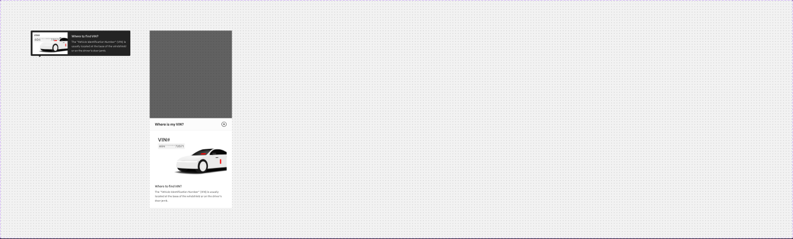

# Tooltip (pattern: "Where to find VIN?")

## Figma
Page **Navigation** (`5607:20490`), file `g5hh34klkdaAOzyjoDRDgJ`.

| Set | Node id | Variants |
|---|---|---|
| Tooltip | `536:165750` | 2 (`Mobile: True\|False`) |

No description and no other props.



## Purpose
A rich help tooltip with an illustration, used next to the VIN field (trade-in / vehicle entry) to show where the VIN is located. On mobile it becomes a bottom sheet.

## Anatomy: Mobile=False (454x122)
```
Tooltip  V, centre
├─ Container  H, padding 8, gap 18, radius 4, bg #232323 (no token)
│  ├─ Illustration 160x100, white bg: car photo ("Isometric perspective 1", IMAGE)
│  │   + VIN plate chip ("VIN#" + "6G4*********73571" body/2/medium text/variant on bg/variant) + red marker strokes (#ff0000)
│  ├─ Text  V gap 4, 260 wide
│  │  ├─ "Where to find VIN?"  body/2/medium  text/inverse
│  │  └─ Description           body/3/medium  inverse/text/variant (#b3b3b3)
│  └─ Link Container (hidden) → Link - Inverse (size=medium)
└─ Arrow  6px tall, padding-x 36, right-aligned (MAX): a 10x6 triangle #232323 pointing down
```
The arrow is at the bottom-right, so the bubble sits above the trigger, right-aligned.

## Anatomy: Mobile=True (375x812, full screen)
```
V, bottom-aligned
├─ Backdrop  375x812  #000 @ 60%
└─ Sheet  V
   ├─ Sidesheet - Header  56 tall, p16/24, bottom 1px border/default, close action; title "Where is my VIN?"
   └─ Body  V p16/24/24/24, gap 24, bg/default
      ├─ Illustration 327x205, r8 (same artwork, larger)
      └─ Details V gap 4: "Where to find VIN?" body/2/medium text/default + description body/3/medium text/variant
```

## Visual spec
| part | desktop | mobile |
|---|---|---|
| surface | #232323 (raw, near `inverse/bg/default` #262626) r4 | `bg/default` sheet; header bg #fcfcfc bound to `bg/default` |
| title | `body/2/medium` `text/inverse` | `body/2/medium` `text/default` |
| body | `body/3/medium` `inverse/text/variant` | `body/3/medium` `text/variant` |
| backdrop | none | #000 @ 60% (the token `backdrop/default` is 52%) |

## Content
Title "Where to find VIN?". Description: "The “Vehicle Identification Number” (VIN) is usually located at the base of the windshield or on the driver’s door jamb." Mobile header: "Where is my VIN?". Sample VIN "6G4*********73571".

## Responsive
Desktop is an anchored dark bubble. Mobile is a modal bottom sheet (reusing the `Sidesheet - Header` part, close X) over a backdrop.

## Notes
- This differs from the foundation `.aec-tooltip` (Tooltip - Dark: #262626, radius 0, padding 16, 384 wide, 8px arrow). Here the surface is #232323, the radius is 4, the padding is 8, there is an image slot and a 6px arrow. Build it as a variant of `.aec-tooltip` with a media slot.
- The illustration includes vehicle photography plus red marker vectors. Treat it as an image slot (not exported).
- The mobile backdrop opacity (60%) does not match `backdrop/default` (52%).
- The mobile header bg #fcfcfc is bound to `bg/default` (#ffffff), which looks like a stale style value.
