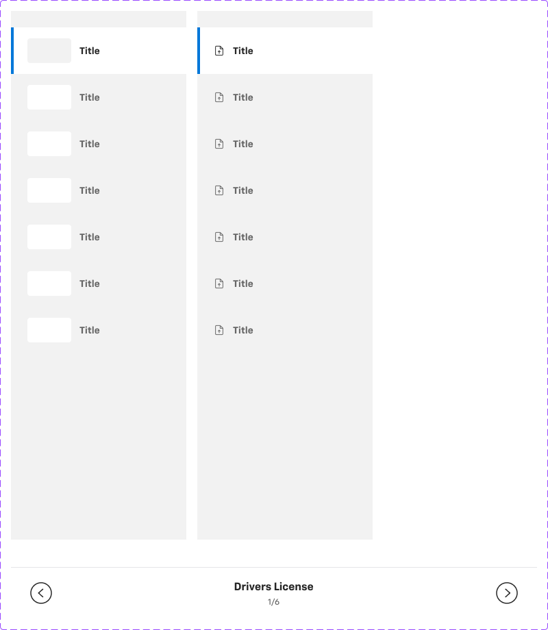
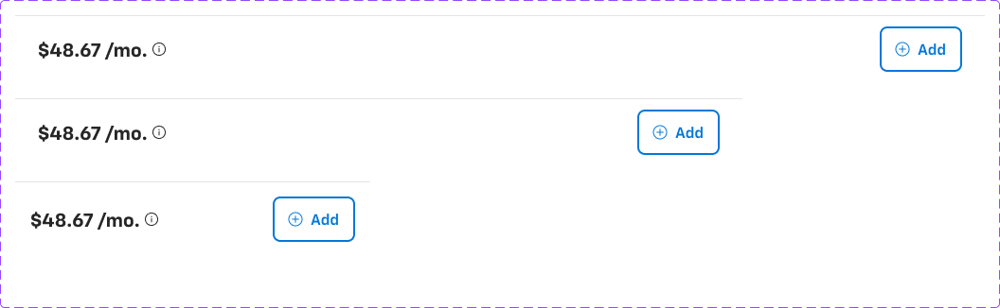

# Sheet anatomy (shared shell for sidesheets, modals, bottom sheets)

**Figma**: page *Sheets and Modals* (`5613:20297`), file `g5hh34klkdaAOzyjoDRDgJ`. All parts below live in the section
**Unpublished base components** (`6087:54288`). They are not published themselves. Every published sheet/modal/bottom sheet
on this page is built from them, so this file documents them once.

**Purpose**: the frame shared by every overlay in the Chevrolet secure-checkout flow (protection plans, accessories, rebates,
trade-in, delivery, documents, payment options, signature, and so on): a header, an optional left nav rail, a scrolling content slot and a
sticky price/CTA footer.




## Overall layout (desktop sidesheet)
```
Overlay (Rect, full viewport)                 bg backdrop/default (#000 @0.52)
└─ sidepane (V, gap 0, bg bg/default)         right-aligned, full height (900), width 532 / 768 / 1024
   ├─ Sidesheet - Header      (h 56)
   ├─ Main (H, gap 0, fills height 772)
   │   ├─ Sidepanel Navigation Bar  (w 256, optional — "Sidesheet Nav" boolean)
   │   └─ <Module> content slot     (instance-swap "Module"/"Mobile Module")
   └─ Sidesheet - Footer      (h 72; mobile 80)
```
No radius and no shadow on the sidepane. The overlay supplies the separation.

## 1. Sidesheet - Header (`5795:58889`, component)
| Part | Spec |
|---|---|
| Container | H, `space-between`, padding 16/24 (`container-padding-s` vertical / `container-padding-m` horizontal), gap 16, bg `bg/default`, bottom border 1px `border/default` |
| Title block | V, gap 2, centred. **Title** text `heading/3` in the master (h 62). Every placed instance overrides it to `heading/5` (h 56), so use **heading/5 / text/default** |
| Description | hidden text under the title (optional subtitle) |
| Right slot | gap 16: hidden `_Sidesheet Header filter` (Edit-signature / Active filter chip, `36:58917`) + **Icon Button - Neutral** (`.aec-icon-btn`, size medium, plain, rectangle, 24px close icon) |

Copy in use: "Title", "Upload documents", "Create Your Signature", "Reserve vehicle", "Share Vehicle details", "Electronic Signature Disclosure".

## 2. Sidepanel Navigation Bar (`5502:7236`, 3 variants: `Icons` true/false × `Mobile` true/false)
- **Desktop (Icons=False / True)**: 256 × fill, V, padding-top/bottom 24, gap 0, bg `bg/variant`. It is a stack of 7 **Card - Nav** rows.
- **Mobile (Icons=False, Mobile=True)**: 768/375 × 76 bar, H `space-between`, padding 16/24, gap 8, bg `bg/default`, **top** border 1px
  `border/default`. Contents: 40px `CaretCircleLeft` icon, centred title stack (`heading/5` "Drivers License" + `body/3/regular text/variant` "1/6"),
  40px `CaretCircleRight` icon. It is placed at the bottom of the mobile sheet, above the footer, as a prev/next pager.

### Card - Nav (`28:49460`, 6 variants: `State` Default/Hover/Selected × `Type` Image/Icon; bool `Status`)
| Prop | Default | Hover | Selected |
|---|---|---|---|
| bg | `bg/variant` | `bg/default` | `bg/default` |
| left border | – | – | 4px `primary/default`, left side only, inside |
| title | `body/2/bold` `text/subtle` | `body/2/bold` `text/subtle` | `body/2/bold` `text/default` |
- Row: 256 × 68, H, padding 16/24, gap 12.
- Type=Image: 64×36 thumbnail (`Sidesheet Nav - Image` `28:51629`, radius 4, bg `bg/default` on grey rows / `bg/variant` on white rows). This is an image slot.
- Type=Icon: 16px icon (`Sidesheet Nav - Icon` `28:51630`).
- Hidden `Icon Status` (`28:52288`: Error/Info/Success…) is the trailing status icon, enabled by the `Status` boolean (used in Doc upload for per-document status).

## 3. Content slot
An instance-swap property `Module` (desktop) and `Mobile Module` holds one of the **Sidesheet Content – …** sets (table below). The slot fills the
remaining width (768 when the nav is shown in a 1024 sheet; otherwise the sheet width) and scrolls. Desktop content sets usually have 0 outer padding and pad
internally. Mobile content uses padding 16/24/24/24 and gap 24.

## 4. Sidesheet - Footer (`2140:63070`, 3 variants: `Web` / `Tablet` / `Mobile`; props `Button group` bool, `Show Left Slot` bool, `Left Slot` instance-swap)
| | Web (1024×72) | Tablet (768×72) | Mobile (375×80) |
|---|---|---|---|
| layout | H, justify end, padding 16/24, gap 16 | same | padding 16 all round |
| bg / border | `bg/default`, **top** border 1px `border/default` | same | same |
| left slot | `Price - …` instance (fill) | same | same |
| right | `Actions` (H, gap 8, justify end): hidden `Next Upload` + **Button group** | same | Button group only |

- **Button group** (`2140:63113`): H, gap 16, justify end. It holds hidden `Chip - Information` + hidden `Button - Standard` + **Button - Primary**
  (large, filled, "Add") → `.aec-btn--primary` + `.aec-chip`. Sheet instances commonly swap the primary for **Toggle Button Option 1** (`.aec-toggle`,
  large: white bg, 2px `primary/default` border, radius 8, leading icon + "Add"). That is the add/added toggle for an add-on product.
- **Sidesheet Footer - Text** (`9866:105687`): an alternative left slot, `body/3/regular text/subtle`: "You can close this window at any time and we'll still continue to upload your documents."
- `Next Upload` (`2140:63066`, 167×42): a hidden secondary action used by the Doc-upload flow.

### Price – … left-slot variants (all components; numbers are sample copy)
| Component | Layout | Content / styles |
|---|---|---|
| Price - Monthly `2140:63128` | H gap 8 | hidden "Delivery Price:" label; "$48.67 /mo." `heading/4` + 16px info icon (gap 4) |
| Price - Total `2140:63123` | H gap 8 | "Total cart value:" `body/3/bold text/variant` + "$1,000*" `heading/4` + info icon |
| Price - Total 2 `2140:63118` | V (stacked) | same as Price - Total, label above value |
| Price - Monthly & Total `2140:63142` | H gap 4 | "$48.67" `heading/4` + "/mo." `body/3/regular`, "•" `text/disabled`, "Total price: $3,044.00" `body/3/regular` |
| Price - Monthly & Total 2 `2140:63149` | V gap 4 | monthly row (+ info icon) above "Total price: $3,044.00" |
| Price - Month & Miles `2140:63131` | V | "12 months \| 5,000 miles" `body/3/regular` + **Link** (small, brand, "Edit") / "$36.99" `heading/5` + "/mo." + info icon + "•" + "Total $810.00" |

## 5. Conflict Resolution (`2335:79105`, Web/Mobile)
A hidden layer inside Sidesheet - Default (bool `Conflict message`). It is a bottom-anchored panel over a `#0f0f0f @0.40` scrim (raw value, not a token; compare
`backdrop/default` #000 @0.52). Panel: full-width, padding 16/8, bg `bg/default`, border `primary/default`. **Conflict main content** (`2335:78983`, 720 wide on desktop and 343 on mobile,
gap 24) shows "Confirm Selection", then the conflict copy ("There is a conflict or dependency on your sel…"), Add/Remove rows ("19-in Glint Black Alloy Wheels" $280,
"Package 1" with products), "Net Price Change:", and **Button - Standard** "CANCEL" + **Button - Primary** "CONFIRM". It also has 2 **Link**s.

## 6. Content types (Sidesheet Content sets, all unpublished; one line each)
| Set (id) | Variants | What it shows | Reused atoms |
|---|---|---|---|
| Protection plans `529:30259` | Plans/Packages × Mobile (4); bool Show Tags | Media (video/image) + plan title, "Product Brochure 2.9MB" link, coverage description | Media, Link, Chip - Information |
| Accessories `529:30260` | Mobile (2); Limited edition, Show Tags, Breadcrumbs | Breadcrumb "Packages / Styling", media, title, "Includes All-Season Floor Mats, Splash Guards…" | Chip - Information, Media |
| Rebates `529:30261` | Mobile (2); Show Tags, Image, Dealer details, DOC uploading status | "First Responders Program" eligibility copy + optional ID text field + doc-upload card | Chip, Text field, Card - Upload SP |
| Trade-in `9139:61631` | Mobile (2); Show Tags, Image | Condition guide: Rough / Average / … each with bullet descriptors | Chip - Information |
| Subscription `529:34914` | Mobile (2); Contact dealer - collapsed | "SiriusXM" media + description + disclaimer | Media |
| Charger `529:35046` | Mobile (2); Contact dealer - collapsed | "Home Charging Kit": "Free AC Wall Mounted charger / $500 Installation" + disclaimer | Media |
| Delivery method `529:35286` | Mobile (2); Map, Dropdown, Manual address collapse/expand | "Search address" field, map, "Deliver price: $249", "Add address manually" accordion (Address line 1/2, City, State, ZIP) | Text field ×6, Chip, `_Add Address accordion` |
| Contact dealer `529:35287` | Mobile (2) | Dealer card: "Tachyon Motors", address, email, phone, "Get Directions" | Button - Primary, Chip |
| Doc upload `529:35288` | Mobile (2) | "Drivers License – Upload your valid US drivers license", 4 drag-and-drop upload cards | Card - Upload SP (`5502:7301`, states Standard/Uploading/Error/Completed/Disabled/Uploaded hover) |
| schedule `3514:85763` | Type appointment/date&time/Contact details/Confirmation/empty/error × Mobile (10) | 3-step tabs "1.Appointment 2.Date & Time 3.Contact Details", appointment-type cards (Test Drive / Sales Appointment) | Segment Control, Tab M, Schedule Appointment card |
| Payment Summary `3515:172601` | Mobile (2) | Vehicle header (2025 Blazer EV, miles, dealer) + collapsible price breakdown (MSRP, Discount, Dealer Price…) | Summary expand, Content - Payment Summary, Chip |
| Reservation `6567:30292` | Payment option/Processing/Payment success/Place holder/Payment Failed × Mobile (10) | "Payment Options" (Card / ACH Direct Deposit / Apple Pay) + card form (Name on Card, Card Number, Expiry, CVC) and result states | Text field ×4, card-logo (image slot) |
| Vehicle detail `464:149183` | CPO/ZDX/Appointment/Date & time/Test drive confirmed × Mobile (10); 6 booleans | Shared-vehicle landing: greeting, vehicle gallery, title "2025 Blazer EV SS AWD", chips (Available Now / New), VIN/stock, views, features, schedule CTA | Vehicle Image, Link, Segment Control, Tab M, Chip, Button - Primary |

The payment-options content (`Content - Payment Type` `5795:57125`, `Content - Payment Summary` `5795:58603`,
`Side panel - Content - payment options` `5835:68531`) and `Doc preview media` (`85:46343`) are described in [sidesheets.md](sidesheets.md).
Signature parts are in [sidesheet-signature.md](sidesheet-signature.md).

## Responsive
- Desktop 1440/1366: sheet anchored right, width fixed (532 S / 768 M / 1024 L), overlay visible on the left.
- Tablet 768: the sheet fills the full width (768 × 1024) and the content area grows to 896 high.
- Mobile 375: full width, stacked header → content → (nav pager) → footer, anchored to the bottom. The footer gets 16px padding all round and the price slot takes the remaining width.

## Notes
- Header master uses `heading/3` (62px high), but every instance overrides it to `heading/5` (56px high). Treat heading/5 as canonical.
- Header/footer borders are single-side strokes: header bottom, footer top, mobile nav top.
- Selected Card - Nav = 4px inside left stroke `primary/default`.
- Conflict scrim `#0f0f0f @0.40` has no token.
- Typo in layer name "Ttile" in Sidesheet - Default's header instance.
