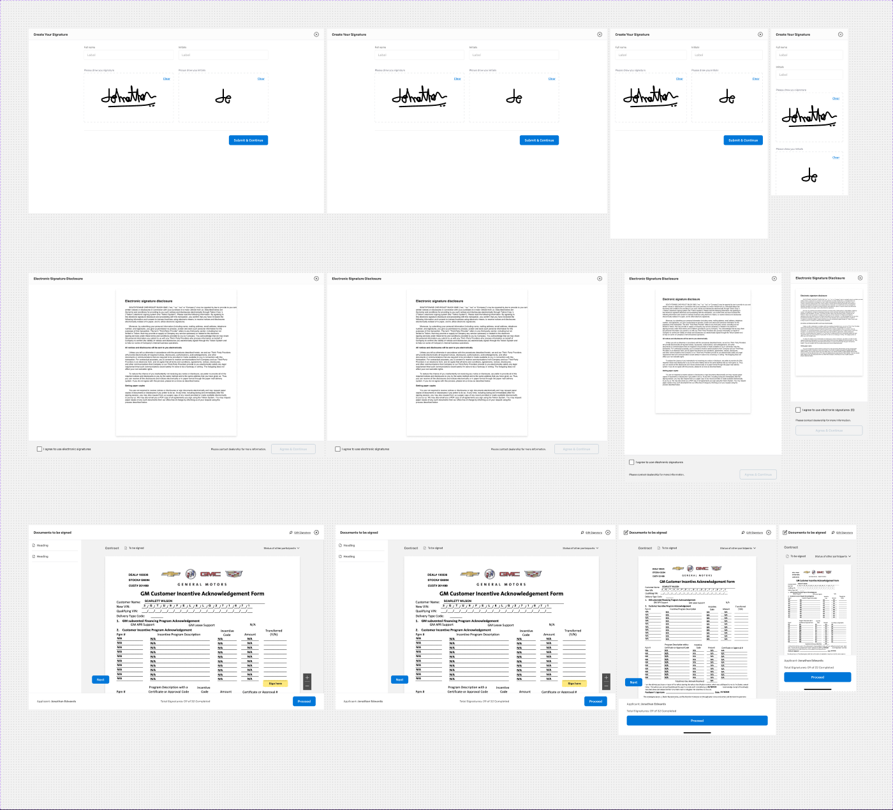

# Sidesheet - Signature

**Figma**: page *Sheets and Modals* (`5613:20297`), set **Sidesheet - Signature** `479:62708`, **12 variants**.
Axes: `Type` = Signing / Add Sign / Electronic Signature Disclosure × `Web (1440)` / `Web (1366)` / `Tablet` / `Mobile` (one-hot booleans).
Props: `DT Signoff placeholder`, `Error state`, `Signature Style`, `Footer`, `Mobile Header menu` (booleans).

**Purpose**: the e-signing step of secure checkout. It has three screens: create your signature (Add Sign), accept the electronic signature disclosure (ESD), then sign
each contract document (Signing). All three are full-screen sheets over the overlay.



Shared header/footer basics: [sheet-anatomy.md](sheet-anatomy.md). The signature parts below come from *Unpublished base components*.

## 1. Type = Signing (Web 1440, `3388:88448`)
```
1440×900  Overlay (backdrop/default) + sidepane V
├─ Signature-header (3388:102669) 1440×72: H space-between, padding 0/24, bg/default, bottom border 1px border/default
│   ├─ "Documents to be signed" heading/5 text/default
│   ├─ (hidden) Concierge Session Status (live session pill, 3388:102730) + Button set "Join Now / Stop / Leave" (3388:102770)
│   └─ right (gap 16): Link (small, neutral, leading icon) "Edit Signature" + 24px icon (hidden: Sign All CTA = Button - Primary, minus icon)
├─ Body H 1440×748
│   ├─ Signature left Nav (3389:176130) 256 wide, bg/variant, right border 1px border/default
│   │    list of _Signature Document list item (separated by 1px divider lines)
│   └─ _Doc preview media 1184×748 V padding 24/96/0/96 gap 16 bg/variant
│        └─ 950-wide column (gap 24): Document header ("Contract" + Chip "To be signed" + "Status of other participants"),
│           Zoom In-out control, document page with Signature placeholder + "Sign here" annotation, Button - Primary "Next"
└─ _Signature-sidesheet-footer 1440×80: H space-between, padding 16/40, bg white, top border 1px border/default
     "Applicant:" body/2/regular text/variant + "Jonathan Edwards" body/2/bold text/subtle |
     "Total Signatures: 09 of 32 Completed" body/2/regular text/variant | Footer button → Button - Primary (large) "Proceed"
```

### Signature parts
| Part (id) | Variants | Spec |
|---|---|---|
| Signature-header `3388:102669` | Web / Tab / Mobile; bools Sign All CTA, Concierge panel, Icon-Minus | 72 high. Mobile has padding 0/16 and a 213-wide title group |
| Signature left Nav `3389:176130` | Collapsed × Web/Mobile (3); bool Toggle | 256 wide expanded. The Signing variant uses Collapsed=True (fewer items, document icons) |
| _Signature Document list item `3389:176075` | Error / Completed / Default / Disabled / Inprogress (5); bools Expand, Selected | V padding 16, gap 4. Header row: 16px status icon (`_Signature Heading Status Icon`) + "Heading" 14/Bold `text/subtle`. Below it, an indented list (padding-left 24) of `_Signature Status` rows: 12px circle icon (Default = 1px `action/border/hover` ring; Inprogress / Completed variants) + "Buyer: 1 of 1 signed" 12/Regular `text/subtle` |
| Chip - Information (signature status) `3388:102718` | To be signed / In-signing / Signed / Waiting / Expired | Wraps the atomic **Chip - Information** (small, `.aec-chip`). In-signing = `secondary/subtle` bg, `secondary/default` 12/Bold text "In-Signing : 7/9", leading icon |
| Footer button `2529:86605` | Primary - CTA / Waiting for Co-buyer | CTA = Button - Primary "Proceed". Waiting = text "Waiting for Co-buyer to complete signing" |
| _Signature-sidesheet-footer `2529:86569` | Web/Tab/Mobile × Default / Acknowledgment (5); bool Total signature | Default: as above. Acknowledgment: 112 high, bg `bg/variant`, 2 × **Checkbox with Label** (`.aec-checkbox`) on the left, then **Button - Standard** "Contact Dealership" + **Button - Primary** (disabled) "Agree & Continue" |

## 2. Type = Add Sign (Web 1440, `479:62524`), "Create Your Signature"
Sidesheet - Header ("Create Your Signature", heading/5, close) + Main (V, padding-y 24, bg/default) holding a centred 900-wide **Signature types**
block (`314:98738`, 6 variants: Default / Styles / Styles+Selected / Draw / Draw+Selected / Upload):
- **Default** (`Signature default` `2522:150594`, 898×488, V gap 40): two **Standard Text Input - Outlined** (`.aec-field`, state prompt)
  "Full name" / "Initials" side by side (437 each, gap 24). Below them, a draw area: a 548-wide "Please draw you signature" pad and a 325-wide
  "Please draw you initials" pad, each with a **Link** "Clear". Then a 1px `border/default` rule and **Button - Primary** (large, disabled)
  "Submit & Continue".
- **Styles**: "Please select a signature". It shows 4 × `Signature` cards (`314:98500`, Selected true/false, 898×144) built from `Signature Style` 01–04
  (`314:98443`), with "Signed by John Freeman", an ID hash "07AH60037MK9255F6…" and "Initials JF".
- **Draw**: `Signature upload` pad (`314:98734`, 898×320) "Please draw your signature here".
- **Upload**: the same pad as a drop zone: "Click here or drag and drop your file here to upload", "Supported format: PNG, JPEG, JPG, PDF, EPS, …".
- Hidden extras: Checkbox with Label (consent), "Error & Empty state" frame (bool `Error state`).

## 3. Type = Electronic Signature Disclosure (Web 1440, `2872:125274`)
Sidesheet - Header "Electronic Signature Disclosure" + **Doc preview media** (ESD=True; 588×716 document image with drop shadow, padding 24/96,
centred) + an inline acknowledgment footer (80 high, padding 16/40, bg `bg/variant`, top border). The footer has a **Checkbox with Label**, the text
"Please contact dealership for more information." (`body/3/regular`) and **Button - Primary** (large, outline, disabled).

## Responsive
- 1366 / Tablet 768: same structure. The left nav collapses on Tab.
- Mobile 375 (Signing, `3388:89823`): mobile Signature-header (72 high), document area (padding 24/24/0/24, bg/variant) with `Document header`,
  page preview and a medium Button - Primary "Next". The footer stacks vertically (178 high, padding 16/24, gap 12) with Applicant, totals, a full-width
  "Proceed" button and the iOS home indicator.

## Notes
- Legacy (pre-foundation) styles are still bound here and have no token: `Overlay & BG/Background White` (footer bg, = `bg/default`) and
  `Dividers & Borders/Divider Light & Input Border` (left-nav divider lines, ≈ `border/default`).
- Document-list heading and status text use raw 14/Bold and 12/Regular, not text styles (≈ `body/2/bold`, `body/3/regular`).
- Placeholder copy "Heading" / "Title" remains in the nav items. The draw labels have the typo "Please draw **you** signature/initials".
- Document page images are image slots. Do not export them.
