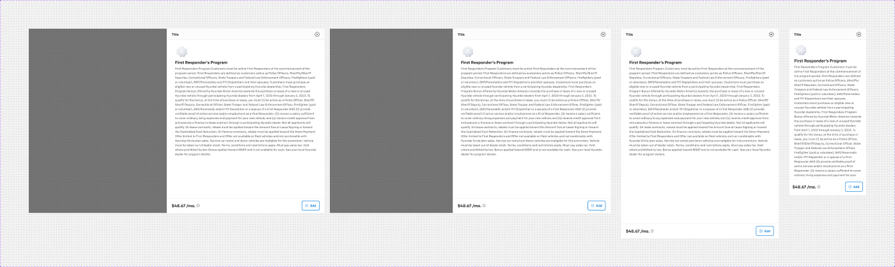
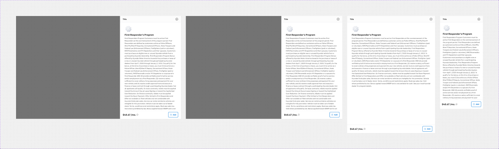
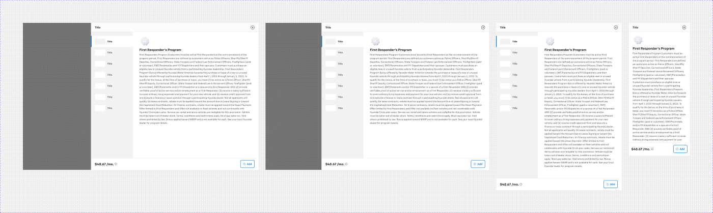
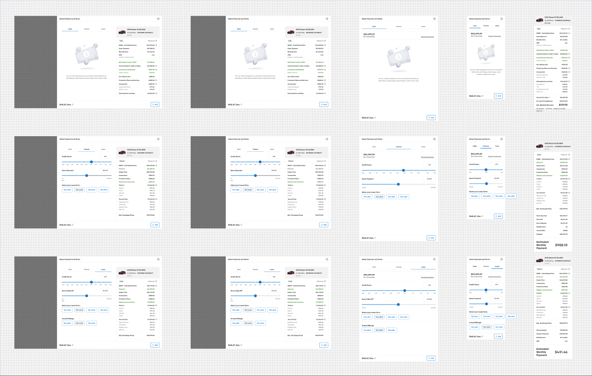
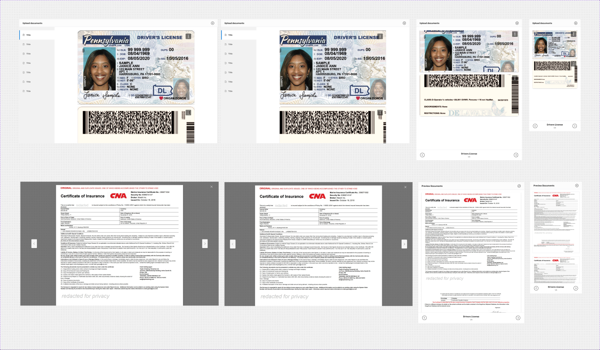

# Sidesheets (Default / Small / Large, Payment options, Doc preview)

Shared shell (header, nav rail, content slot, footer, Price variants): see [sheet-anatomy.md](sheet-anatomy.md).
Figma page *Sheets and Modals* (`5613:20297`), file `g5hh34klkdaAOzyjoDRDgJ`.

## 1. Sidesheet - Default / Small / Large
| Set | Node | Variants | Sheet width (desktop) | Props |
|---|---|---|---|---|
| Sidesheet - Small | `9866:94887` | 4 | **532** | Footer, Module, Mobile Module |
| Sidesheet - Default | `529:52006` | 4 | **768** | Footer, Conflict message, Module, Mobile Module, Sidesheet Nav |
| Sidesheet - Large | `9866:94888` | 4 | **1024** (256 nav + 768 content) | Footer, Module, Mobile Module, Sidesheet Nav |

Variant axes (one-hot booleans): `Web (1440)` / `Web (1366)` / `Tablet` / `Mobile` → frames 1440×900, 1366×900, 768×1024, 375×812.

**Purpose**: a right-hand panel used to show details for one checkout item (rebate, accessory, protection plan, trade-in…) and add it to the deal.





### Anatomy (Default, Web 1440, `529:52007`)
```
Component 1440×900  V, cross-axis align end (sheet sits right, x=672)
├─ Overlay  Rect 1440×900  backdrop/default (absolute)
├─ sidepane 768×900 V gap0 bg/default
│  ├─ Sidesheet - Header 768×56 (title "Title", heading/5; Icon Button - Neutral close)
│  ├─ Main 768×772 H — [Sidepanel Navigation Bar hidden] + Module instance (default "Sidesheet Content - Rebates")
│  └─ Sidesheet - Footer 768×72 — Price - Monthly "$48.67 /mo." + Button group (Toggle Button "+ Add")
└─ Conflict Resolution (hidden, bool "Conflict message")
```
- Large: same, with `Sidepanel Navigation Bar` (Icons=False) visible at 256 wide before the 768 content.
- Small: 532 wide, no nav.

### Visual spec
Overlay `backdrop/default`. Sheet `bg/default` with no radius and no shadow. Header bottom and footer top dividers are 1px `border/default`. Default content
(Rebates) shows the title "First Responders Program" plus long eligibility copy. The image slot is a generic placeholder.

### Responsive
- 1366: same sheet widths, overlay narrower.
- Tablet 768×1024: the sheet takes the full width and the nav is hidden. The footer uses the Tablet variant (768×72).
- Mobile 375×812: full width with header 56 / content (padding 16/24/24/24, gap 24) / footer 80 (padding 16). Large mobile has a hidden "Navigation" pager.

### Notes
- Small/Large were added later (ids 9866:*) and reuse the Default variants' internals (their variant ids are 3515:* / 2538:*).
- Small has no `Sidesheet Nav` boolean.

## 2. Sidesheet - Payment options (`2302:54327`, 15 variants)
Axes: `Type` = Cash / Finance / Lease / Cash Summary / Finance Summary / Lease Summary × `Web (1440)` / `Web (1366)` / `Tab` / `Mobile`.
Summary types exist **only for Mobile**. They are full-height mobile screens (375×921 / 1088 / 1016) holding the summary card on its own.

**Purpose**: choose a payment type (Cash/Finance/Lease) and set its terms, with a live payment summary beside it.



### Anatomy (Finance, Web 1440, `2302:54334`)
Each variant wraps one instance of the hidden base **`.Side panel - Payment options- old`** (Overlay + 1024-wide sheet):
```
Sheet 1024×900 V
├─ Sidesheet - Header 1024×56
├─ Side panel - Content - payment options (5835:68531) 1024×772 H padding 24 gap 24 bg/default
│  ├─ Content - Payment Type (5795:57125) 532 wide, V padding 24 gap 24
│  │   ├─ Segment Control (Medium): 3 × Tab M "Cash | Finance | Lease"  — selected tab bottom border 2px primary/default,
│  │   │   others 1px border/default, padding 12/16
│  │   └─ Finance content V gap 24: "Credit Score" block (value "690" + scale labels "250", "609", "619" … "699"),
│  │       term/down-payment rows (H space-between), "Form - Question" = _Button group of 4 × _Button - Default /
│  │       Toggle Button Option 1 (term chips), Button - Standard ×2
│  └─ Content - Payment Summary (5795:58603, Summary=Finance) 420 wide, padding-y 24
│      └─ Content V gap 16 radius 8/8/0/0 bg/default border 1px border/default
│          ├─ vehicle header H padding 16 gap 8 bg/variant (Media - Trade-In 80×55 image slot; "2025 Blazer EV SS AWD",
│          │   "24,200 Miles", "RIVERSIDE CHEVROLET (21.1 mi)")
│          ├─ "Finance" + "Collapse all" link row (padding 0/24)
│          └─ Finance Summary sections (padding 0/24, separated by 1px border/default top rules, padding 16/24):
│              "MSRP - Total Vehicle Price $34,999.00", "Discount -$2,000.00", "Dealer Price $32,999.00", …
└─ Sidesheet - Footer 1024×72 (top border)
```
Lease summary sample: MSRP $61,775.00, plus "Eligible customers receive a $1,000 bonus tow…" note.

### Variants
- Type switches the selected Payment Type tab, its form block and the summary card (Summary=Cash/Finance/Lease). Check each variant's form fields in the screenshot.
- Tab (768): content stacks vertically. Mobile 375: header + Content - Payment Type (padding 16/24/24/24) + footer (64 high, Web footer variant is
  used, so the padding is 16/24). The summary moves to the separate "… Summary" mobile variants.

### Notes
- It is built on a hidden base named "…- old", which suggests a newer version may replace it.
- Mobile uses the **Web** footer variant instead of the Mobile one (64 vs 80 height).
- Atoms: Segment Control/Tab M map to `.aec-tabs`; Toggle Button Option 1 maps to `.aec-toggle`; Button - Standard maps to `.aec-btn` (standard); credit-score scale is probably `.aec-slider` (verify).

## 3. Sidesheet - Doc preview (`463:32859`, 8 variants)
Axes: `Web (1440)` / `Web (1366)` / `Tablet` / `Mobile` × `Acura` (true/false). Props: `Navigation`, `Footer`, `Mobile Header menu`.

**Purpose**: a full-screen document viewer in the "Upload documents" step (driver's licence front/back, insurance, e-sign disclosure).



### Anatomy (Web 1440, Acura=False, `85:44488`)
```
1440×900: Overlay + sidepane 1440×900 (full screen)
├─ Sidesheet - Header 1440×56 — "Upload documents"
├─ Main H
│  ├─ Sidepanel Navigation Bar (Icons=True) 256×844 — Card - Nav icon rows, selected = 4px left primary bar
│  └─ Doc preview media (85:46343, Driving license) 1184×844 V padding 24/168 gap 16 bg/default
│      ├─ Card - Upload SP 848×538 radius 4, border 1px border/default, shadow/m — image (doc front) + "more option"
│      │   40×40 button (padding 8, radius 4, bg backdrop/default, 24px DotsThreeVertical icon, white)
│      └─ Card - Upload SP 848×594 — image + _Footer - Upload (H padding 8/16, top border):
│          "Drivers License - Back" body/2/bold + Status=Success "Uploaded"; more-option menu ("Re-upload", "Delete")
└─ _Signature-sidesheet-footer (hidden)
```
- `Doc preview media` set (9 variants): Web/Tablet/Mobile × Insurance / Driving license / Electronic Signature Disclosure; bools Tab, More option.
- **Acura=True** variants: a dark full-bleed image viewer. They have no header. They show a 1014-wide "Main Image" (padding 24, radius 8, drop shadow), an
  **Icon Button - Inverse** close (top-right), and prev/next chevron buttons (40×64, padding 20/8, radius 4, bg `neutral/bg/variant`) spread 1280 wide.

### Responsive
Mobile 375: header + doc cards stacked (327 wide, padding 24/0 gap 8) + the mobile **Sidepanel Navigation Bar** pager at the bottom
("Drivers License 1/6" with caret-circle prev/next), top border.

### Related published helpers (section "components" `9226:155304`)
- **gallery header** (`9226:155305`, State Default/Edit): a 1440×56 bar, padding 16, `space-between`, on a dark viewer. Its title is `heading/5 text/inverse`
  ("Front view - 1" / "Other - 1" + edit icon) and its icons are `inverse/icon/variant`.
- **preview** (`9226:155316`): a 1440×109 thumbnail strip, H centred, padding 0/32, gap 8, 80×45 thumbnails (radius 4 on the first). These are image slots.

### Notes
- `neutral/bg/variant` (Acura chevrons) and `inverse/icon/variant` are not in the token list. They probably map to `bg/variant` / `inverse/text/variant` (#b3b3b3).
- "Acura" is a leftover brand axis in a Chevrolet file. It is really an "image viewer / lightbox" mode.
- Document images are user uploads (image slots). Do not export them.
