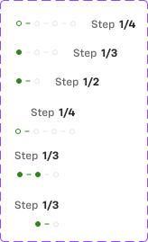

# Stepper (progress dots)

## Figma
Page **Navigation** (`5607:20490`), file `g5hh34klkdaAOzyjoDRDgJ`. All three sets sit in the section **"_Unpublished base components"** (`6065:15962`). They are base parts, but In-page Header uses Stepper (hidden by default, `Stepper` boolean).

| Set | Node id | Variants | Axes |
|---|---|---|---|
| Stepper | `106:7444` | 6 | `Stepper: Step 2\|Step 3\|Step 4\|Mobile Step 2\|Mobile Step 3\|Mobile Step 4`; `Mobile: False\|True` |
| Stepper group | `5502:5065` | 3 | `Steps: 4\|3\|2` |
| Stepper elements | `5502:5037` | 5 | `Status: Completed\|In Progress\|Not Started`; `Connector: False\|True` |

No component descriptions. No non-variant props.



## Purpose
A compact "Step x/y" progress indicator for multi-step checkout sections (e.g. trade-in, credit application). It sits in the right side of the In-page Header.

## Anatomy
Desktop (`Stepper=Step 4, Mobile=False`, 134x20):
```
Stepper  H auto-layout, gap 16, align centre
├─ Stepper group (Steps=4)  H, gap 2, 68x8
│   dot · line · dot · line · dot · line · dot    (each a Stepper elements instance, 8x8)
└─ Step  H, gap 4
   ├─ "Step"  12 Medium, body/3/regular, text/variant
   └─ "1/4"   12 Bold,   body/3/bold,    text/default
```
Mobile (`Mobile=True`, 68x36 for 4 steps): V auto-layout, gap 8, **right-aligned**. The "Step 1/4" label is on top and the dot group is below it.

Stepper elements (each cell is 8x8):
| element | drawing |
|---|---|
| Completed dot | 6x6 ellipse, filled `success/default` |
| In Progress dot | 6x6 ellipse, 1px stroke `success/default`, no fill |
| Not Started dot | 6x6 ellipse, 1px stroke `border/default` |
| Connector "Completed" | 5px line, 1px `success/default` |
| Connector "In Progress" | 5px line, 1px `border/default` (grey). It is the "not reached" connector. |

Group widths: 4 steps = 7 cells = 68px, 3 steps = 48px, 2 steps = 28px (8px cells + 2px gaps).

## Visual spec
| part | token |
|---|---|
| done / current colour | `--aec-color-success-default` (#2d871b), green, not primary blue |
| pending colour | `--aec-color-border-default` (#e6e6e6; some instances use #e4e4e7) |
| "Step" label | `body/3/regular` style (rendered Medium 12) `text/variant` |
| "1/4" counter | `body/3/bold` `text/default` |
| gaps | dots 2; group–label 16 (desktop) / 8 (mobile, vertical) |

## Variants & states
- Only the number of steps changes (2/3/4) plus the mobile stacking. There is no variant per "current step"; the progress fill is made with instance overrides of the dots.
- Main `Steps=4` group: dot 1 = In Progress, connector 1 green, the rest Not Started. In the `Step 4` Stepper instance this shows as an outlined green first dot.
- Main `Steps=3`: dots 1–2 Completed, dot 3 Not Started. `Steps=2`: dot 1 Completed, dot 2 Not Started.
- In the `Stepper=Step 3` desktop instance the overrides are dot 1 Completed and the rest pending.

## Content
"Step 1/4", "Step 1/3", "Step 1/2".

## Responsive
Desktop: dots and label in one row. Mobile: label above dots, right-aligned (used in the In-page Header mobile "Main" row).

## Notes
- The counter label does not match the dot state. For example, `Steps=3` shows 2 completed dots but says "1/3". **`Mobile Step 2` says "1/3"** (typo, should be 1/2).
- The `Connector=True, Status=In Progress` variant is really a "pending" connector. There is no `Connector=True, Status=Not Started`.
- There is no `Stepper=Step 5+`. A longer flow would need a generated version. In code, build it as `.aec-stepper` with `n` dots, `current` index and a label, rather than fixed variants.
- `border/default` is bound to two different hexes (#e6e6e6 and #e4e4e7), which suggests two library versions. Use the token.
- The Bottom Navigation Bar has a separate (hidden) 10-segment "Progress Bar" (4px lines `primary/default` / `primary/subtle`). That is another progress indicator; see `footers.md`.
