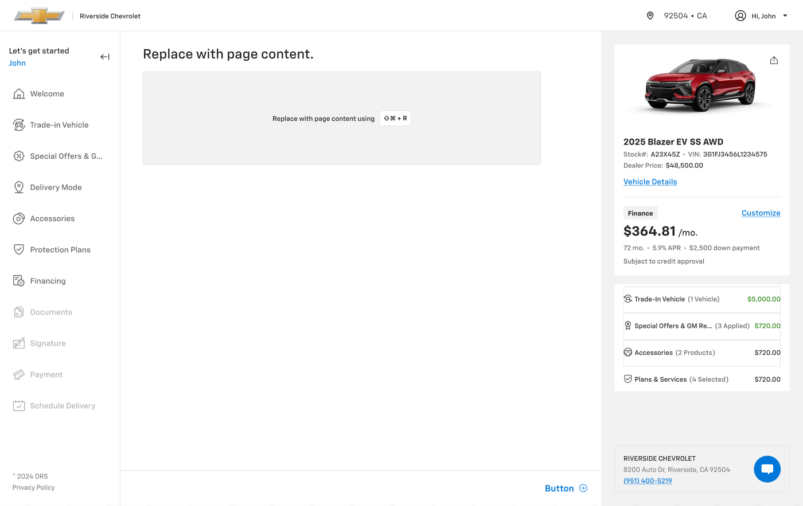

# Templates: `$Base` page layout

## Figma
Page **Templates** (`5607:18706`), file `g5hh34klkdaAOzyjoDRDgJ`, section "Templates" (`6153:81745`).

| Set | Node id | Variants |
|---|---|---|
| $Base | `5607:18708` | 9 (`Size: L (1440) \| XL (1600) \| XL (1920) \| M (1280) \| M (768) \| M (1024) \| S (375) \| S (360) \| ---`) |

Non-variant booleans: `Description` (true) and `Stepper` (true). They are passed through to the header and are not visible at the top level. `Size=---` is an empty 1x1 placeholder.




## Purpose
The checkout page shell: a global top bar, the Left Navigation, a content column with a 12/8/4-column layout grid, the Mathbox (vehicle & payment summary) on the right, and the Bottom Navigation Bar.

## Anatomy (L 1440 × 908)
```
$Base  V, bg #ffffff (bg/default), no padding
├─ Top Navigation bar   1440x56   (instance → foundation `.aec-header`)
└─ Main  H, 1440x852
   ├─ Left Navigation Bar  216 wide, full height                   → left-navigation.md
   ├─ Column  862 wide, V
   │  ├─ Content  V, padding 24/40/104/40, gap 16, LAYOUT GRID 12 col
   │  │  ├─ "Replace with page content."  (24px title)
   │  │  └─ Placeholder  714x168, bg/variant
   │  └─ Bottom Navigation Bar  862x64 (pinned to the column bottom)      → footers.md
   └─ Mathbox (vehicle details)  362 wide, V padding 24, gap 16, bg/variant (#f2f2f2)
```
In the template, the Bottom Navigation Bar sits in the content column only at L 1440 and M 768.

## Layout grid per breakpoint
All grids are on the **Content** frame (not the root): `COLUMNS`, `STRETCH`, gutter **16**, offset = the horizontal padding. The root frames have no layout grids.

| Variant | Frame | Main width / x | Top bar | Left nav | Content col (frame) | Content padding T/R/B/L | Grid cols / gutter / margin | Inner content width | Mathbox | Bottom nav |
|---|---|---|---|---|---|---|---|---|---|---|
| XL (1920) | 1920×1080 | 1440, centred at x 240 | 56 | 216 | 862 | 24/40/104/40 | 12 / 16 / 40 | 782 (placeholder 714) | 362 | — |
| XL (1600) | 1600×900 | 1440, centred at x 80 | 56 | 238 | 840 | 24/40/104/40 | 12 / 16 / 40 | 760 (714) | 362 | — |
| L (1440) | 1440×908 | 1440 at x 0 | 56 | 216 | 862 | 24/40/104/40 | 12 / 16 / 40 | 782 (714) | 362 | 64 (862 wide) |
| M (1280) | 1280×879 | 1280 | 56 | 238 | 680 | 24/40/104/40 | 12 / 16 / 40 | 600 | 362 | — |
| M (1024) | 1024×879 | 1024 | 56 | 238 | 786 | 24/32/104/32 | 8 / 16 / 32 | 722 | **none** | — |
| M (768) | 768×1024 | 768 | 56 | **64 (rail)** | 704 | 24/32/104/32 | 8 / 16 / 32 | 640 | none | 64 (704 wide) |
| S (375) | 375×812 | 375 | 56 | none | 375 | 16/24/104/24 | 4 / 16 / 24 | 327 | none | — |
| S (360) | 360×812 | 360 | 56 | none | 360 | 16/16/104/16 | 4 / 16 / 16 | 328 | none | — |

Derived rules:
- **Max page width is 1440**. On larger screens the 1440 "Main" is centred, and the top bar stays full-bleed (1600/1920 wide).
- **Columns**: 12 at ≥1280, 8 at 768–1024, 4 at ≤375. **Gutter is always 16** (`--aec-spacing-container-gap-m`).
- **Content margins**: 40 at ≥1280 (`container/padding/l`), 32 at 768–1024 (no token; between m24 and l40), 24 at 375 (`container/padding/m`), 16 at 360 (`container/padding/s`).
- Content padding-top is 24 (desktop/tablet) or 16 (mobile). The **104 bottom padding** reserves space above the sticky 64px Bottom Navigation Bar (64 + 40).
- **Header height is 56** at every breakpoint. **Footer (Bottom Navigation Bar) is 64** (mobile version 112: summary row 48 + action row 64).
- The content stack gap is 16.
- **Mathbox (right rail) is 362 fixed**. It appears only at ≥1280 and is dropped at 1024 and below (the summary moves into the Bottom Navigation Bar on tablet/mobile).
- **Left nav**: 216/238 at ≥1024, 64 icon rail at 768, hidden on mobile (it becomes the drawer).

## Visual spec
Root `bg/default`. Mathbox `bg/variant`. There is a vertical 1px "Line" at the right edge of each frame (a frame-edge artefact). The placeholder is `bg/variant` with the copy "Replace with page content using ⇧⌘ + R".

## Content (from the L screenshot)
Top bar: Chevrolet logo (image slot), "Riverside Chevrolet", "92504 • CA", "Hi, John". Mathbox: "2025 Blazer EV SS AWD", "Stock#: A23X45Z • VIN: 3G1FJ3456L1234575", "Dealer Price: $48,500.00", "Vehicle Details", Finance "$364.81 /mo.", "72 mo. • 5.9% APR • $2,500 down payment", "Subject to credit approval", line items (Trade-In Vehicle $5,000.00, Special Offers & GM Rewards $720.00, Accessories $720.00, Plans & Services $720.00), and the dealer card "RIVERSIDE CHEVROLET, 8200 Auto Dr, Riverside, CA 92504, (951) 400-5219" with a chat FAB. (The Mathbox is specced by another agent; see `mathbox.md` if present.)

## Notes
- The left-nav width is inconsistent (216 vs 238), so the content column width differs between 1440 (862) and 1600 (840) although both are "1440 max". Standardise on one width, e.g. 216.
- M (1024) keeps the full 238 left nav but drops the Mathbox, and has no Bottom Navigation Bar in the template.
- S (375/360) has no Bottom Navigation Bar or nav entry point in the template. The header and footer patterns supply them (`in-page-header.md` mobile + `footers.md` Mobile).
- The grid sits on Content only, and its margin offset equals the padding (so the grid's columns span the inner width).
- The heights (908/900/879) are arbitrary canvas heights, not breakpoints.
