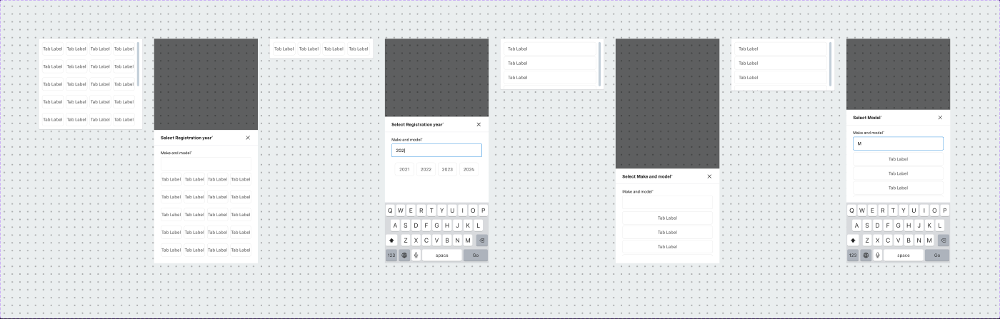

# Year / Make / Model selection ("Year make model selection new")



## Figma
Page `Form` (5613:20164). Set **Year make model selection new** `6092:11793`, 8 variants. Axes: `Mobile` (True/False) × one active step of `Year` / `Search` / `Make` / `Model`. Prop `Add address manually` (bool, false).
| Variant | Node | Size |
|---|---|---|
| Desktop Year | 6092:11791 | 375×328 |
| Desktop Search | 6093:12447 | 375×72 |
| Desktop Make | 6094:15160 | 375×184 |
| Desktop Model | 6094:15268 | 375×188 |
| Mobile Year / Search / Make / Model | 6092:11792 / 6093:12431 / 6094:15688 / 6094:16280 | 375×812 each |
Base parts (unpublished): `Dropdown - Year` (5502:6839), `Dropdown - Make Model` (5502:6867).

## Purpose
Trade-in vehicle identification: a dropdown panel under the "Make and model" field that walks the user through year → make → model (with a type-ahead search state).

## Anatomy (desktop)
```
Dropdown panel  H, padding 12, gap 8, r4, bg bg/default, 1px border/default, shadow/s
├─ Options  V
│  Year:  5 rows (gap 16) × 4 Toggle group tab-item (large, 78×48, r8) — year grid
│  Make / Model:  V gap 4 list of full-width Toggle tab-items (335×48, left-aligned) — 5 (Make) / 6 (Model)
│  Search: single row of results (48h)
└─ Scrollhandle 8×160, r1000, bg/disabled
```
Option tiles are the atomic Toggle tile [.aec-toggle-group item] (bg #ffffff, 1px #e6e6e6, r8, padding 0/16).

## Mobile (bottom sheet, 375×812)
```
Scrim rect #000000@0.60 (≈ backdrop/default)
Bottom sheet  V, bg bg/default, 375×482
├─ Header  56h, padding 16/24, bg #ffffff, bottom border: title heading/5 + Icon Button - Neutral (close)
└─ Body  V, padding 16/24/24/24, gap 8
   ├─ Standard Text Input - Outlined (327×74) label "Make and model*"   [.aec-field]
   └─ Dropdown - Year (embedded, no border/shadow)
```
Titles: Year → "Select Registration year*"; Make/Model → "Select Make and model*".
Search state: input value "202|" with results 2021, 2022, 2023, 2024, and the iOS keyboard drawn in the frame (mock, not part of the component).

## Visual spec
Panel: bg/default, border/default 1px, radius 4, `shadow/s`. Scroll handle bg/disabled. Header title heading/5 text/default.

## Notes
- All option labels are placeholders ("Tab Label"); real values come from data.
- `Add address manually` prop name looks copied from Address Dropdown — irrelevant here.
- Mobile scrim uses raw #000000@0.60 rather than backdrop/default (0.52).
- No explicit selected/hover state shown in this set — relies on the Toggle component's states.
