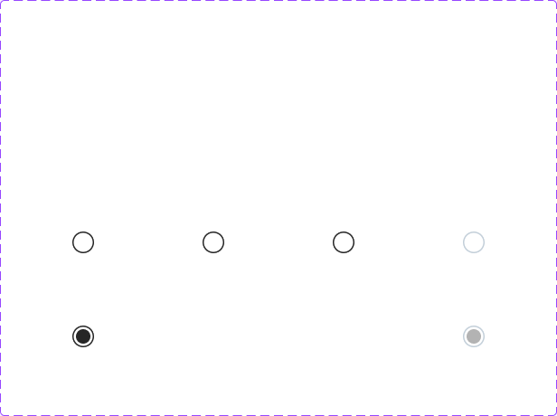

# Radio Button

## Figma
Page **Radio Button** (`3769:50173`).

| Component set | Node id | Variants |
|---|---|---|
| Radio button | `1991:17769` | 6 |
| Radio Group with Label | `4786:67697` | 2 |



## Description
No Figma description. Purpose: select exactly one option from a set.

## Variant axes
- **Radio button**: `state: default|hover|pressed; selected: false|true; disabled: false|true`. Prop: `focus-ring` (bool, false). Only 6 variants exist: hover/pressed only for unselected, and disabled only with state=default.
- **Radio Group with Label**: `mobile: off|on`. It's actually a single radio + label row, despite the "Group" name.

## Anatomy
```
Radio button (COMPONENT 24x24, H auto-layout, gap 8)
├─ container    FRAME 24x24, radius 384 (rounded), fill bg/default, stroke 1.5 inside
│   └─ Indicator ELLIPSE 16x16 (transparent when unselected)
└─ focus-ring   RECTANGLE (hidden) 28x28, radius 388, 2px focus/default (2px outset)

Radio Group with Label (H auto-layout, gap 8)
├─ Radio button INSTANCE
└─ Form Label   INSTANCE .form control label size=medium
```
Row: mobile=off is 40px tall (padding 8/0), mobile=on is 48px (padding 12/0).

## Token table
| Variant | Ring fill | Ring border (1.5px) | Indicator dot (16px) |
|---|---|---|---|
| unselected default / hover / pressed | bg/default | text/default (#262626) | transparent |
| selected default | bg/default | #262626 | #262626 (icon/default) |
| unselected disabled | bg/default | border/disabled | transparent |
| selected disabled | bg/default | border/disabled | icon/disabled (#b3b3b3) |
| focus | focus-ring 2px focus/default | | |

Label: 14px Chevy Sans Medium, text/default ("Enter text" + "(0)").

## Notes
- Hover and pressed look the same as default (no visual change), and there are no selected+hover/pressed variants.
- The dot is 16px inside a 24px ring, leaving a 2.5px gap after the 1.5px border. It's dark, not primary blue.
- The page also has 6 loose Radio button instances, a "Frame 2" and Token Comparison frames (docs).
