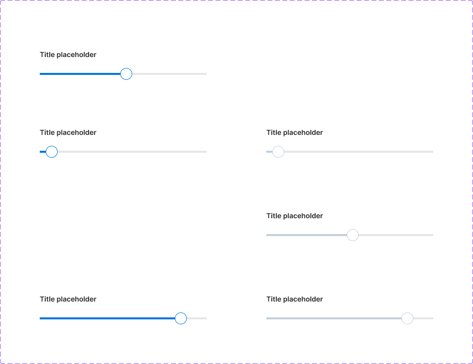
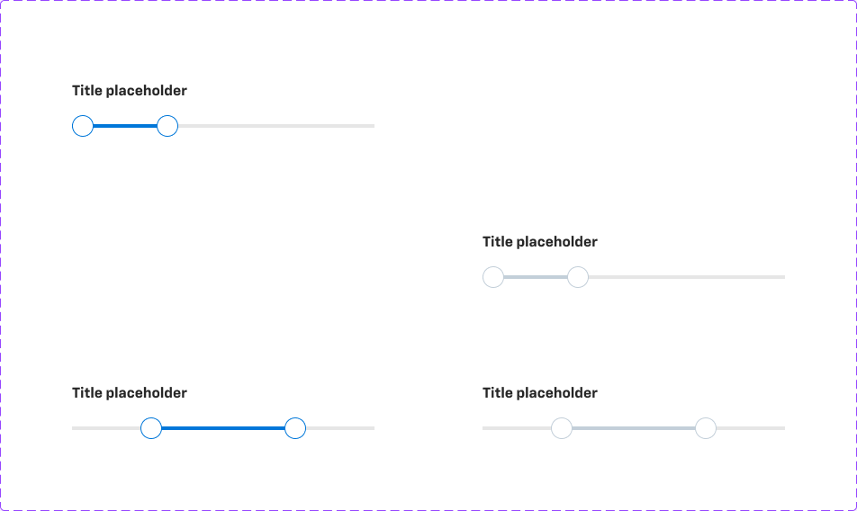

# Slider

## Figma
Page **Slider** (`3773:50156`).

| Component set | Node id | Variants |
|---|---|---|
| Slider - Steps | `2782:45747` | 6 |
| Slider - Range | `2782:46596` | 4 |
| .slider-handle (hidden base) | `2782:45635` | 4 |
| .custom-input-field (hidden component) | `2788:42426` | 1 |




## Description
No Figma descriptions. Purpose: pick a single value (Steps) or a min–max range (Range) along a track.

## Variant axes
- **Slider - Steps**: `preset: 1|2|3` (handle position: ~5%, 50%, ~83%); `disabled: false|true`.
- **Slider - Range**: `preset: 1|2` (range positions); `disabled`.
- Props (both): `title` (bool, true), `value` (bool, false; shows the value input(s)), `min-max` (bool, false; shows the Min/Max labels).
- **.slider-handle**: `state: default|hover|pressed; disabled`.

## Anatomy (Slider - Steps, preset 2)
```
Slider (COMPONENT 336x62, V auto-layout, gap 16)
├─ Title Placeholder   FRAME H, gap 16
│   ├─ Title placeholder TEXT 14px Inter Semi Bold (Range: 16px Chevy Sans Bold)
│   └─ custom-input-field (hidden) 50x26, padding 2/8, radius 8, bg/variant; value 14px Avenir Next Regular
└─ Container           FRAME V, gap 2
    ├─ Slider          FRAME 336x24
    │   ├─ track          RECT 336x4, border/default (#e6e6e6)
    │   ├─ track-selected RECT 4px tall, primary/default
    │   └─ Slider Handle  INSTANCE .slider-handle (24x24)
    └─ Min Max Value (hidden) H: "Min"/"Max" 12px Chevy Sans Medium, text/subtle
```
Range: two handles in a `handles` frame, and value inputs joined by "to" (14px Avenir Next, text/subtle).

## Token table
| Part | default | disabled |
|---|---|---|
| Track (4px, square ends) | border/default (#e6e6e6) | border/default |
| Selected track | primary/default | bg/disabled (#c3cfd9) |
| Handle (24px circle, radius 384) | fill bg/default, 1px primary/default border | fill bg/default, 1px border/disabled |
| Title | text/default | text/default (not dimmed) |
| Value input | bg/variant, text/default (hidden master uses #505050, no token) | — |

## Notes
- `.slider-handle` hover and pressed are identical to default, so there's no hover/pressed feedback and no focus ring anywhere.
- The handle has padding 8 but is 24x24; the visual circle fills the box.
- Mixed fonts: Steps title is **Inter Semi Bold 14**, Range title is **Chevy Sans Bold 16**, and the value text is **Avenir Next Regular**. These are inconsistent with the rest of the system (Chevy Sans).
- Disabled doesn't dim the title.
- Only `border/width/10` (1) is bound as a variable.
