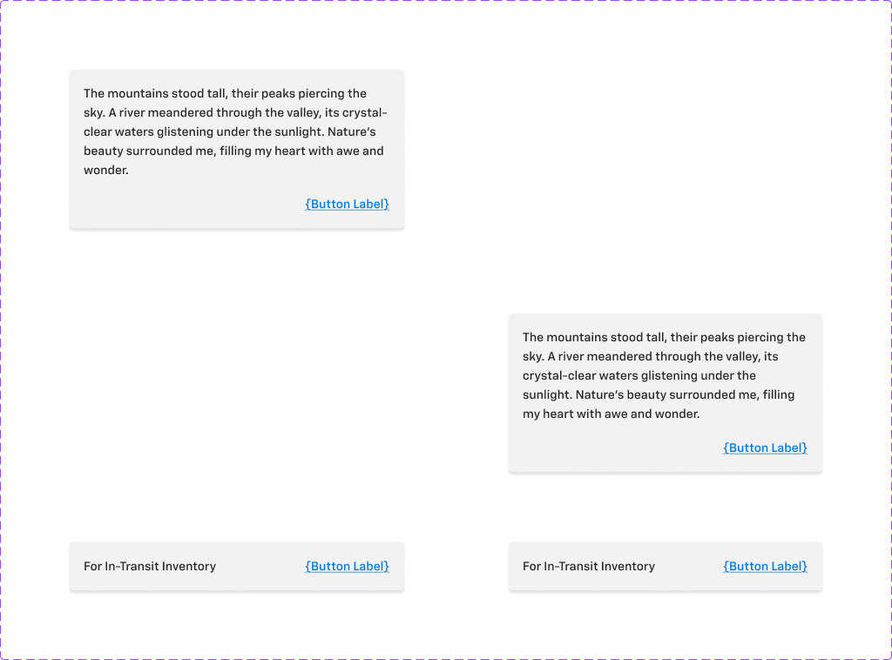

# Snackbar

## Figma
Page **Snackbar** (`3769:50202`), file `ilpJ5K66cGR85o287K4HDD`.

| Component set | Node id | Variants |
|---|---|---|
| Snackbar | `2747:44301` | 4 |



## Description
Figma description: "Position and Align will work when Pointer is Toggle ON". This was copied from Tooltip and does not apply. Purpose: a brief, transient message with an optional text action (Link).

## Variant axes and props
- `mobile: off|on`
- `multi-line: off|on`
- Non-variant prop: `action` (true), which shows the Link.

## Anatomy
Single-line (mobile=off, multi-line=off):
```
Snackbar (COMPONENT, H auto-layout, 384x56, padding 16 (spacing/container/padding/s), gap 16 (spacing/container/gap/m), radius 4)
├─ Message  TEXT "For In-Transit Inventory" 14 Medium (fills)
└─ Link     INSTANCE Link (size=medium, style=primary) → "{Button Label}" 14 Medium
```
Multi-line (multi-line=on): V auto-layout, 384x182. The message wraps (352 wide) and the Link sits below it inside a `Link Container`. Gap 16.

Mobile: width 360, otherwise identical.

## Token table
| property | value |
|---|---|
| background | `bg/variant` (#f2f2f2) |
| border | none |
| radius | 4 (`--aec-border-radius-rounded-rect`) |
| padding | 16 (`--aec-spacing-container-padding-s`) |
| gap | 16 (`--aec-spacing-container-gap-m`) |
| message | `text/default` 14 Medium |
| action | Link primary, `primary/default` 14 Medium |
| shadow | 0 2 2 rgba(0,0,0,.06) + 0 4 3 rgba(0,0,0,.07), raw effect, no effect style bound (the same values as Alert) |
| width | 384 desktop / 360 mobile |

## Notes
- The snackbar is light (#f2f2f2), not the usual dark (inverse) snackbar.
- There are no status variants and no close icon.
- The description text is a leftover from Tooltip.
- Colours are raw hex. Spacing is bound to variables. No text styles are bound.
