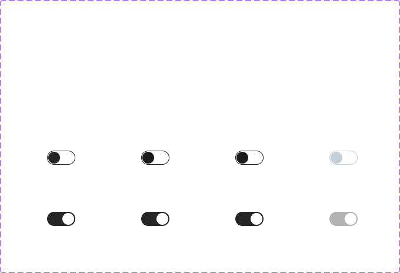

# Switch

## Figma
Page **Switch** (`3769:50176`).

| Component set | Node id | Variants |
|---|---|---|
| Switch | `1994:23532` | 8 |
| Switch with Label | `4786:67754` | 4 |
| .Switch (hidden base) | `1865:14356` | 8 |



## Description
No Figma description. Purpose: an on/off toggle for a setting that applies immediately.

## Variant axes
- **Switch**: `state: default|hover|pressed; selected: off|on; disabled: off|on`. Prop: `focus-ring` (bool, false). Disabled only with state=default (8 variants).
- **Switch with Label**: `mobile: off|on; position: left|right`.

## Anatomy
```
Switch (COMPONENT 48x24, V auto-layout, padding 2, radius 384)
├─ Container   FRAME 48x24, H auto-layout, padding 2, gap 8, radius 384, stroke 1 inside
│   └─ Handle  RECTANGLE 20x20, radius 384, drop shadow (raw effect, no shadow style)
└─ Focus Ring  RECTANGLE (hidden) 56x28, radius 772, 2px focus/default
```
Switch with Label: H auto-layout, gap 8. Label is a `.form control label` (14px). Row is 40px with padding 8 when mobile=off, 48px with padding 12 when mobile=on. With position=right the label comes first.

## Token table
| Variant | Track fill | Track border (1px) | Handle |
|---|---|---|---|
| off default | bg/default | secondary/default (#262626) | #262626, left |
| off hover = pressed | bg/default | secondary/hover (#1a1a1a) | #1a1a1a |
| off disabled | bg/default | border/disabled | bg/disabled (#c3cfd9) |
| on default | secondary/default (#262626) | none | bg/default (white), right |
| on hover = pressed | #262626 | #262626 | white |
| on disabled | #b3b3b3 (border/variant / text/disabled) | none | white |
| focus | focus-ring 2px focus/default (4px wider than track) | | |

## Notes
- "On" is dark grey/black, not primary blue.
- Hover and pressed are identical. For "on" they're visually the same as default (only a same-colour border gets added).
- The hidden `.Switch` base set (`1865:14356`) duplicates the public set, with `disabled: false|true` and capitalised `Off|On`.
- The track border is 1px here, but Checkbox and Radio use 1.5px.
